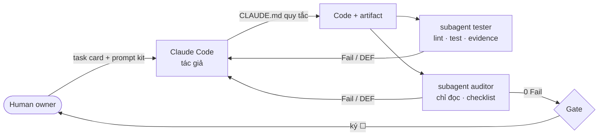

# Harness — cách AI agent được điều khiển trong dự án

| Thành phần | File | Vai trò |
|---|---|---|
| Hướng dẫn repo | [CLAUDE.md](../../CLAUDE.md) | Quy tắc bắt buộc, lệnh, bản đồ thư mục |
| Subagent `auditor` | [.claude/agents/auditor.md](../../.claude/agents/auditor.md) | Audit checklist chỉ đọc, phiên riêng (đã dùng: 2 vòng, 14 checklist) |
| Subagent `tester` | [.claude/agents/tester.md](../../.claude/agents/tester.md) | Chạy kiểm thử và lưu evidence |
| Skill `sdlc-gate` | [.claude/skills/sdlc-gate/SKILL.md](../../.claude/skills/sdlc-gate/SKILL.md) | Vòng Specify → Generate → Audit → Fix → Approve cho mỗi phase |
| Prompt | `requirements/ analysis/ design/ development/ verification/*.md` | Prompt 6 mục của kit (bảng dùng ở [docs/README §2](../README.md#2-mục-lục-tài-liệu)) |
| Checklist | `*.xlsx` của kit | Tiêu chí gate, chấm trong `docs/*/audits/` |
| Kiểm soát chất lượng tự động | `app/scripts/lint.js`, `app/scripts/run-tests.js`, `.github/workflows/ci.yml` | Lint, test, coverage, junit, evidence theo run-id |

