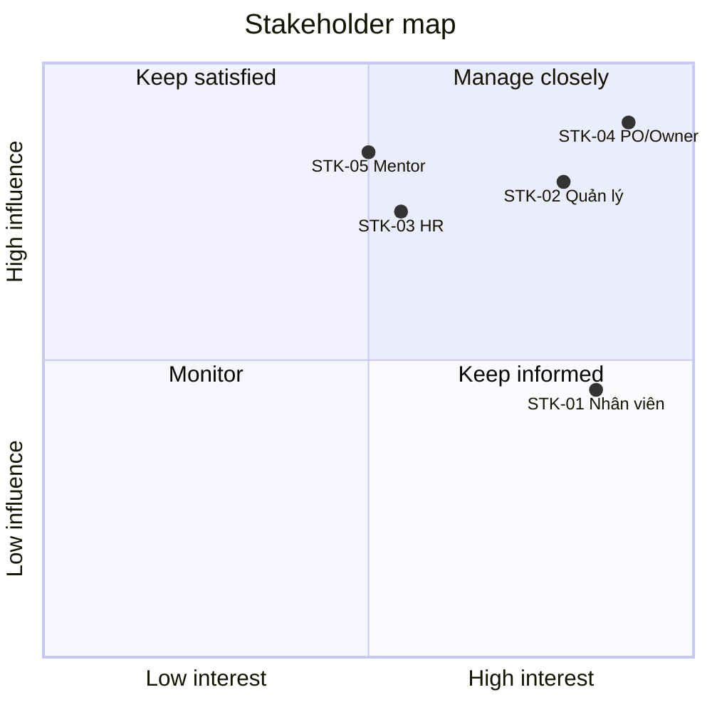

# Stakeholders — LeaveFlow

| Thuộc tính | Giá trị |
|---|---|
| Mã tài liệu | STK-LF-001 · v1.0 · 2026-11-02 · Owner: Nguyễn Trần Hà |
| Prompt | `requirements/Intake_Intent_Prompt.md` v2.0 |

> Nhân vật STK-01…STK-03 là **persona giả định** của bài tập; vai trò SDLC (STK-04…STK-07) ánh xạ theo SOP §4.

| ID | Người / nhóm | Vai trò | Mối quan tâm chính | Ảnh hưởng | Quyền lợi |
|---|---|---|---|---|---|
| STK-01 | Nguyễn Văn An, Trần Thị Bình | Nhân viên | Gửi đơn nhanh, biết ngay còn bao nhiêu phép, biết đơn được duyệt chưa | Trung bình | Cao |
| STK-02 | Lê Minh Chi | Quản lý trực tiếp | Thấy mọi đơn chờ ở một chỗ; duyệt 1 click; không duyệt nhầm người ngoài nhóm | Cao | Cao |
| STK-03 | Phòng HR | Chủ quy trình nghỉ phép | Số dư đúng chính sách; có lịch sử để giải trình | Cao | Trung bình |
| STK-04 | Nguyễn Trần Hà | PO + Human owner / Engineer | Phạm vi, ưu tiên, chất lượng artifact | Cao | Cao |
| STK-05 | Mentor khóa SDLC | Reviewer độc lập / Tech lead | Artifact đúng chuẩn, truy vết đầy đủ, code review | Cao | Trung bình |
| STK-06 | AI agent (Claude) | Trợ lý soạn thảo, sinh code/test | — (không phải người phê duyệt) | — | — |
| STK-07 | Nguyễn Trần Hà | Release owner | Release có thể rollback, có health check | Cao | Cao |

## Ma trận Power / Interest

