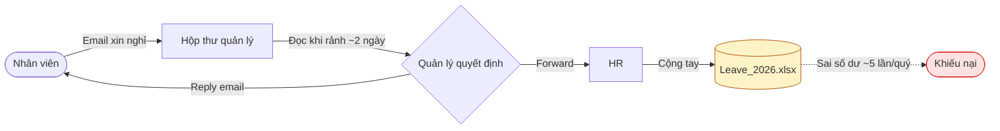
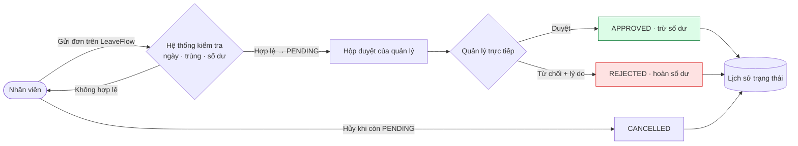
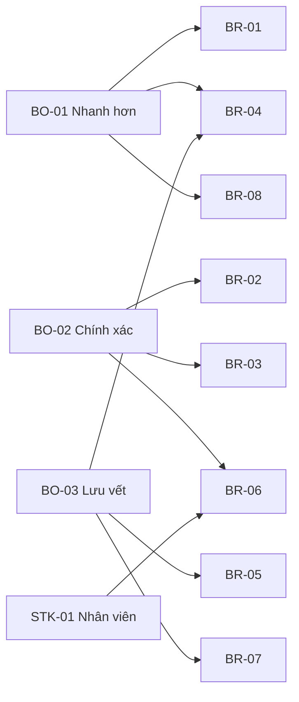

# BUSINESS REQUIREMENTS DOCUMENT — LeaveFlow

## PROJECT DETAILS

| PROJECT NAME | LeaveFlow — Quản lý đơn nghỉ phép | |
|---|---|---|
| CREATOR | Nguyễn Trần Hà (PO / human owner), soạn nháp với AI agent | |
| **DOCUMENT NO.** | **DATE** | **VERSION NO.** |
| BRD-LF-001 | 2026-11-02 | 1.1 (sau audit vòng 1) |

| Kiểm soát tài liệu | Giá trị |
|---|---|
| Trạng thái | Sẵn sàng baseline — tag `requirements-v1` sẽ được tạo khi commit; chờ PO ký (xem §11.3) |
| Template | `requirements/BRD-Template.md` |
| Prompt | `analysis/BRD_Prompt_IEEE_standard.md` (chuẩn ISO/IEC/IEEE 29148) |
| Checklist | `analysis/BRD_IEEE_29148_Checklist.xlsx` → kết quả tại [brd-audit.md](./brd-audit.md) |
| Đầu vào | [intent.md](../01-intake/intent.md), [SRC-001](./interviews/SRC-001.md), [sources.md](../01-intake/sources.md) |

## 1. EXECUTIVE SUMMARY SNAPSHOT

BRD này mô tả nhu cầu nghiệp vụ cho **LeaveFlow**, một web app nội bộ thay thế quy trình xin nghỉ bằng
email + Excel. Mục tiêu: rút thời gian duyệt từ ~2 ngày xuống ≤ 4 giờ làm việc, loại bỏ lỗi số dư phép,
và lưu vết 100 % quyết định. Đối tượng đọc: PO, HR, quản lý, nhóm phát triển và reviewer của khóa SDLC.
Phạm vi v1.0 gồm 8 yêu cầu nghiệp vụ (BR-01…BR-08) cho hai vai trò Nhân viên và Quản lý.

**Tầm nhìn:** *"Xin nghỉ và duyệt nghỉ trong vài giây, số dư phép luôn đúng, mọi quyết định đều có dấu vết."*

## 2. PROJECT DESCRIPTION

Nhóm 15 người đang gửi email xin nghỉ cho quản lý; HR cập nhật tay vào Excel. Hệ quả: email trôi, duyệt chậm,
cộng sai số dư, không ai biết đơn đang ở trạng thái nào và vì sao bị từ chối. Dự án xây một ứng dụng nhỏ
tự động hóa các quy tắc của chính sách nghỉ phép (SRC-003), đồng thời là dự án mẫu để thực hành trọn
vòng đời Agentic SDLC.

## 3. PROJECT SCOPE

| IN-SCOPE ITEMS | OUT-OF-SCOPE ITEMS |
|---|---|
| Item 1: Gửi đơn nghỉ 3 loại (ANNUAL/SICK/UNPAID) với kiểm tra hợp lệ | Item 1: Đăng nhập thật (SSO/LDAP) — dùng người dùng demo |
| Item 2: Tính số dư phép năm tự động, giữ chỗ đơn đang chờ | Item 2: Ngày lễ, nghỉ nửa ngày, chuyển phép sang năm sau |
| Item 3: Quản lý trực tiếp duyệt / từ chối (có lý do) | Item 3: Thông báo email/chat, mobile app |
| Item 4: Nhân viên hủy đơn chưa xử lý | Item 4: Báo cáo HR, tích hợp lương |
| Item 5: Lịch sử trạng thái mỗi đơn | Item 5: Duyệt nhiều cấp, ủy quyền duyệt |

**Deliverables:** mã nguồn `app/`, bộ test tự động, tài liệu SDLC `docs/01…11`, bản release v1.0.0 chạy local.
### 3.1 Business constraints

| ID | Ràng buộc | Loại |
|---|---|---|
| BC-01 | Chi phí 0: không hạ tầng, không license | Ngân sách |
| BC-02 | Release v1.0.0 dự kiến 2026-11-05 (sau review độc lập) | Thời hạn |
| BC-03 | Chính sách nghỉ phép nội bộ SRC-003 là luật áp dụng; phần mềm không thay đổi chính sách | Chính sách |
| BC-04 | Không xử lý dữ liệu cá nhân thật trong v1.0 (chỉ user demo) | Pháp lý / dữ liệu |
| BC-05 | Nhóm thực hiện: 1 người + AI agent | Nguồn lực |

## 4. BUSINESS DRIVERS

| Driver | Giải thích |
|---|---|
| **Business Driver 1: Hiệu quả** | Quản lý mất ~2 ngày để phản hồi email; mục tiêu ≤ 4 giờ làm việc (BO-01) |
| **Business Driver 2: Chính xác** | ~5 lỗi số dư/quý gây khiếu nại; quy tắc phải được hệ thống tự áp dụng (BO-02) |
| **Business Driver 3: Minh bạch & tuân thủ** | Cần lưu vết ai duyệt, khi nào, lý do từ chối để giải trình (BO-03) |
| **Business Driver 4: Đào tạo** | Dự án mẫu chứng minh quy trình SDLC có kiểm soát với AI agent |

### Business objectives

| ID | Mục tiêu | Baseline | Target | Đo bằng |
|---|---|---|---|---|
| BO-01 | Giảm thời gian ra quyết định | ~2 ngày | ≤ 4 giờ làm việc (median) | SM-01 |
| BO-02 | Không lỗi số dư phép | ~5 lỗi/quý | 0 | SM-02 |
| BO-03 | Lưu vết 100 % quyết định | 0 % | 100 % | SM-03 |

## 5. PRESENT PROCESS

## 6. PROPOSED PROCESS

**Kịch bản vận hành (operational scenarios)**

| ID | Kịch bản | BR |
|---|---|---|
| OS-01 | An mở LeaveFlow, thấy còn 12 ngày phép, gửi đơn 5 ngày; hệ thống báo đơn *Chờ duyệt*, số dư còn 7 | BR-01, BR-03, BR-08 |
| OS-02 | An gửi nhầm ngày trùng đơn cũ → hệ thống từ chối ngay, nêu mã đơn trùng | BR-02 |
| OS-03 | Chi mở hộp duyệt buổi sáng, duyệt đơn của An, từ chối đơn của Bình kèm lý do | BR-04, BR-05 |
| OS-04 | An đổi kế hoạch, hủy đơn còn chờ; số ngày giữ chỗ được trả lại | BR-06 |
| OS-05 | Có khiếu nại: An/Chi mở chi tiết đơn xem ai duyệt, khi nào, lý do và trình cho HR (HR chưa có tài khoản ở v1.0) | BR-07 |

## 7. FUNCTIONAL REQUIREMENTS

**– PRIORITY:** dùng thang 1 Immediate · 2 High · 3 Moderate · 4 Low · 5 Prospective của template.

**– CATEGORIES (RC1) — Gửi và quản lý đơn**

| ID | REQUIREMENT | PRIORITY | RAISED BY | Nguồn / Mục tiêu | Tiêu chí chấp nhận nghiệp vụ |
|---|---|---|---|---|---|
| BR-01 | Nhân viên phải gửi được đơn nghỉ điện tử thay cho email | 1 | STK-01 | SRC-001 Q1 · BO-01 | Đơn được tạo ở trạng thái chờ duyệt và quản lý thấy ngay |
| BR-02 | Hệ thống phải từ chối đơn không hợp lệ (ngày sai, quá khứ, trùng đơn còn hiệu lực, không có ngày làm việc) | 1 | STK-03 | SRC-001 Q9 · BO-02 | Đơn sai không được lưu, người dùng thấy lý do |
| BR-03 | Phép năm 12 ngày/năm; đơn đang chờ giữ chỗ; không được xin vượt số dư | 1 | STK-03 | SRC-003 · BO-02 | Số dư luôn = 12 − đã duyệt − đang chờ; xin vượt bị từ chối |
| BR-06 | Nhân viên được hủy đơn khi quản lý chưa xử lý | 3 | STK-01 | SRC-001 Q6 · BO-02 | Đơn đã duyệt/từ chối không thể hủy |
| BR-08 | Nhân viên xem được số dư và trạng thái các đơn của mình | 2 | STK-01 | SRC-001 Q2 · BO-01 | Số dư và trạng thái hiển thị trên một màn hình |

**– CATEGORIES (RC2) — Duyệt và kiểm soát**

| ID | REQUIREMENT | PRIORITY | RAISED BY | Nguồn / Mục tiêu | Tiêu chí chấp nhận nghiệp vụ |
|---|---|---|---|---|---|
| BR-04 | Chỉ quản lý trực tiếp được duyệt/từ chối; không ai tự duyệt đơn của mình | 1 | STK-02 | SRC-001 Q7 · BO-03 | Mọi người khác bị chặn |
| BR-05 | Từ chối bắt buộc có lý do | 2 | STK-01 | SRC-001 Q8 · BO-03 | Không thể từ chối khi lý do trống |
| BR-07 | Mọi thay đổi trạng thái được lưu vết (ai, khi nào, từ → đến, ghi chú) | 2 | STK-03 | SRC-001 Q1 · BO-03 | 100 % đơn có lịch sử từ lúc tạo |

## 8. NON-FUNCTIONAL REQUIREMENTS

| ID | REQUIREMENT | Ưu tiên | Nguồn / lý do | PRD |
|---|---|---|---|---|
| BNFR-01 | Mọi thao tác thường ngày cho kết quả trong dưới 1 giây với người dùng | 2 | SRC-001 Q2 — người dùng bỏ quy trình nếu chậm hơn email | NFR-01 |
| BNFR-02 | Đơn đã gửi/đã duyệt không bị mất khi ứng dụng khởi động lại | 1 | BO-02, BO-03 | NFR-03 |
| BNFR-03 | Người không có quyền không xem/sửa được đơn của người khác | 1 | BR-04, SRC-001 Q7 | NFR-04 |
| BNFR-04 | Giao diện tiếng Việt, dùng được bằng bàn phím, báo lỗi rõ ràng | 2 | STK-01 | NFR-02 |
| BNFR-05 | Cài đặt và chạy trên máy cá nhân mà không cần hạ tầng hay phần mềm trả phí | 2 | BC-01 | NFR-06 |
| BNFR-06 | **Sẵn sàng & liên tục:** dùng trong giờ hành chính; RTO ≤ 1 giờ; RPO = backup cuối ngày; khi hệ thống không dùng được thì quay về quy trình email (fallback) và nhập bù sau | 2 | BO-01 | NFR-08 |
| BNFR-07 | **Tuân thủ & dữ liệu:** lịch sử quyết định giữ ít nhất hết năm phép + 1 năm; chỉ dùng dữ liệu cá nhân thật sau khi có xác thực thật (v2.0) và đánh giá quyền riêng tư | 2 | BO-03, BC-04 | NFR-04 |

## 9. GLOSSARY

Xem [glossary.md](../01-intake/glossary.md). Các thuật ngữ chính: Đơn nghỉ, Ngày công, Số dư phép năm, Quản lý trực tiếp, Lịch sử trạng thái.

## 10. REFERENCES

| NAME | LOCATION |
|---|---|
| Intent | [../01-intake/intent.md](../01-intake/intent.md) |
| Phỏng vấn SRC-001 | [./interviews/SRC-001.md](./interviews/SRC-001.md) |
| BRD audit | [./brd-audit.md](./brd-audit.md) |
| PRD (bước tiếp theo) | [../03-analysis/PRD.md](../03-analysis/PRD.md) |
| ISO/IEC/IEEE 29148:2018 | Requirements engineering |

## 11. APPENDIX

### 11.1 Truy vết BO → BR

### 11.2 Assumptions & risks

| ID | Nội dung | Owner | Xử lý |
|---|---|---|---|
| ASM-01 | Người dùng được định danh bằng cách chọn user demo (không có mật khẩu) | PO | ADR-003; RISK-01 |
| ASM-02 | Một năm dương lịch = một kỳ phép; đơn không vắt qua năm | HR | Quy tắc validation |
| ASM-03 | Mỗi nhân viên có đúng một quản lý trực tiếp; quản lý không xin nghỉ qua hệ thống (OQ-03) | HR | Seed data |
| ASM-04 | Người dùng truy cập bằng trình duyệt hiện đại trên máy tính | PO | NFR-02 |
| ASM-05 | Số liệu baseline (~2 ngày, ~5 lỗi/quý) là giả định của bài tập `[GIẢ ĐỊNH]` | PO | Đo lại sau 1 tháng |
| RISK-01 | Định danh giả lập không an toàn nếu đưa lên mạng thật | Tech lead | Chỉ chạy local; SSO là điều kiện của v2.0 (OQ-04) |
| RISK-07 | Người dùng không chuyển sang công cụ mới (adoption) | PO | Demo cho nhóm; giữ email làm fallback 1 tháng; đo SM-01 |
| RISK-08 | Số dư đầu kỳ từ `Leave_2026.xlsx` không được nhập → số dư sai | HR | v1.0 giả định đầu năm (12 ngày); nhập số dư đầu kỳ là DEP-01 trước khi dùng thật |

### 11.2b Dependencies

| ID | Phụ thuộc | Ảnh hưởng nếu thiếu | Owner |
|---|---|---|---|
| DEP-01 | Số ngày đã nghỉ hiện có trong `Leave_2026.xlsx` (SRC-002) | Không dùng thật được giữa năm | HR |
| DEP-02 | Danh sách nhân viên + quản lý trực tiếp từ HR | Không gán đúng người duyệt | HR |
| DEP-03 | Máy có Node.js ≥ 22 | Không chạy được | Owner |
| DEP-04 | SSO công ty (v2.0, OQ-04) | Không mở rộng ra ngoài localhost | Tech lead |

### 11.3 Sign-off

| Vai trò | Tên | Quyết định | Ngày |
|---|---|---|---|
| PO | Nguyễn Trần Hà | ☐ Chờ ký | |
| HR (STK-03) | Persona — đại diện bởi PO | ☐ Chờ ký | |
| Soạn nháp | AI agent (Claude) | Không phải người phê duyệt (SOP §3.1) | 2026-11-02 |
