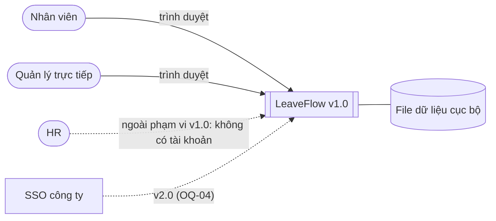

# PRD — LeaveFlow v1.0

| Thuộc tính | Giá trị |
|---|---|
| Mã tài liệu | PRD-LF-001 |
| Phiên bản | 1.2 (R1.1 — CR-R11-01: FR-11…FR-14, NFR-09) |
| Trạng thái | Baseline tag `analysis-v1` tại commit `31ac9c5` (tag ghi rõ **chưa ký**); chờ PO + Tech lead ký |
| Owner | Nguyễn Trần Hà |
| Ngày | 2026-11-02 |
| Prompt | `analysis/PRD_Prompt_IEEE_standard.md` (ISO/IEC/IEEE 29148) |
| Checklist | `analysis/PRD_IEEE_29148_Checklist.xlsx` → [prd-audit.md](./prd-audit.md) |
| Đầu vào | [BRD-LF-001](../02-requirements/BRD.md) |

## 1. Product strategy

| Mục | Nội dung |
|---|---|
| Tầm nhìn | Xin nghỉ và duyệt nghỉ trong vài giây, số dư luôn đúng |
| Người dùng mục tiêu | Nhân viên (An, Bình) và quản lý trực tiếp (Chi) |
| Chỉ số thành công | SM-01…SM-04 ([intent.md §5](../01-intake/intent.md#5-success-measures)) |
| Release | v1.0.0 — MVP local, một nhóm, một cấp duyệt |

### 1.1 System boundary

Không có hệ thống ngoài nào được tích hợp trong v1.0.

## 2. Personas

| Persona | Mục tiêu | Nỗi đau hiện tại | Màn hình chính |
|---|---|---|---|
| **An — Nhân viên** | Gửi đơn trong < 1 phút, biết ngay còn bao nhiêu phép | Không biết email đã được đọc chưa; số dư phải hỏi HR | S-01, S-02, S-03 |
| **Chi — Quản lý** | Thấy mọi đơn chờ ở một nơi, duyệt 1 click | Email lẫn với công việc; không nhớ ai đã nghỉ bao nhiêu | S-04, S-05 |
| **HR — chủ quy trình** (không phải người dùng hệ thống ở v1.0) | Quy tắc số dư/duyệt được áp dụng đúng | Cộng tay, sai số dư | — |

**Đặc điểm người dùng:** nhân viên văn phòng quen dùng web/email, không cần đào tạo; dùng laptop/máy bàn với trình duyệt hiện đại; tần suất vài lần/tháng (nhân viên), hằng ngày (quản lý).

## 3. Functional requirements

| ID | Yêu cầu (The system shall …) | BR | Ưu tiên | Kiểm chứng |
|---|---|---|---|---|
| FR-01 | Cho phép người dùng vai trò EMPLOYEE tạo đơn với `type`, `startDate`, `endDate`, `reason`; đơn mới có trạng thái `PENDING`, mã `LR-xxxx`, approver = quản lý trực tiếp | BR-01 | P0 | Test |
| FR-02 | Từ chối đơn khi: `type` ∉ {ANNUAL, SICK, UNPAID}; ngày không đúng `YYYY-MM-DD` hoặc không tồn tại; `endDate < startDate`; `startDate < hôm nay`; khác năm; 0 ngày công; `reason` trống hoặc > 200 ký tự — trả về thông báo lỗi tiếng Việt | BR-02 | P0 | Test |
| FR-03 | Từ chối đơn có khoảng ngày giao với một đơn `PENDING` hoặc `APPROVED` khác của cùng nhân viên | BR-02 | P0 | Test |
| FR-04 | Tính số dư phép năm `available = 12 − used − pending` theo năm; từ chối đơn ANNUAL có số ngày công > `available`; SICK/UNPAID không ảnh hưởng số dư | BR-03, BR-08 | P0 | Test |
| FR-05 | Hiển thị danh sách đơn của chính nhân viên, mới nhất trước, kèm trạng thái và nhận xét của quản lý | BR-08 | P1 | Test + Demo |
| FR-06 | Cho phép người tạo hủy đơn đang `PENDING`; mọi trạng thái khác bị từ chối | BR-06 | P1 | Test |
| FR-07 | Hiển thị cho MANAGER danh sách đơn của nhân viên mình phụ trách, lọc được theo trạng thái | BR-04 | P0 | Test + Demo |
| FR-08 | Cho phép approver chuyển `PENDING` → `APPROVED` (nhận xét tùy chọn) hoặc `REJECTED` (lý do bắt buộc, ≤ 200 ký tự) | BR-04, BR-05 | P0 | Test |
| FR-09 | Chỉ approver của đơn được duyệt/từ chối; chỉ người tạo được hủy; chỉ người tạo và approver được xem chi tiết; yêu cầu không có định danh hợp lệ bị từ chối | BR-04 | P0 | Test |
| FR-11 | Hiển thị **xem trước** số ngày công và số dư phép năm còn lại sau đơn ngay khi người dùng chọn ngày, trước khi gửi | BR-02, BR-08 | P1 | Demo (E2E TC-49) |
| FR-12 | Cho phép **lọc** danh sách đơn theo trạng thái và **tìm kiếm** theo mã, tên nhân viên, lý do, loại nghỉ | BR-08, BR-04 | P1 | Demo (E2E TC-50) |
| FR-13 | Hiển thị **lịch tháng** các ngày nghỉ đã duyệt và đang chờ (nhân viên: của mình; quản lý: của nhóm) | BR-04, BR-08 | P1 | Demo (E2E TC-49, TC-50) |
| FR-14 | Cho phép quản lý **xuất CSV** (UTF-8, mở được bằng Excel) đúng các đơn đang hiển thị theo bộ lọc | BR-07 | P2 | Demo (E2E TC-50) |
| FR-10 | Ghi một bản ghi lịch sử bất biến `{actor, from, to, comment, at}` cho mỗi lần tạo/chuyển trạng thái và hiển thị trong chi tiết đơn | BR-07 | P1 | Test + Demo |

## 4. Non-functional requirements (ISO/IEC 25010)

| ID | Đặc tính | Yêu cầu đo được | Ngưỡng | Phương pháp đo | BR |
|---|---|---|---|---|---|
| NFR-01 | Performance efficiency | Thời gian phản hồi API đọc (`/api/me`, `/api/leave-requests`) | p95 **< 200 ms** trên 200 request tuần tự, máy dev | TC-32 (log `p95=` trong `test-spec.log`) | BNFR-01 |
| NFR-02 | Usability / Accessibility | Mọi input có `<label>`; thao tác bằng bàn phím; thông báo qua `aria-live`; có trạng thái rỗng và lỗi | 100 % màn hình S-01…S-05 | Kiểm tra UI thủ công TC-33…TC-37 + checklist UI | BNFR-04 |
| NFR-03 | Reliability | Dữ liệu còn nguyên sau restart; ghi file nguyên tử (tmp + rename) | 0 mất dữ liệu | TC-26, TC-37 | BNFR-02 |
| NFR-04 | Security | 401 khi thiếu định danh; 403 khi sai quyền; chặn path traversal; body ≤ 10 KB; escape HTML ở UI | 0 lỗ hổng trong các ca test | TC-24, TC-28, TC-30, TC-31, review CR | BNFR-03 |
| NFR-05 | Maintainability | Line coverage mỗi file `src/`; lint | **≥ 80 %** mỗi file; lint 0 lỗi | `summary.json` của run | BNFR-05 |
| NFR-06 | Portability | Chạy bằng `node` ≥ 22, **0 dependency** ngoài | `npm start` chạy không cần `npm install` | CI + `package.json` | BNFR-05 |
| NFR-07 | Scalability / capacity | Tải được hỗ trợ ở v1.0: 1 nhóm ≤ 20 người, ≤ 10 000 đơn, **1 tiến trình** | Vượt ngưỡng → đổi store (ADR-002) | Theo dõi kích thước `db.json` (RUNBOOK §3) | BNFR-01 |
| NFR-09 | Maintainability — behavior preservation | Hành vi API của bản trước giữ nguyên khi bảo trì; test đã duyệt không bị sửa để pass | Golden master khớp 100 %; SHA-256 test đã duyệt khớp | TC-43 (characterization), TC-47 (hook + CI guard) | BNFR-05 |
| NFR-08 | Availability | Giờ hành chính; RTO ≤ 1 giờ; RPO = backup cuối ngày; `db.json` hỏng → restore | RUNBOOK §2, §4 | Diễn tập restore thủ công | BNFR-06 |

## 4.1 External interfaces

| Loại | Đặc tả |
|---|---|
| User interface | Web tiếng Việt, 5 màn hình S-01…S-05 ([UI/UX](../04-design/UI_UX_design/README.md)) |
| Communication interface | HTTP/1.1 trên `localhost` (không HTTPS ở v1.0), REST + JSON UTF-8, định danh qua header `X-User-Id`, body ≤ 10 KB ([api.md](../04-design/api.md)) |
| Software interface | Hệ điều hành bất kỳ có Node.js ≥ 22; lưu trữ là một file JSON cục bộ; không tích hợp hệ thống ngoài |
| Hardware interface | N/A — không có thiết bị chuyên dụng |

## 4.2 Operating environment, constraints & dependencies

- Môi trường: Windows/macOS/Linux, Chrome/Edge/Firefox bản hiện hành, **một instance trên localhost**.
- Ràng buộc: BC-01…BC-05 (BRD §3.1); không dùng dữ liệu cá nhân thật (BNFR-07).
- Phụ thuộc: DEP-01…DEP-04 (BRD §11.2b).
- Bảo mật: chỉ bind localhost vì `X-User-Id` giả mạo được (ADR-003); không mã hóa dữ liệu lưu trữ vì không có dữ liệu thật.

## 5. UX requirements

- Ngôn ngữ giao diện: tiếng Việt; mã trạng thái hiển thị dạng nhãn ("Chờ duyệt", "Đã duyệt"…).
- Lỗi form hiển thị inline dưới form (`role="alert"`); thông báo thành công là toast (`aria-live="polite"`) **không che nội dung thao tác**.
- Mỗi bảng có empty-state. Chi tiết: [UI_UX_design](../04-design/UI_UX_design/README.md).

## 6. Release criteria

1. 100 % FR P0 có test PASS; 100 % AC trong [USER_STORIES.md](./USER_STORIES.md) có ít nhất 1 TC PASS.
2. NFR-01, NFR-03, NFR-04, NFR-05 đạt ngưỡng trong cùng một run có evidence.
3. 0 defect mức High/Critical đang mở.
4. Code review không còn finding blocking; release owner ký.

## 7. Constraints, assumptions, out of scope

Kế thừa [BRD §3, §11.2](../02-requirements/BRD.md). Thêm: không hỗ trợ trình duyệt cũ không có `<dialog>`
(Chrome/Edge/Firefox bản hiện hành đều hỗ trợ).
