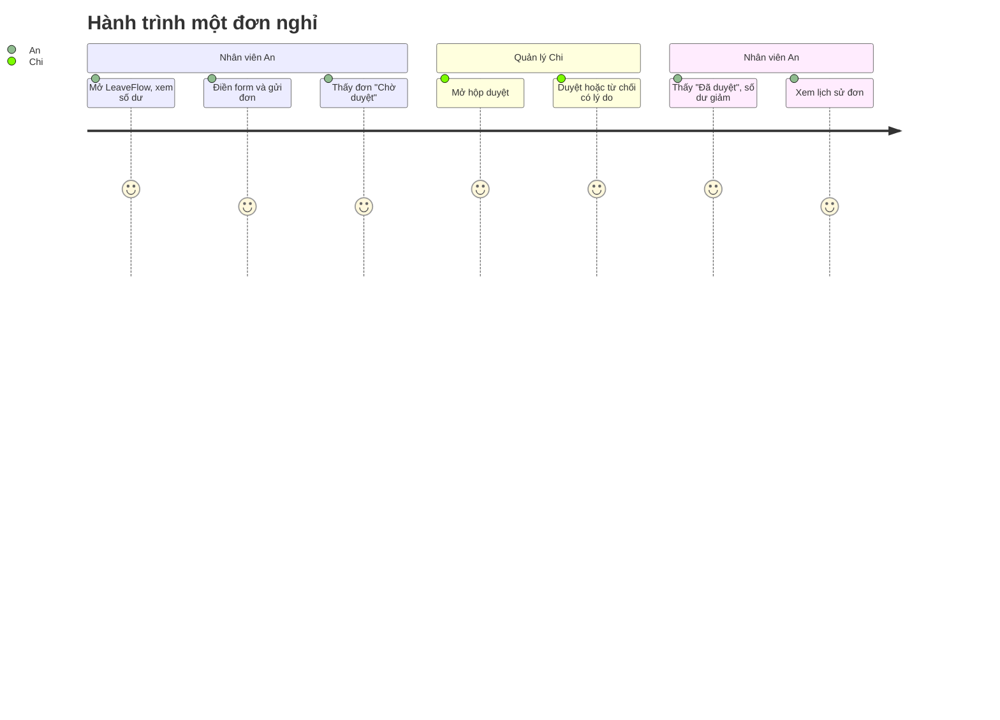

# User Stories — LeaveFlow v1.0

| Thuộc tính | Giá trị |
|---|---|
| Mã tài liệu | US-LF-001 · v1.2 (R1.1: US-09…US-12) · 2026-11-02 · Owner: Nguyễn Trần Hà |
| Nguồn | [PRD-LF-001 §3](./PRD.md#3-functional-requirements) |
| Quy ước | "Là *vai trò*, tôi muốn *năng lực*, để *lợi ích*"; ≤ 5 AC dạng Given-When-Then; mỗi story gắn FR và màn hình S-xx |

## Tổng hợp

| Epic | Story | Ưu tiên | FR | Màn hình |
|---|---|---|---|---|
| E1 Gửi đơn | US-01, US-02, US-03 | P0, P0, P1 | FR-01…06 | S-01, S-02, S-03 |
| E2 Duyệt đơn | US-04, US-05, US-06 | P0 | FR-07, FR-08 | S-04 |
| E3 Kiểm soát | US-07, US-08 | P1, P0 | FR-09, FR-10 | S-05 |
| E4 Trải nghiệm (R1.1) | US-09…US-12 | P1, P1, P1, P2 | FR-11…FR-14 | S-02, S-03, S-06, S-07 |

---

### US-01 · Gửi đơn nghỉ · P0
`E1` · FR-01, FR-02, FR-03 · S-02
> Là **nhân viên**, tôi muốn gửi đơn nghỉ trên web, để quản lý nhận được ngay mà không phải gửi email.

- **AC-01.1** Given An còn đủ phép, When gửi ANNUAL 2026-11-09 → 2026-11-13 lý do "Du lịch", Then đơn `LR-xxxx` được tạo ở trạng thái *Chờ duyệt* với **5 ngày công** và approver là quản lý trực tiếp.
- **AC-01.2** Given dữ liệu sai (ngày kết thúc trước ngày bắt đầu, ngày quá khứ, sai định dạng, khác năm, chỉ gồm cuối tuần, lý do trống/> 200 ký tự, loại không hợp lệ), When gửi, Then đơn không được tạo và thông báo lỗi tiếng Việt hiển thị dưới form.
- **AC-01.3** Given An đã có đơn PENDING/APPROVED giao ngày, When gửi đơn mới giao ngày, Then bị từ chối với thông báo nêu mã đơn trùng; đơn đã hủy không tính là trùng.
- **AC-01.4** Given người dùng là MANAGER, When tạo đơn, Then bị từ chối (403).

### US-02 · Xem số dư và đơn của tôi · P0
`E1` · FR-04, FR-05 · S-01, S-03
> Là **nhân viên**, tôi muốn thấy số dư phép năm và trạng thái các đơn, để tự lên kế hoạch nghỉ mà không cần hỏi HR.

- **AC-02.1** Given An có đơn đã duyệt và đang chờ, When mở trang chủ, Then thấy 4 số: *Được cấp 12 · Đã dùng · Đang chờ · Còn lại* với Còn lại = 12 − Đã dùng − Đang chờ.
- **AC-02.2** Given Còn lại = 12, When gửi ANNUAL 13 ngày công, Then bị từ chối "Không đủ phép năm: cần 13 ngày, còn 12 ngày"; 12 ngày thì được chấp nhận.
- **AC-02.3** Given đơn SICK hoặc UNPAID, When gửi/được duyệt, Then số dư phép năm không đổi.
- **AC-02.4** Given An có nhiều đơn, When xem "Đơn của tôi", Then chỉ thấy đơn của mình, mới nhất trước.

### US-03 · Hủy đơn chưa duyệt · P1
`E1` · FR-06 · S-03
> Là **nhân viên**, tôi muốn hủy đơn khi đổi kế hoạch, để số ngày giữ chỗ được trả lại.

- **AC-03.1** Given đơn PENDING của An, When An bấm *Hủy* và xác nhận, Then trạng thái thành *Đã hủy* và số "Đang chờ" giảm tương ứng.
- **AC-03.2** Given đơn đã APPROVED/REJECTED/CANCELLED, When hủy, Then bị từ chối (409 INVALID_STATE).
- **AC-03.3** Given đơn của An, When Bình cố hủy, Then bị từ chối (403).

### US-04 · Hộp duyệt của quản lý · P0
`E2` · FR-07 · S-04
> Là **quản lý**, tôi muốn thấy tất cả đơn chờ của nhóm ở một chỗ, để không bỏ sót đơn nào.

- **AC-04.1** Given An và Bình (nhân viên của Chi) có đơn chờ, When Chi mở hộp duyệt, Then thấy đúng các đơn đó với tên nhân viên, loại, thời gian, số ngày, lý do; không thấy đơn của nhóm khác.
- **AC-04.2** Given người dùng là EMPLOYEE, When gọi danh sách `scope=team`, Then bị từ chối (403).

### US-05 · Duyệt đơn · P0
`E2` · FR-08, FR-04 · S-04
> Là **quản lý**, tôi muốn duyệt đơn bằng một nút, để nhân viên nhận kết quả trong ngày.

- **AC-05.1** Given đơn PENDING 5 ngày của An, When Chi bấm *Duyệt*, Then đơn thành *Đã duyệt* và số dư của An: Đã dùng +5, Đang chờ −5.
- **AC-05.2** Given đơn đã được xử lý, When duyệt/từ chối lần nữa, Then bị từ chối (409).

### US-06 · Từ chối có lý do · P0
`E2` · FR-08 · S-04
> Là **nhân viên**, tôi muốn biết lý do khi bị từ chối, để điều chỉnh kế hoạch.

- **AC-06.1** Given đơn PENDING, When Chi từ chối với lý do trống, Then bị chặn "Phải nhập lý do khi từ chối"; lý do > 200 ký tự cũng bị chặn.
- **AC-06.2** Given Chi từ chối với lý do "Trùng lịch release", Then đơn *Từ chối*, nhận xét hiển thị cho An, số dư được hoàn.

### US-07 · Xem lịch sử đơn · P1
`E3` · FR-10, FR-09 · S-05
> Là **nhân viên hoặc quản lý**, tôi muốn xem ai đã làm gì với đơn và khi nào, để giải trình với HR khi cần.

- **AC-07.1** Given đơn đã tạo rồi bị từ chối, When mở chi tiết, Then thấy 2 dòng: `NEW → PENDING bởi An`, `PENDING → REJECTED bởi Chi – "lý do"` kèm thời gian.
- **AC-07.2** Given người không phải người tạo hay approver, When xem chi tiết, Then bị từ chối (403).

### US-08 · Chỉ đúng người được duyệt · P0
`E3` · FR-09 · S-04
> Là **HR (chủ quy trình, STK-03)**, tôi muốn hệ thống chỉ cho quản lý trực tiếp duyệt đơn, để tránh duyệt nhầm hoặc tự duyệt. *(HR không đăng nhập ở v1.0 — story mô tả quy tắc HR yêu cầu.)*

- **AC-08.1** Given đơn của An (quản lý Chi), When nhân viên khác, chính An, hoặc quản lý nhóm khác duyệt/từ chối, Then đều bị từ chối (403); Chi thì được.
- **AC-08.2** Given request không có hoặc sai `X-User-Id`, When gọi API cần định danh, Then nhận 401 UNAUTHENTICATED.

---

## E4 — Trải nghiệm (R1.1, CR-R11-01)

### US-09 · Xem trước số ngày công · P1
`E4` · FR-11 · S-02
> Là **nhân viên**, tôi muốn thấy ngay số ngày công và số phép còn lại sau đơn khi chọn ngày, để không phải gửi thử rồi mới biết thiếu phép.

- **AC-09.1** Given An còn 7 ngày phép, When chọn ANNUAL 16/11 → 20/11, Then hiển thị "Số ngày công: 5 · Phép năm còn sau đơn: 2" trước khi gửi; nếu âm thì cảnh báo "Vượt số dư".

### US-10 · Lọc và tìm kiếm đơn · P1
`E4` · FR-12 · S-03, S-07
> Là **quản lý**, tôi muốn lọc theo trạng thái và tìm theo tên, để tra nhanh đơn của một người.

- **AC-10.1** Given nhóm có đơn ở nhiều trạng thái, When chọn chip "Từ chối", Then chỉ còn đơn bị từ chối và mỗi chip hiển thị số lượng.
- **AC-10.2** Given danh sách nhóm, When gõ "Bình" bằng bộ gõ tiếng Việt, Then ô tìm kiếm giữ đúng chữ đã gõ và chỉ còn đơn của Trần Thị Bình.

### US-11 · Lịch nghỉ tháng · P1
`E4` · FR-13 · S-06
> Là **quản lý**, tôi muốn thấy ai nghỉ ngày nào trên lịch tháng, để tránh duyệt quá nhiều người nghỉ cùng lúc.

- **AC-11.1** Given có đơn đã duyệt và đang chờ, When mở Lịch nhóm, Then mỗi ngày làm việc trong khoảng nghỉ hiện tên + loại nghỉ; đã duyệt nền xanh, đang chờ viền vàng nét đứt; chuyển được tháng trước/sau.

### US-12 · Xuất CSV · P2
`E4` · FR-14 · S-07
> Là **quản lý**, tôi muốn xuất danh sách đơn ra CSV, để gửi HR tổng hợp.

- **AC-12.1** Given đang lọc/tìm, When bấm "Xuất CSV", Then file chứa đúng các dòng đang hiển thị với tiêu đề tiếng Việt, mã hóa UTF-8 có BOM.

## Definition of Ready / Done

| | Tiêu chí |
|---|---|
| **Ready** | Có FR, AC đo được, màn hình S-xx, ước lượng ≤ 1 task card |
| **Done** | Code + test tự động PASS, AC có TC trong [RTM](../07-verification/RTM.md), lint sạch, review xong, tài liệu cập nhật |
