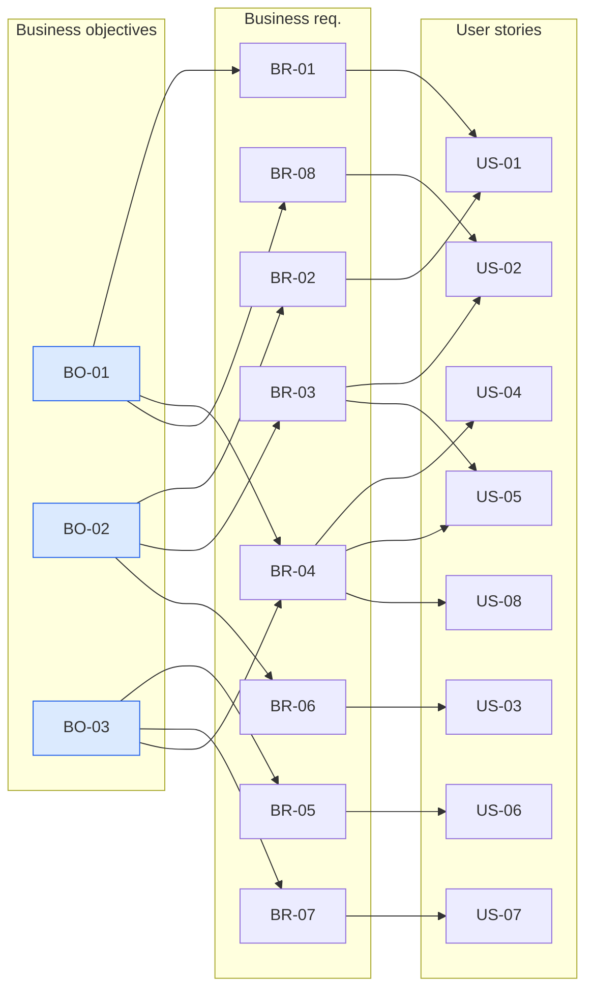

# Traceability Matrix — BO → BR → FR → US → CMP → TASK → TC

| Thuộc tính | Giá trị |
|---|---|
| Mã tài liệu | TRC-LF-001 · v1.2 · 2026-11-02 · Owner: Nguyễn Trần Hà |
| Lịch sử | v1.0 sau Phase 3 · v1.1 thêm CMP/API/TASK sau Phase 4–5 · v1.2 thêm TC-33…38, NFR-07/08 sau Phase 7 + audit (CHG-01…03 trong SDP §10) |
| Quy tắc | Hai chiều: mọi con có cha, mọi cha có ít nhất 1 con; nhánh gãy đánh dấu `[ORPHAN]` (guidance §C2) |

## 1. Sơ đồ truy vết tổng thể

## 2. Ma trận chi tiết

| BR | FR | US | Component (SAD) | API | Task | Test case |
|---|---|---|---|---|---|---|
| BR-01 | FR-01 | US-01 | CMP-02, CMP-03, CMP-04 | API-05 | TASK-04, TASK-05 | TC-12, TC-27, TC-29, TC-33 |
| BR-02 | FR-02 | US-01 | CMP-03 | API-05 | TASK-02 | TC-01…TC-09, TC-30, TC-34 |
| BR-02 | FR-03 | US-01 | CMP-02 | API-05 | TASK-04 | TC-14, TC-30 |
| BR-03, BR-08 | FR-04 | US-02, US-05 | CMP-03 | API-03 | TASK-02, TASK-04 | TC-11, TC-15, TC-16, TC-18, TC-28 |
| BR-08 | FR-05 | US-02 | CMP-02, CMP-05 | API-04 | TASK-04, TASK-06 | TC-23, TC-33 |
| BR-06 | FR-06 | US-03 | CMP-02 | API-07 | TASK-04 | TC-10, TC-17, TC-29 |
| BR-04 | FR-07 | US-04 | CMP-02, CMP-05 | API-04 | TASK-04, TASK-06 | TC-23, TC-29, TC-35 |
| BR-04, BR-05 | FR-08 | US-05, US-06 | CMP-02, CMP-03 | API-08, API-09 | TASK-04 | TC-18, TC-19, TC-21, TC-29, TC-35 |
| BR-04 | FR-09 | US-07, US-08 | CMP-01, CMP-02 | tất cả | TASK-04, TASK-05 | TC-13, TC-20, TC-22, TC-24, TC-25, TC-28 |
| BR-02, BR-08 | FR-11 | US-09 | CMP-05 | — (client) | CR-R11-01 | TC-49 |
| BR-08, BR-04 | FR-12 | US-10 | CMP-05 | API-04 | CR-R11-01 | TC-50 |
| BR-04, BR-08 | FR-13 | US-11 | CMP-05 | API-04 | CR-R11-01 | TC-49, TC-50 |
| BR-07 | FR-14 | US-12 | CMP-05 | API-04 | CR-R11-01 | TC-50 |
| BR-07 | FR-10 | US-07 | CMP-02, CMP-04 | API-06 | TASK-03, TASK-04 | TC-12, TC-22, TC-36 |

| NFR | Nơi hiện thực (SAD) | Task | Test / evidence |
|---|---|---|---|
| NFR-01 | CMP-01 không framework, dữ liệu in-memory (ADR-001, ADR-002) | TASK-05 | TC-32 |
| NFR-02 | CMP-05 (label, aria-live, empty-state) | TASK-06 | TC-33…TC-36 |
| NFR-03 | CMP-04 atomic write (ADR-002) | TASK-03 | TC-26, TC-37 |
| NFR-04 | CMP-01 auth/route guard, CMP-02 authz, CMP-05 `escapeHtml` | TASK-04…06 | TC-24, TC-28, TC-30, TC-31, TC-38 |
| NFR-05 | Toàn bộ `src/` | TASK-07 | `evidence/<run-id>/summary.json` |
| NFR-06 | `package.json` không dependencies | TASK-01 | CI workflow |
| NFR-07 | CMP-04 một tiến trình (ADR-002) | TASK-03 | TC-39 (`scripts/capacity-check.js`) |
| NFR-08 | Backup/restore (RUNBOOK) | TASK-08 | TC-40 (diễn tập restore) |
| NFR-09 | Characterization test + hook/CI bảo vệ test đã duyệt | CR-R11-01 | TC-43, TC-47 |

## 3. Kiểm tra hai chiều

| Kiểm tra | Kết quả |
|---|---|
| BR không có FR | 0 |
| FR không có BR | 0 |
| FR không có US | 0 |
| US không có AC | 0 (8/8 story, 21 AC) |
| FR không có TC | 0 |
| `[ORPHAN]` | Không có |
