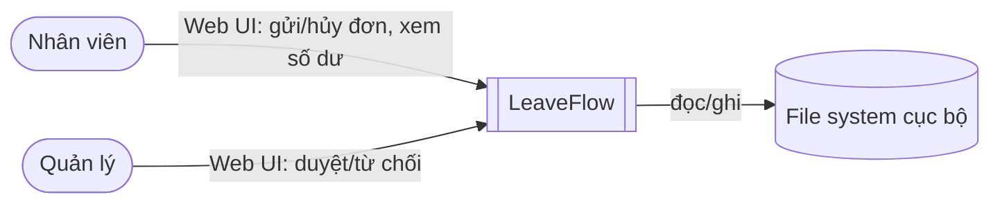
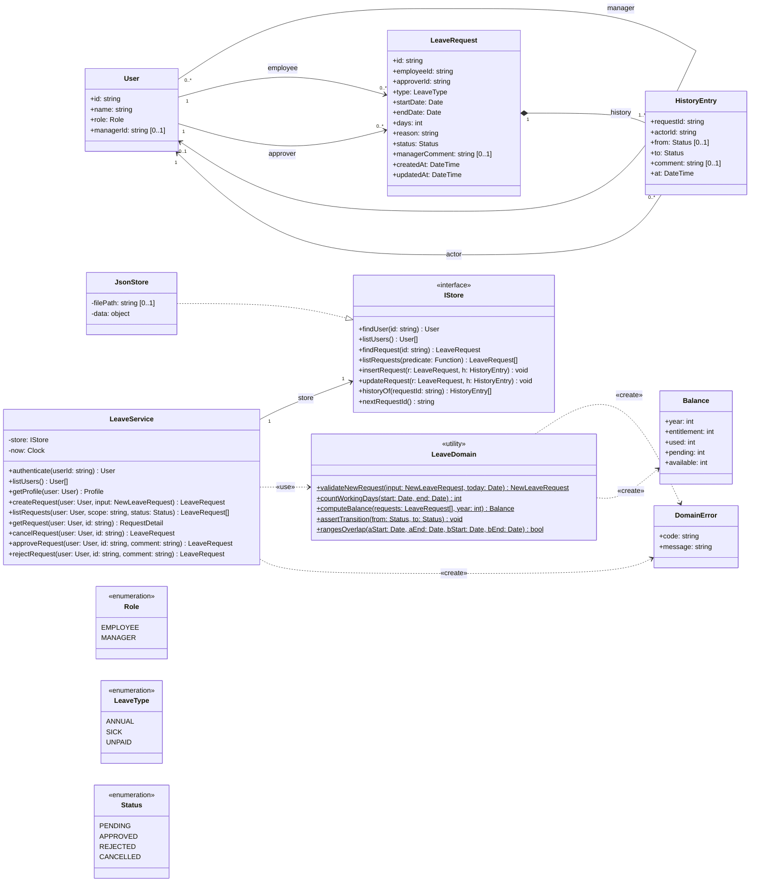
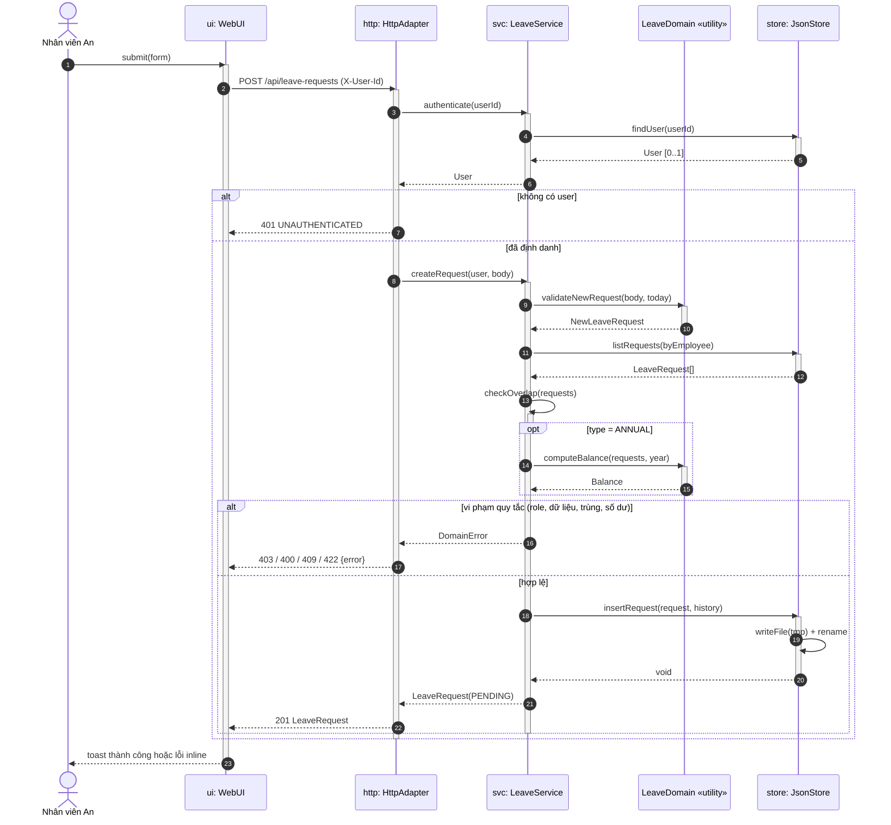
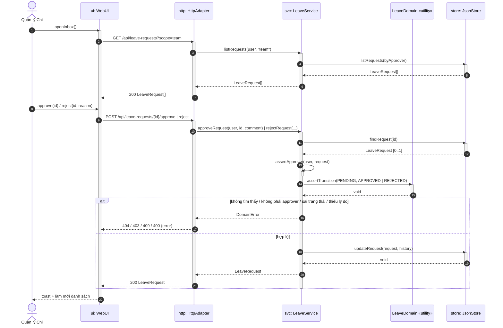
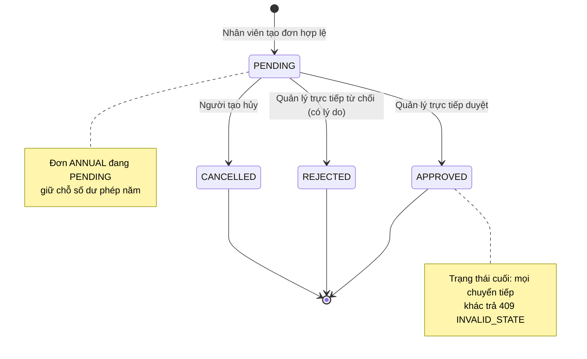
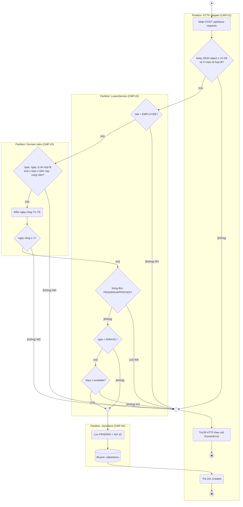
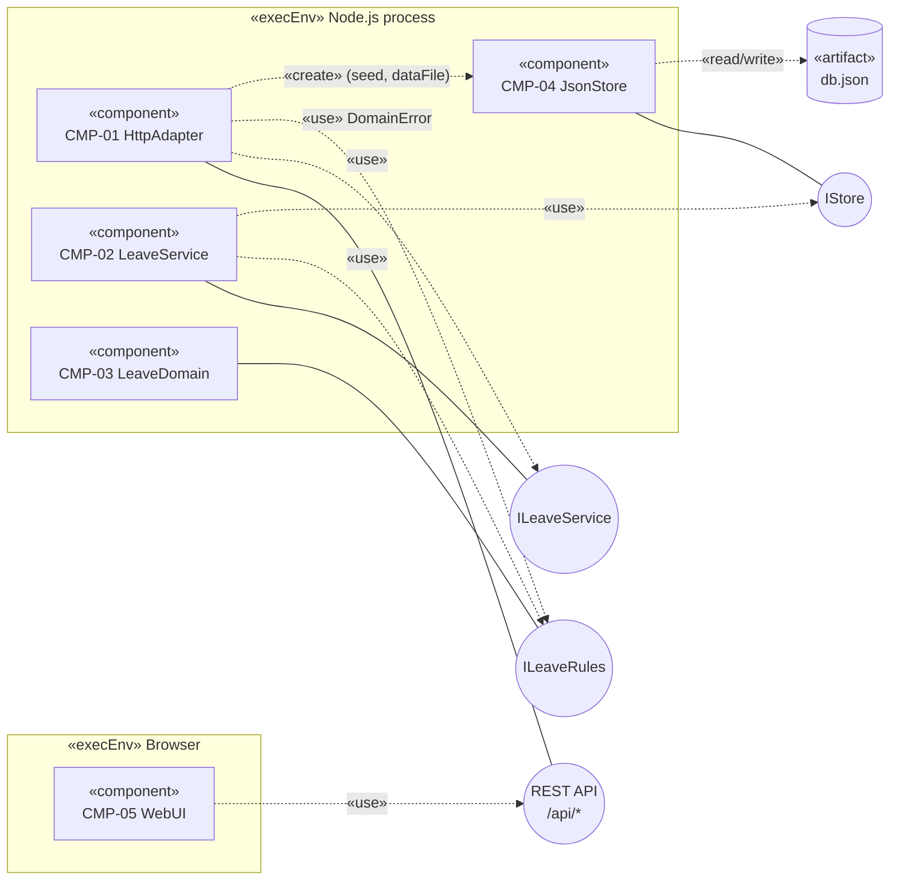
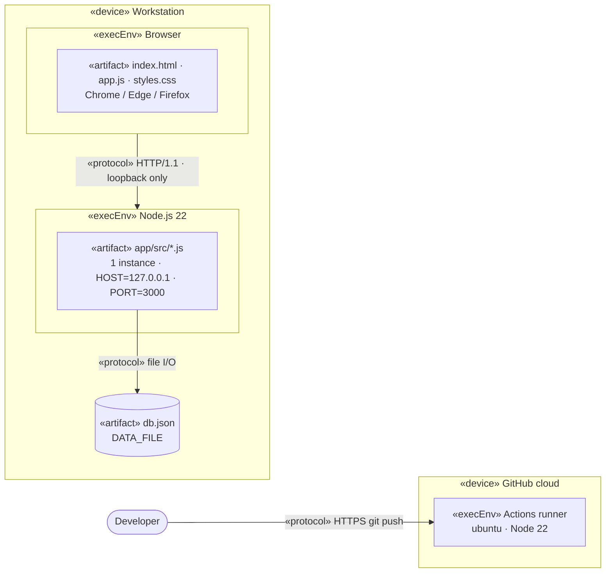
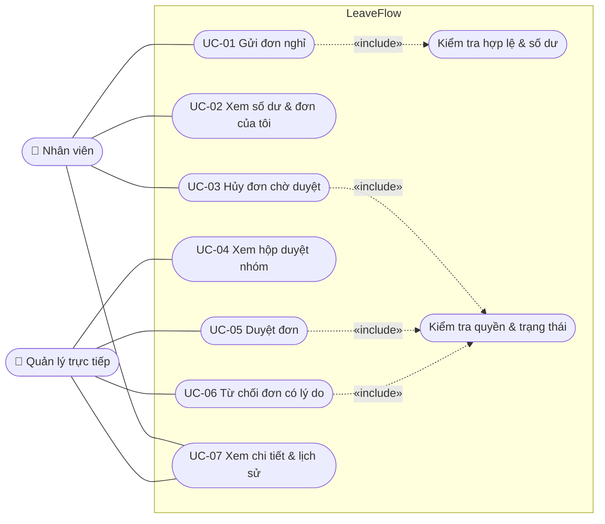

# Software Architecture Document — LeaveFlow v1.0

| Thuộc tính | Giá trị |
|---|---|
| Mã tài liệu | SAD-LF-001 |
| Phiên bản | 1.2 (R1.1 — CMP-05 mở rộng; API không đổi trừ kiểm tra UTF-8) |
| Trạng thái | Baseline tag `design-v1` tại commit `31ac9c5` (tag ghi rõ **chưa ký**); chờ Tech lead ký |
| Owner | Nguyễn Trần Hà |
| Ngày | 2026-11-02 |
| Prompt | `design/SAD_Prompt_IEEE_standard.md` (IEEE 1016-2009, view 4+1) |
| Checklist | `design/SAD_IEEE_1016_Checklist.xlsx` + checklist UML 2.0 từng sơ đồ → [design-audit.md](./design-audit.md) |
| Đầu vào | [PRD](../03-analysis/PRD.md), [USER_STORIES](../03-analysis/USER_STORIES.md), [traceability](../03-analysis/traceability.md) |

## 1. Giới thiệu

### 1.1 Mục đích & phạm vi
Mô tả kiến trúc của LeaveFlow v1.0 — web app một tiến trình Node.js phục vụ REST API và giao diện tĩnh,
lưu dữ liệu vào một file JSON. Tài liệu dùng mô hình **4+1 view** (Kruchten); mọi sơ đồ viết bằng
**Mermaid** để render trực tiếp trên GitHub và sửa được như mã nguồn (xem [adaptation log](../00-kit/adaptation-log.md)).

### 1.2 Stakeholder concerns

| Stakeholder | Concern | View trả lời |
|---|---|---|
| Nhân viên, Quản lý | Chức năng nào, ai làm gì? | Scenarios (§7) |
| Developer | Module, phụ thuộc, nơi đặt quy tắc | Logical (§3), Development (§5) |
| Tester | Luồng, trạng thái, điểm kiểm soát lỗi | Process (§4) |
| Release owner | Chạy ở đâu, cấu hình gì, rollback thế nào | Physical (§6) |
| Security | Định danh, phân quyền, dữ liệu vào | §8 Quality scenarios, ADR-003 |

### 1.3 Ràng buộc kiến trúc

| ID | Ràng buộc | Nguồn |
|---|---|---|
| CON-01 | Node.js ≥ 22, **không dependency ngoài** | NFR-06, intent §4 |
| CON-02 | Chạy local một máy, một tiến trình | intent §4 |
| CON-03 | Không có hệ thống định danh thật | Out of scope, ADR-003 |

## 2. Tổng quan kiến trúc

Kiến trúc **phân lớp (layered / hexagonal-lite)**: HTTP adapter → Application service → Domain (thuần, không I/O) ← Repository adapter.
Quy tắc nghiệp vụ nằm hoàn toàn trong lớp Domain/Service để test được mà không cần server.

| ID | Building block | File | Trách nhiệm | FR/NFR |
|---|---|---|---|---|
| CMP-01 | HTTP adapter | `app/src/server.js` | Routing, đọc JSON body (≤ 10 KB), định danh `X-User-Id`, map `DomainError` → HTTP status, phục vụ file tĩnh an toàn, bind `127.0.0.1` | FR-09, NFR-01, NFR-04, NFR-06 |
| CMP-02 | LeaveService | `app/src/service/leaveService.js` | Use case: tạo, liệt kê, xem, hủy, duyệt, từ chối; phân quyền; ghi lịch sử | FR-01, FR-03, FR-05…FR-10, NFR-05 |
| CMP-03 | Domain rules | `app/src/domain/leave.js` | Validation, đếm ngày công, máy trạng thái, số dư | FR-02, FR-04, FR-06, FR-08 |
| CMP-04 | JsonStore | `app/src/repo/jsonStore.js` | Lưu trữ in-memory + ghi file nguyên tử, trả bản sao (hiện thực `IStore`) | FR-01, FR-10, NFR-03, NFR-07 |
| CMP-05 | Web UI | `app/public/*` | SPA vanilla JS, hash routing: tổng quan + xem trước ngày công, danh sách lọc/tìm/CSV, hộp duyệt, lịch tháng, modal, dark mode | FR-05, FR-07, FR-11…FR-14, NFR-02 |

### 2.1 Context view

LeaveFlow **cung cấp** REST API `/api/*` + UI tĩnh; **cần** file system cục bộ và Node.js ≥ 22. Không gọi hệ thống ngoài.
Thông tin chi tiết: Information view → [data/model.md](./data/model.md); Interface view → [api.md](./api.md), [openapi.yaml](./openapi.yaml); use case đầy đủ → [use-cases.md](./use-cases.md).

### 2.2 Resource budget

| Tài nguyên | Ngân sách v1.0 | Căn cứ |
|---|---|---|
| Bộ nhớ tiến trình | < 100 MB ở mức 10 000 đơn | Toàn bộ dữ liệu in-memory (ADR-002) |
| File dữ liệu | ≈ 3.6 MB ở 10 000 đơn | Đo trong TC-39 |
| Thời gian ghi | < 100 ms/lần ghi ở 10 000 đơn | TC-39: POST 89.89 ms |
| CPU | 1 core, đơn luồng | Node event loop |

## 3. Logical view — Class diagram

## 4. Process view

### 4.1 Sequence — Tạo đơn (US-01)

### 4.2 Sequence — Duyệt / từ chối (US-05, US-06, US-08)

### 4.3 State machine — Vòng đời đơn nghỉ (FR-06, FR-08)

### 4.4 Activity — Tạo đơn nghỉ (FR-01…FR-04)

| | |
|---|---|
| **Activity** | `CreateLeaveRequest(userId, body) : LeaveRequest` |
| **Pre-conditions** | Server đang chạy; người dùng có trong store |
| **Post-conditions (thành công)** | Một `LeaveRequest` PENDING + một `HistoryEntry` (null → PENDING) được ghi nguyên tử vào `db.json` |
| **Post-conditions (thất bại)** | Không thay đổi dữ liệu; client nhận lỗi 400/401/403/409/413/422 |

## 5. Development view — Component diagram

**Ký hiệu:** vòng tròn = interface được cung cấp (lollipop); mũi tên nét đứt «use» = interface được yêu cầu (socket) — cặp provide/use trên cùng interface là assembly connector. `HttpAdapter` tạo `JsonStore` với seed và `DATA_FILE`.

**Quy tắc phụ thuộc:** chỉ đi từ ngoài vào trong (`server → service → domain`); `domain` không import gì của
dự án; `service` nhận `store` và `now()` qua constructor (dependency injection) để test với đồng hồ cố định.

## 6. Physical view — Deployment

«execEnv» = «executionEnvironment» (viết tắt để vừa khung sơ đồ).

| Cấu hình | Mặc định | Ý nghĩa |
|---|---|---|
| `HOST` | `127.0.0.1` | Địa chỉ bind — chỉ máy cục bộ (RISK-01) |
| `PORT` | 3000 | Cổng HTTP |
| `DATA_FILE` | `app/data/db.json` | Vị trí file dữ liệu (được `.gitignore`) |
| `LOG_REQUESTS` | tắt | `1` = log `METHOD path status ms` mỗi request |

## 7. Scenarios view — Use case

| Use case | Story | Lớp hiện thực |
|---|---|---|
| UC-01 | US-01 | CMP-05 → CMP-01 → CMP-02 → CMP-03/04 |
| UC-02 | US-02 | API-03, API-04 |
| UC-03 | US-03 | API-07 |
| UC-04 | US-04 | API-04 `scope=team` |
| UC-05, UC-06 | US-05, US-06, US-08 | API-08, API-09 (include "Kiểm tra quyền & trạng thái") |
| UC-07 | US-07 | API-06 |

## 8. Quality attribute scenarios

| NFR | Kích thích | Phản hồi mong đợi | Quyết định thiết kế |
|---|---|---|---|
| NFR-01 | 200 request đọc liên tiếp | p95 < 200 ms | Dữ liệu in-memory, không framework (ADR-001, ADR-002) |
| NFR-03 | Tắt tiến trình giữa chừng / restart | Không mất đơn đã xác nhận, file không hỏng | Ghi `db.json.tmp` rồi `rename` (nguyên tử trên cùng ổ đĩa) |
| NFR-04 | Request không có `X-User-Id`, sai quyền, `/../src/server.js`, body 11 KB | 401 / 403 / 404 / 413 | Guard tập trung ở CMP-01, phân quyền ở CMP-02, `path.normalize` + kiểm tra prefix |
| NFR-04 | Lý do chứa `<script>` | Hiển thị dạng text | `escapeHtml` trước khi chèn vào DOM |
| NFR-05 | Dev sửa quy tắc số dư | Test domain đỏ ngay | Domain thuần, test đơn vị không cần server |

## 9. Architecture decisions

| ADR | Quyết định | Trạng thái |
|---|---|---|
| [ADR-001](./ADR-001-node-no-framework.md) | Node.js thuần (`node:http`, `node:test`), không framework | Accepted |
| [ADR-002](./ADR-002-json-file-store.md) | Lưu dữ liệu bằng file JSON thay vì DBMS | Accepted |
| [ADR-003](./ADR-003-simulated-auth.md) | Giả lập định danh bằng header `X-User-Id` | Accepted (giới hạn v1.0) |

## 10. Rủi ro kỹ thuật

| ID | Rủi ro | Xác suất | Ảnh hưởng | Giảm thiểu | Owner |
|---|---|---|---|---|---|
| RISK-01 | Định danh giả lập bị lạm dụng nếu public | Thấp (chỉ local) | Cao | Chỉ bind localhost khi demo; SSO ở v2.0 | Tech lead |
| RISK-02 | File JSON không chịu được nhiều tiến trình ghi đồng thời | Thấp | Trung bình | Chạy 1 tiến trình; chuyển SQLite khi > 1 nhóm (ADR-002) | Owner |
| RISK-03 | Múi giờ làm lệch "hôm nay" | Trung bình | Thấp | Thống nhất UTC trong domain; ghi chú runbook | Owner |
