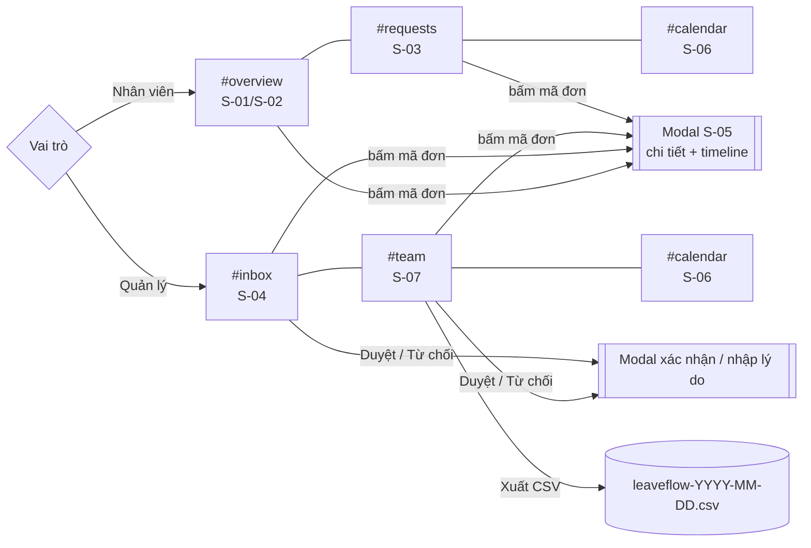
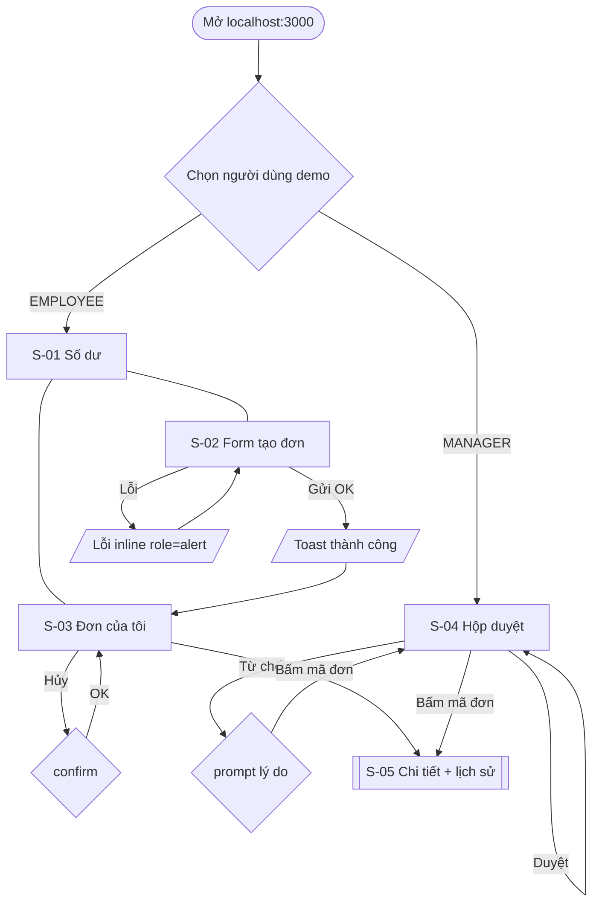

# UI/UX Design — LeaveFlow v1.0

| Thuộc tính | Giá trị |
|---|---|
| Mã tài liệu | UX-LF-001 · v1.2 (R1.1 — giao diện mới) · 2026-11-02 · Owner: Nguyễn Trần Hà |
| Prompt | `design/UI-UX-Design_prompt.md` · Checklist `design/UI_UX_Design_IEEE-1016-2009_Checklist.xlsx` |
| Prototype | Chính là app chạy được: `npm start` → http://localhost:3000 (`app/public/`) |

## 0. R1.1 — giao diện mới (CR-R11-01)

| Màn hình | Ảnh thật |
|---|---|
| S-01/S-02 Tổng quan nhân viên: 4 thẻ số liệu, vòng tiến độ phép năm, form có xem trước | [20](../../07-verification/evidence/ui-r1.1-2026-11-02/20-employee-overview.jpg), [21](../../07-verification/evidence/ui-r1.1-2026-11-02/21-live-working-day-preview.jpg) |
| S-03 Đơn của tôi: chip lọc có đếm, tìm kiếm | [24](../../07-verification/evidence/ui-r1.1-2026-11-02/24-DEF-008-retest-my-requests.jpg) |
| S-04 Hộp duyệt: thẻ KPI, thẻ đơn có avatar | [26](../../07-verification/evidence/ui-r1.1-2026-11-02/26-manager-inbox.jpg) |
| S-05 Modal chi tiết với timeline; modal từ chối có kiểm tra | [31](../../07-verification/evidence/ui-r1.1-2026-11-02/31-detail-timeline.jpg), [27](../../07-verification/evidence/ui-r1.1-2026-11-02/27-reject-modal-validation.jpg) |
| S-06 Lịch tháng (nhân viên / nhóm) | [25](../../07-verification/evidence/ui-r1.1-2026-11-02/25-employee-calendar.jpg), [34](../../07-verification/evidence/ui-r1.1-2026-11-02/34-team-calendar.jpg) |
| S-07 Đơn của nhóm: lọc, tìm, xuất CSV | [30](../../07-verification/evidence/ui-r1.1-2026-11-02/30-DEF-009-retest-search.jpg) |
| Giao diện tối | [33](../../07-verification/evidence/ui-r1.1-2026-11-02/33-DEF-010-retest-dark-mode.jpg) |
| Mobile 375 px | [35](../../07-verification/evidence/ui-r1.1-2026-11-02/35-mobile-375px.jpg) |

**Thay đổi so với v1.0:** layout sidebar + hash routing (`#overview`, `#requests`, `#inbox`, `#team`, `#calendar`); hộp thoại riêng thay `prompt()`/`confirm()` (đóng CR-06/OQ-06); giao diện tối theo `prefers-color-scheme` và lưu lựa chọn; skip-link; `prefers-reduced-motion`; breakpoint 900 px và 600 px. Mọi cặp màu ở cả 2 theme ≥ 4.5:1 ([37-contrast-r1.1.txt](../../07-verification/evidence/ui-r1.1-2026-11-02/37-contrast-r1.1.txt)).



> Phần dưới là thiết kế v1.0/v1.1, giữ lại để truy vết.

## 1. Screen inventory

| ID | Màn hình | Vai trò | Story / FR | Trạng thái được thiết kế | Ảnh |
|---|---|---|---|---|---|
| S-01 | Dashboard số dư (4 thẻ) | EMPLOYEE | US-02 · FR-04 | bình thường | [01](../../07-verification/evidence/ui-2026-11-02/01-employee-empty.jpg) |
| S-02 | Form tạo đơn | EMPLOYEE | US-01 · FR-01, FR-02 | bình thường · lỗi inline · gửi thành công (toast) | [02](../../07-verification/evidence/ui-2026-11-02/02-validation-error.jpg), [06](../../07-verification/evidence/ui-2026-11-02/06-retest-DEF-001-toast-top.jpg) |
| S-03 | Bảng "Đơn của tôi" + nút Hủy | EMPLOYEE | US-02, US-03 · FR-05, FR-06 | rỗng · có dữ liệu · xác nhận hủy | [01](../../07-verification/evidence/ui-2026-11-02/01-employee-empty.jpg), [06](../../07-verification/evidence/ui-2026-11-02/06-retest-DEF-001-toast-top.jpg) |
| S-04 | Hộp duyệt + lịch sử nhóm | MANAGER | US-04…06, US-08 · FR-07, FR-08 | rỗng · có đơn chờ · nhập lý do từ chối | [07](../../07-verification/evidence/ui-2026-11-02/07-manager-after-restart.jpg) |
| S-05 | Dialog chi tiết + timeline lịch sử | Cả hai | US-07 · FR-10 | có lịch sử | [08](../../07-verification/evidence/ui-2026-11-02/08-retest-DEF-003-actor-name.jpg) |

## 2. Navigation flow



## 3. Wireframe (bố cục S-01…S-03)

```text
┌──────────────────────────────────────────────────────────────┐
│ [LF] LeaveFlow                    Đăng nhập với vai trò [▼]   │
├──────────────────────────────────────────────────────────────┤
│ ┌Được cấp┐ ┌Đã dùng┐ ┌Đang chờ┐ ┌Còn lại┐        ┌ Toast ──┐ │
│ │  12    │ │   0   │ │   5    │ │   7   │        └─────────┘ │
│ ┌ Tạo đơn nghỉ phép ─────────────────────────────────────────┐ │
│ │ Loại [▼]   Từ ngày [  ]   Đến ngày [  ]                    │ │
│ │ Lý do [________________________________]                   │ │
│ │ (lỗi inline màu đỏ)                       [Gửi đơn]        │ │
│ └────────────────────────────────────────────────────────────┘ │
│ ┌ Đơn của tôi ───────────────────────────────────────────────┐ │
│ │ Mã | Loại | Thời gian | Ngày công | Trạng thái | NX | Hủy   │ │
│ └────────────────────────────────────────────────────────────┘ │
└──────────────────────────────────────────────────────────────┘
```

## 4. Design tokens

| Token | Giá trị | Dùng cho |
|---|---|---|
| `--primary` | `#2563eb` | Nút chính, link, thẻ "Còn lại" |
| `--danger` | `#dc2626` | Nút Từ chối, lỗi, badge REJECTED |
| `--ok` | `#15803d` | Toast thành công, badge APPROVED |
| `--warn` | `#b45309` | Badge PENDING |
| `--warn-bg / --warn-text` | `#fef3c7 / #92400e` | Badge PENDING (6.37:1) |
| `--ok-bg / --ok-text` | `#dcfce7 / #166534` | Badge APPROVED (6.49:1) |
| `--danger-bg / --danger-text` | `#fee2e2 / #991b1b` | Badge REJECTED (6.8:1) |
| `--neutral-bg / --neutral-text` | `#e5e7eb / #374151` | Badge CANCELLED (8.33:1) |
| `--text / --muted / --border / --bg / --surface` | `#1f2937 / #6b7280 / #e5e7eb / #f5f7fb / #fff` | Chữ, chữ phụ, viền, nền trang, nền panel |
| Lưới khoảng cách | bội số **4 px** (`--space`): 4 · 8 · 12 · 16 · 24 | padding, gap |
| Bo góc | 8 px (control), 12 px (panel), 999 px (badge) | |
| Font | `system-ui` | Hỗ trợ tiếng Việt sẵn |

### 4.1 Type scale

| Vai trò | Cỡ | Độ đậm |
|---|---|---|
| Brand | 1.2 rem | 700 |
| Số trên thẻ số dư | 1.8 rem (1.4 rem < 600 px) | 700 |
| Tiêu đề panel (h2) | 1.1 rem | 600 |
| Nội dung, bảng | 0.9 rem | 400 |
| Badge, nhãn thẻ | 0.8–0.85 rem | 600 / 400 |

### 4.2 Breakpoints & redlines

| Breakpoint | Thay đổi |
|---|---|
| ≥ 601 px | Form 3 cột (`auto-fit, minmax(180px,1fr)`), thẻ số dư 4 cột |
| ≤ 600 px | Thẻ số dư 2 cột, padding topbar 16 px, chi tiết đơn 1 cột; bảng cuộn ngang trong panel |

Kích thước: control cao tối thiểu **44 px** (touch target), padding 8×12 px; panel padding 16×20 px; khoảng cách panel 16 px; nội dung tối đa 1080 px.

### 4.3 Component catalog & states

| Component | Biến thể | Trạng thái |
|---|---|---|
| Button | default · `.primary` · `.danger` · `.link` | default · hover (sáng −6 %) · active (lún 1 px) · focus-visible (viền 3 px `#93c5fd`) · disabled/loading ("Đang gửi…", opacity .55) |
| Input / select / textarea | — | default · focus-visible · lỗi (thông báo `role=alert` dưới form) |
| Badge | pending · approved · rejected · cancelled | tĩnh |
| Card số dư | default · `.accent` (Còn lại) | tĩnh |
| Table | — | có dữ liệu · rỗng (`.empty`) |
| Toast | success · error | hiện 4 s, `aria-live=polite`, góc trên phải |
| Dialog chi tiết | — | mở/đóng (`<dialog>`, phím Esc) |

### 4.4 Ngăn lỗi & trạng thái hệ thống

- **Duyệt** (không hoàn tác) và **Hủy** đều hỏi xác nhận; **Từ chối** bắt buộc nhập lý do.
- Nút *Gửi đơn* bị vô hiệu và đổi chữ "Đang gửi…" khi request đang chạy (chống gửi trùng).
- Lỗi luôn kèm cách sửa (vd. "còn 7 ngày").

## 5. Accessibility (WCAG 2.1 AA — mức áp dụng cho bài tập)

| Tiêu chí | Hiện thực | Kết quả |
|---|---|---|
| 1.3.1 Info & relationships | Mọi input nằm trong `<label>`; bảng có `<thead>` | Pass (TC-33) |
| 1.4.3 Contrast | Mọi cặp chữ/nền ≥ 4.5:1 (thấp nhất 4.51:1) — v1.0 badge REJECTED/CANCELLED chỉ 3.95/3.90:1 (**DEF-005**), đã sửa | Pass — [11-contrast-check.txt](../../07-verification/evidence/ui-2026-11-02/11-contrast-check.txt) |
| 2.1.1 Keyboard | Chỉ dùng phần tử native (`button`, `select`, `dialog`) | Pass |
| 2.4.7 Focus visible | `:focus-visible` outline 3 px | Pass |
| 3.3.1 Error identification | Lỗi bằng chữ, `role="alert"` | Pass (TC-34) |
| 4.1.3 Status messages | Toast `role="status" aria-live="polite"` | Pass |
| 2.5.5 Target size | Control ≥ 44 px | Pass — đo 44 px ở 375 px ([13-mobile-check.json](../../07-verification/evidence/ui-2026-11-02/13-mobile-check.json)) |
| Responsive | Breakpoint 600 px; không cuộn ngang ở 375 px | Pass — [13-mobile-375px.jpg](../../07-verification/evidence/ui-2026-11-02/13-mobile-375px.jpg) |
