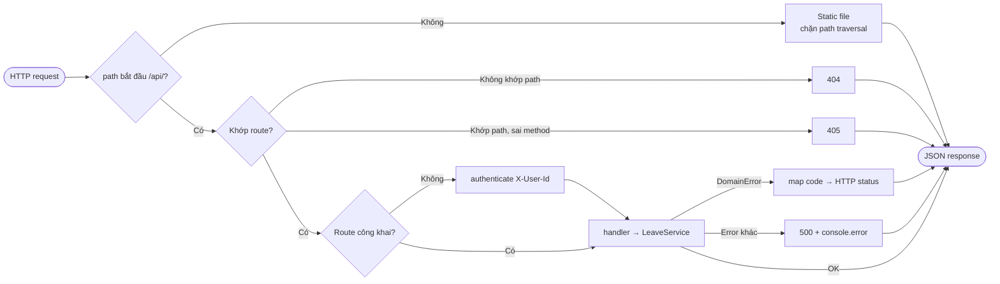

# API Design — LeaveFlow REST API v1

| Thuộc tính | Giá trị |
|---|---|
| Mã tài liệu | API-LF-001 · v1.1 (sau audit thiết kế) · 2026-11-02 · Owner: Nguyễn Trần Hà |
| Prompt | `design/apiDesign_prompt.md` · Checklist `design/API_Design_IEEE-1016-2009Checklist.xlsx` |
| Hợp đồng máy đọc | [openapi.yaml](./openapi.yaml) (OpenAPI 3.0.3) |
| Hiện thực | `app/src/server.js` — bảng route `buildRoutes()` |

## 1. Quy ước chung

| Mục | Quy ước |
|---|---|
| Base URL | `http://localhost:3000/api` |
| Định dạng | JSON UTF-8; ngày `YYYY-MM-DD`; thời điểm ISO-8601 UTC |
| Định danh | Header `X-User-Id: u1` (ADR-003). Thiếu/sai → `401` |
| Giới hạn | Body ≤ 10 KB → quá thì `413` |
| Lỗi | `{ "error": { "code": "<CODE>", "message": "<tiếng Việt>" } }` |
| Idempotency | GET an toàn; `approve/reject/cancel` lần 2 trả `409 INVALID_STATE` (không đổi dữ liệu) |
| Versioning | Hợp đồng hiện tại là **v1** (ngầm định, chưa có tiền tố). Quy tắc: thay đổi tương thích ngược (thêm field, thêm endpoint) giữ nguyên đường dẫn; thay đổi phá vỡ (đổi/xóa field, đổi ngữ nghĩa mã lỗi) → phát hành song song dưới `/api/v2/*` và giữ `/api/*` ≥ 1 release |
| Rate limiting | **Không áp dụng ở v1.0 — quyết định có chủ đích:** server chỉ bind `127.0.0.1` (RISK-01), một người dùng mỗi máy; lạm dụng tốc độ không có bề mặt tấn công. Điều kiện bật lại: khi bind ra mạng (v2.0) → thêm giới hạn 60 req/phút/user, trả `429` |
| Pagination | **Không áp dụng ở v1.0:** một nhân viên có tối đa vài chục đơn/năm; TC-39 cho thấy list ở 10 000 đơn vẫn < 100 ms. Ngưỡng xem lại: > 500 đơn trong một lần list → thêm `?limit&cursor` |
| Đặt tên tài nguyên | Danh từ số nhiều `/leave-requests`. Ba hành động chuyển trạng thái dùng sub-resource động từ (`/cancel`, `/approve`, `/reject`) thay vì `PATCH {status}` vì mỗi hành động có **quy tắc quyền và dữ liệu riêng** (lý do bắt buộc khi reject) — tách endpoint giúp kiểm tra quyền và test rõ ràng |

## 2. Danh sách endpoint

| ID | Method & path | Auth | Quyền | Mô tả | FR | Thành công |
|---|---|---|---|---|---|---|
| API-01 | `GET /api/health` | — | Công khai | Health check | NFR (ops) | 200 `{status:"ok"}` |
| API-02 | `GET /api/users` | — | Công khai | Danh sách user demo | ADR-003 | 200 `User[]` |
| API-03 | `GET /api/me` | ✔ | Mọi user | Hồ sơ + số dư phép năm hiện tại | FR-04 | 200 `{user, balance}` |
| API-04 | `GET /api/leave-requests?scope=mine\|team&status=` | ✔ | `team`: MANAGER | Danh sách đơn | FR-05, FR-07 | 200 `LeaveRequest[]` |
| API-05 | `POST /api/leave-requests` | ✔ | EMPLOYEE | Tạo đơn | FR-01…04 | 201 `LeaveRequest` |
| API-06 | `GET /api/leave-requests/{id}` | ✔ | Người tạo, approver | Chi tiết + lịch sử | FR-10 | 200 `RequestDetail` |
| API-07 | `POST /api/leave-requests/{id}/cancel` | ✔ | Người tạo | Hủy đơn PENDING | FR-06 | 200 `LeaveRequest` |
| API-08 | `POST /api/leave-requests/{id}/approve` | ✔ | Approver | Duyệt, body `{comment?}` | FR-08 | 200 `LeaveRequest` |
| API-09 | `POST /api/leave-requests/{id}/reject` | ✔ | Approver | Từ chối, body `{comment}` bắt buộc | FR-08 | 200 `LeaveRequest` |

## 3. Bảng mã lỗi

| HTTP | `code` | Khi nào | Test |
|---|---|---|---|
| 400 | `VALIDATION_ERROR` | Vi phạm FR-02, thiếu lý do từ chối, `scope` hoặc `status` sai | TC-23, TC-30 |
| 400 | `BAD_JSON` | Body không phải JSON, JSON không phải object (DEF-004), hoặc không phải UTF-8 hợp lệ (DEF-008) | TC-30, TC-46 |
| 401 | `UNAUTHENTICATED` | Thiếu/sai `X-User-Id` | TC-28 |
| 403 | `FORBIDDEN` | Sai vai trò hoặc không phải chủ/approver | TC-30 |
| 404 | `NOT_FOUND` | Không có đơn / endpoint / file tĩnh | TC-30, TC-31 |
| 405 | `METHOD_NOT_ALLOWED` | Path đúng, method sai | TC-30 |
| 409 | `CONFLICT` | Trùng thời gian (FR-03); nhân viên chưa có quản lý (DI-02) | TC-13, TC-30 |
| 409 | `INVALID_STATE` | Chuyển trạng thái không hợp lệ | TC-30 |
| 413 | `PAYLOAD_TOO_LARGE` | Body > 10 KB | TC-30 |
| 422 | `INSUFFICIENT_BALANCE` | Không đủ phép năm (FR-04) | TC-30 |
| 500 | `INTERNAL_ERROR` | Lỗi không lường trước (đã log server) | — (xem TEST_REPORT §5) |

## 4. Ví dụ

**Tạo đơn**
```http
POST /api/leave-requests
X-User-Id: u1
Content-Type: application/json

{ "type": "ANNUAL", "startDate": "2026-11-09", "endDate": "2026-11-13", "reason": "Du lịch gia đình" }
```
```json
HTTP/1.1 201 Created
{ "id": "LR-0001", "employeeId": "u1", "approverId": "u3", "type": "ANNUAL",
  "startDate": "2026-11-09", "endDate": "2026-11-13", "reason": "Du lịch gia đình", "days": 5,
  "status": "PENDING", "managerComment": null,
  "createdAt": "2026-11-02T08:00:00.000Z", "updatedAt": "2026-11-02T08:00:00.000Z" }
```

**Không đủ phép**
```json
HTTP/1.1 422 Unprocessable Entity
{ "error": { "code": "INSUFFICIENT_BALANCE", "message": "Không đủ phép năm: cần 13 ngày, còn 12 ngày" } }
```

## 5. Luồng xử lý lỗi trong adapter


