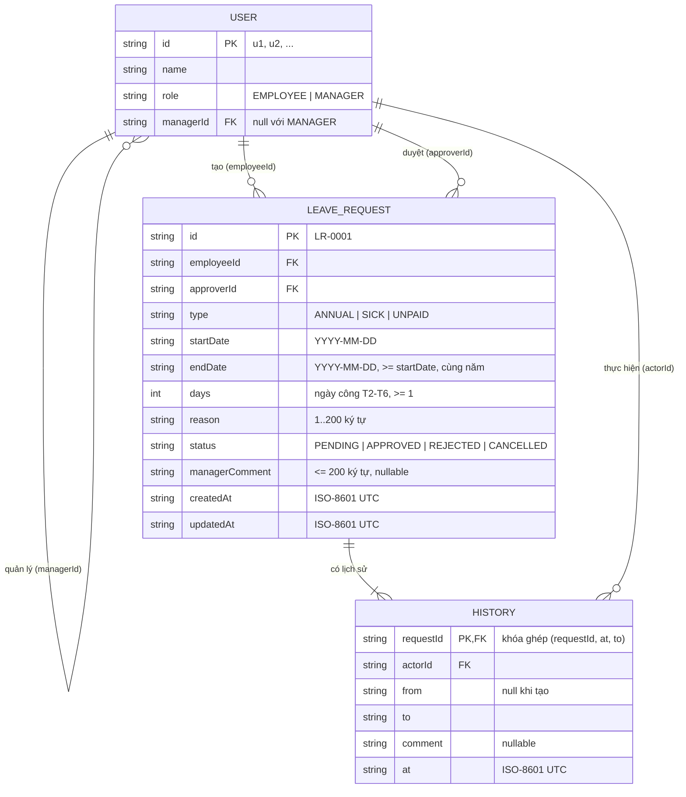

# Data Model — LeaveFlow v1.0

| Thuộc tính | Giá trị |
|---|---|
| Mã tài liệu | DATA-LF-001 · v1.1 (sau audit thiết kế) · 2026-11-02 · Owner: Nguyễn Trần Hà |
| Prompt | `design/databaseDesign_NoSQL_prompt.md` (document store dạng file JSON — ADR-002) |
| Checklist | `design/Database_Design_Checklist.xlsx` |
| Hiện thực | `app/src/repo/jsonStore.js`, file `DATA_FILE` (mặc định `app/data/db.json`) |

## 0. Workload

| Mục | Giá trị |
|---|---|
| Phân loại | OLTP nhỏ, document store một file, toàn bộ dữ liệu nạp vào bộ nhớ |
| Tỷ lệ đọc/ghi | ≈ 10 : 1 (mỗi lần mở trang: 2–3 lần đọc; ghi chỉ khi tạo/hủy/duyệt) |
| SLA đọc | p95 < 200 ms (NFR-01) — đo 5.69 ms (TC-32), ≤ 97 ms ở 10 000 đơn (TC-39) |
| SLA ghi | < 200 ms mỗi lần ghi ở mức tải tối đa — đo 89.89 ms (TC-39) |
| Khối lượng tối đa v1.0 | 20 user, 10 000 đơn, ≈ 3.6 MB (NFR-07) |

## 1. ER diagram (logical)



## 2. Physical layout (`db.json`)

```json
{
  "users":    [ { "id": "u1", "name": "Nguyễn Văn An", "role": "EMPLOYEE", "managerId": "u3" } ],
  "requests": [ { "id": "LR-0001", "employeeId": "u1", "approverId": "u3", "type": "ANNUAL", "...": "..." } ],
  "history":  [ { "requestId": "LR-0001", "actorId": "u1", "from": null, "to": "PENDING", "comment": null, "at": "..." } ]
}
```

## 3. Ràng buộc toàn vẹn (được enforce ở code)

| ID | Ràng buộc | Nơi enforce | Test |
|---|---|---|---|
| DI-01 | `id` đơn duy nhất, tăng dần `LR-0001…` | `JsonStore.nextRequestId` | TC-27 |
| DI-02 | `approverId` = `managerId` của người tạo tại thời điểm tạo | `LeaveService.createRequest` | TC-12 |
| DI-03 | Không có 2 đơn PENDING/APPROVED giao ngày của cùng nhân viên | `LeaveService.createRequest` | TC-14 |
| DI-04 | `Σ days(ANNUAL, APPROVED+PENDING, năm Y) ≤ 12` | `computeBalance` + `createRequest` | TC-15 |
| DI-05 | `HISTORY` chỉ thêm, không sửa/xóa (append-only) | `JsonStore` không có API sửa history | TC-22 |
| DI-06 | Mỗi `LEAVE_REQUEST` có ≥ 1 `HISTORY` | `insertRequest(request, historyEntry)` bắt buộc 2 tham số | TC-12, TC-26 |
| DI-07 | `employeeId`, `approverId`, `actorId` trỏ tới `USER` tồn tại (khóa ngoại ở tầng ứng dụng — file JSON không có FK) | `authenticate()` cho actor; DI-02 kiểm tra `managerId` tồn tại trước khi tạo đơn | TC-13, TC-24 |
| DI-08 | Khóa chính `HISTORY` = (`requestId`, `at`, `to`) — mỗi lần chuyển trạng thái của một đơn là duy nhất vì state machine chỉ cho tối đa 2 bản ghi/đơn | State machine (TC-10) | TC-22 |

### 3.1 Trường dẫn xuất / phi chuẩn hóa (có chủ đích)

| Trường | Nguồn | Lý do lưu/tính |
|---|---|---|
| `LEAVE_REQUEST.days` | `countWorkingDays(startDate, endDate)` | **Lưu** lúc tạo để số dư không đổi nếu quy tắc đếm ngày thay đổi về sau (bất biến lịch sử) |
| `employeeName` (API-04) | Join `USER.name` | **Tính khi đọc**, không lưu |
| `actorName` (API-06) | Join `USER.name` | **Tính khi đọc**, không lưu (DEF-003) |

## 4. Vận hành dữ liệu

| Mục | Quy định |
|---|---|
| Phân loại | Nội bộ, dữ liệu demo — không có dữ liệu cá nhân thật |
| Ghi | Nguyên tử: `db.json.tmp` → `rename` (NFR-03) |
| Backup / restore | Cuối mỗi ngày làm việc copy `db.json` (RPO = 1 ngày, RTO ≤ 1 giờ — NFR-08); quy trình trong [RUNBOOK](../../10-operations/RUNBOOK.md); **đã diễn tập** restore ở TC-40 (phục hồi 3.7 s) |
| Migration | v1.0 chưa có schema version; v2.0 thêm `"schemaVersion"` và script chuyển sang SQLite (ADR-002) |
| Retention | Giữ hết trong v1.0; quy định xóa khi decommission — xem [DECOMMISSION_PLAN](../../11-decommissioning/DECOMMISSION_PLAN.md) |
