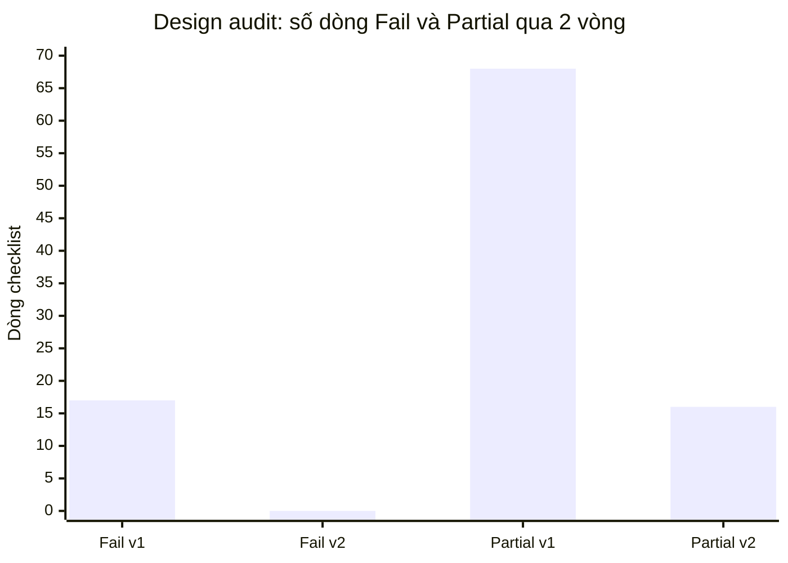

# Design Audit — cross-artifact (design-v1)

| Thuộc tính | Giá trị |
|---|---|
| Prompt | `design/Design_Audit_Prompt.md` |
| Phạm vi | [SAD](./SAD.md) · [use-cases](./use-cases.md) · [ADR-001…003](./ADR-001-node-no-framework.md) · [api.md](./api.md) · [openapi.yaml](./openapi.yaml) · [data/model.md](./data/model.md) · [UI_UX_design](./UI_UX_design/README.md) · mã nguồn `app/` |
| Auditor | Agent độc lập, chỉ đọc (phiên riêng) |
| Báo cáo chi tiết | Vòng 1: [design_checklists_audit.md](./audits/design_checklists_audit.md) · Vòng 2: [design_checklists_audit_round2.md](./audits/design_checklists_audit_round2.md) |
| Ngày | 2026-11-02 |

> **Ghi chú trung thực:** bản đầu của file này do tác giả tự viết, có bảng điểm với số dòng **không khớp** file
> checklist (ghi 133 dòng, thực tế 222) và kết luận "0 Fail" chưa được chấm thật. Auditor độc lập đã chỉ ra sai sót
> này ở vòng 1. Nội dung dưới đây là kết quả chấm thật từng dòng.

## 1. Điểm theo checklist (vòng 1 → vòng 2)

| Checklist | Vòng 1 P / Pa / F / NA | Vòng 2 P / Pa / F / NA | Dòng |
|---|---|---|---|
| `SAD_IEEE_1016_Checklist.xlsx` | 11 / 5 / 0 / 0 | 16 / 0 / 0 / 0 | 16 |
| `Class_Diagram_UML2.0_Checklist.xlsx` | 12 / 6 / 0 / 7 | 16 / 2 / 0 / 7 | 25 |
| `Sequence_Diagram_UML2.0_Checklist.xlsx` | 9 / 5 / **2** / 6 | 15 / 1 / 0 / 6 | 22 |
| `Activity_Diagram_UML2.0_Checklist.xlsx` | 3 / 6 / **3** / 16 | 10 / 2 / 0 / 16 | 28 |
| `Component_Diagram_UML2.0_Checklist.xlsx` | 4 / 4 / **5** / 5 | 12 / 1 / 0 / 5 | 18 |
| `Deployment_Diagram_UML2.0_Checklist.xlsx` | 7 / 6 / 0 / 3 | 12 / 1 / 0 / 3 | 16 |
| `UseCase_Document_UML2.0_Checklist.xlsx` | 10 / 13 / **3** / 3 | 23 / 3 / 0 / 3 | 29 |
| `API_Design_IEEE-1016-2009Checklist.xlsx` | 10 / 5 / **2** / 4 | 13 / 4 / 0 / 4 | 21 |
| `Database_Design_Checklist.xlsx` | 6 / 8 / 0 / 11 | 13 / 1 / 0 / 11 | 25 |
| `UI_UX_Design_IEEE-1016-2009_Checklist.xlsx` | 7 / 10 / **2** / 3 | 18 / 1 / 0 / 3 | 22 |
| **Tổng** | **79 / 68 / 17 / 58** | **148 / 16 / 0 / 58** | **222** |

## 2. 17 Fail vòng 1 → cách sửa

| Nhóm | Fail | Sửa |
|---|---|---|
| Sequence | Không có activation; self-call không lồng | Vẽ lại SAD §4.1–4.2 với `activate/deactivate`, self-call lồng |
| Activity | Thiếu pre/post-condition, merge node, partition | SAD §4.4: bảng pre/post, nút merge, 4 swimlane theo component, guard `[ ]`, final node |
| Component | Thiếu «component», interface provided/required, usage dependency sai, không assembly | SAD §5: «component», 4 interface lollipop, «use» nét đứt, sửa cạnh seed/DomainError |
| Use case | Không có main success scenario đánh số, action/response, flow reference | [use-cases.md](./use-cases.md): 7 UC đủ trường, bảng Actor/System đánh số, alternate flow theo bước |
| API | Không có chính sách versioning, rate limiting | api.md §1: quy tắc `/api/v2`, quyết định không rate-limit vì chỉ bind loopback (bind thực hiện — DEF-007) |
| UI/UX | Touch target < 44 px; không micro-interaction | DEF-005: `min-height: 44px`, hover/active/disabled, khóa nút khi gửi; đo ở TC-41 |

## 3. Mười phép đối chiếu cặp (xác minh bởi auditor)

| # | Cặp | Kết quả |
|---|---|---|
| 1 | SAD CMP ↔ code | Đúng — 5/5 file |
| 2 | SAD ↔ PRD | Đúng (lệch nhỏ cột FR/NFR đã đồng bộ ở SAD v1.1) |
| 3 | Class ↔ data model | Đúng; thêm liên kết approver/actor → User ở v1.1 |
| 4 | Sequence ↔ API | Đúng |
| 5 | State machine ↔ `TRANSITIONS` | Đúng |
| 6 | Activity ↔ API errors | Đúng; v1.1 bổ sung 401/413/BAD_JSON |
| 7 | API ↔ openapi.yaml | Đúng; v1.1 khai báo đủ mã lỗi |
| 8 | UI ↔ stories | Đúng |
| 9 | Deployment ↔ cấu hình | Đúng; thêm `HOST` |
| 10 | ADR ↔ rủi ro | Mapping đúng, nhưng giảm thiểu RISK-01 **chưa được hiện thực** ở v1.0 → DEF-007, đã sửa |

## 4. Kết luận
Vòng 2: **0 Fail** trên 10 checklist thiết kế; 16 Partial đều có hành động, owner và hạn (4 dòng API hoãn có chủ đích tới v2.0).
→ `design-v1` đủ điều kiện baseline, **chờ Tech lead ký**.
