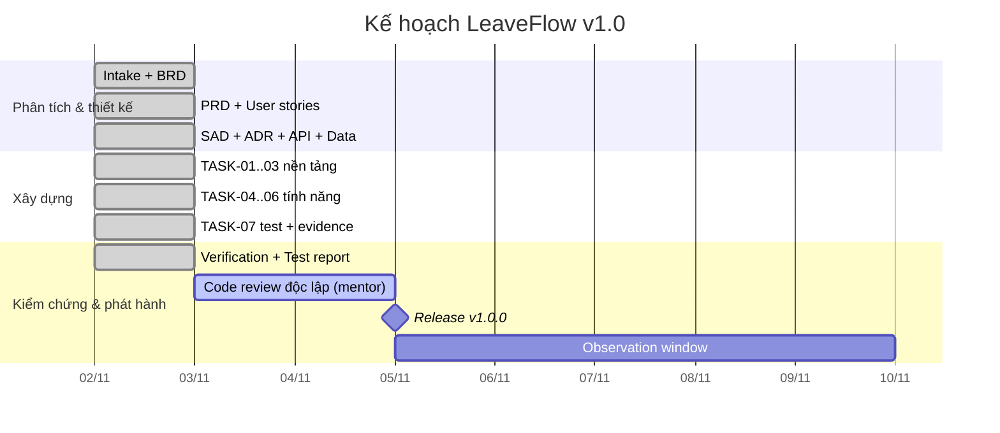

# Software Development Plan — LeaveFlow v1.0

| Thuộc tính | Giá trị |
|---|---|
| Mã tài liệu | SDP-LF-001 |
| Phiên bản | 1.1 (sau audit vòng 1) |
| Trạng thái | Baseline tag `plan-v1` tại commit `31ac9c5` (tag ghi rõ **chưa ký**); chờ PO + Tech lead ký |
| Owner | Nguyễn Trần Hà |
| Ngày | 2026-11-02 |
| Prompt | `development/DevPlan_ISO_24748_5_Prompt.md` (ISO/IEC/IEEE 24748-5:2017) |
| Checklist | `development/DevPlan_ISO_24748_5_Checklist.xlsx` |
| Đầu vào | [PRD](../03-analysis/PRD.md), [SAD](../04-design/SAD.md), [USER_STORIES](../03-analysis/USER_STORIES.md) |

## 1. Tổng quan dự án

| Mục | Nội dung |
|---|---|
| Mục tiêu | Giao LeaveFlow v1.0.0 đáp ứng PRD §6 Release criteria |
| Sản phẩm bàn giao | `app/` (mã + test), `docs/01…11`, CI workflow, evidence của run kiểm thử |
| Mô hình vòng đời | **Agentic SDLC tuần tự theo phase có gate** (SOP §5), bên trong Phase 6 lặp theo task card (vertical slice) |
| Risk tier | Medium (intent) |
| Business drivers | BO-01 thời gian duyệt, BO-02 số dư đúng, BO-03 lưu vết ([BRD §4](../02-requirements/BRD.md#4-business-drivers)); đo bằng SM-01…SM-04 |
| Kiến trúc tóm tắt | Web app 1 tiến trình Node.js: HTTP adapter → service → domain thuần ← JSON store; UI tĩnh vanilla JS ([SAD §2](../04-design/SAD.md#2-tổng-quan-kiến-trúc)) |
| Tailoring | Các điều chỉnh so với kit ghi tại [adaptation-log](../00-kit/adaptation-log.md) — cần Tech lead duyệt cùng plan |

### 1.1 Chuẩn áp dụng

| Chuẩn | Áp dụng cho |
|---|---|
| ISO/IEC/IEEE 29148:2018 | BRD, PRD, user stories |
| IEEE 1016-2009, ISO/IEC/IEEE 42010 | SAD, ADR |
| UML 2.x (thể hiện bằng Mermaid) | Sơ đồ 4+1 |
| ISO/IEC/IEEE 24748-5:2017 | Kế hoạch này |
| ISO 21511:2018 | WBS |
| IEEE 829-2008 | Test plan, cases, RTM, report |
| IEEE 1028-2008 | Code review |
| ISO/IEC 25010 | Phân loại NFR |
| WCAG 2.1 AA (mức áp dụng) | UI |

## 2. Lifecycle & gates

```mermaid
flowchart LR
    P1[1 Intake] -->|intake-v1| P2[2 Requirements]
    P2 -->|requirements-v1| P3[3 Analysis]
    P3 -->|analysis-v1| P4[4 Design]
    P4 -->|design-v1| P5[5 Planning]
    P5 -->|plan-v1| P6[6 Implementation]
    P6 --> P7[7 Verification]
    P7 -->|TEST_REPORT GO| P8[8 Review]
    P8 -->|approved commit| P9[9 Release]
    P9 -->|v1.0.0| P10[10 Operations]
    P10 -.->|hết vòng đời| P11[11 Decommission]
    P7 -. "defect DEF-xxx" .-> P6
    P8 -. "blocking finding" .-> P6
```

Vòng lặp mỗi bước (guidance §A4): **Specify → Generate → Audit → Fix → Approve**, tối đa 3 vòng.

## 3. Tổ chức & vai trò

| Vai trò (SOP §4) | Người | Trách nhiệm trong dự án |
|---|---|---|
| PO / BA | Nguyễn Trần Hà | Intent, BRD, PRD, ưu tiên, nghiệm thu |
| Human owner / Engineer | Nguyễn Trần Hà | Điều phối agent, kiểm tra output, traceability |
| AI agent | Claude (Claude Code) | Soạn nháp tài liệu, sinh code/test, chạy check — **không phê duyệt** |
| Tech lead / Reviewer độc lập | Mentor khóa SDLC | Duyệt design, plan, code review |
| Release owner | Nguyễn Trần Hà | Authorize release v1.0.0 |

> Một người giữ nhiều vai trò do quy mô bài tập; reviewer độc lập **khác** tác giả (SOP §5.8).

### 3.1 RACI

| Hoạt động | PO / Owner (Hà) | AI agent | Mentor (Tech lead / Reviewer) |
|---|---|---|---|
| Intake, BRD, PRD | A/R | C (soạn nháp) | I |
| Thiết kế, ADR | R | C | A (duyệt `design-v1`) |
| Kế hoạch | R | C | A (duyệt `plan-v1`) |
| Code + test | A | R | I |
| Audit checklist | A | R (auditor riêng, chỉ đọc) | I |
| Code review | R (tác giả trả lời) | C (pre-review) | A (approve) |
| Release | A/R | C (chuẩn bị tài liệu) | I |

### 3.2 Năng lực cần có

| Năng lực | Có sẵn | Thiếu → cách bù |
|---|---|---|
| Node.js, REST, HTML/CSS | Owner + agent | — |
| Viết yêu cầu IEEE 29148, UML | Owner (đang học) | Dùng prompt + checklist của kit, mentor review |
| Kiểm thử, IEEE 829 | Owner (đang học) | Prompt kit + auditor agent |
| Bảo mật web | Cơ bản | Checklist IEEE 1028 mục Security, test NFR-04 |

### 3.3 Stakeholder engagement

| Stakeholder | Kênh | Tần suất | Nội dung | Owner |
|---|---|---|---|---|
| Mentor (Tech lead/Reviewer) | Repo GitHub + buổi học | Mỗi gate (design, plan, review, release) | Link artifact + audit, xin ký | Hà |
| HR / Quản lý (persona) | Phỏng vấn mô phỏng (SRC-001) | Phase 2; khi có thay đổi BR | Xác nhận BR, AC | Hà |
| Lớp học (học viên khác) | Bảng danh sách repo | Cuối khóa | Trạng thái dự án (Analysis/Implemented/Tested) | Hà |

## 4. Lịch trình

> Với AI agent hỗ trợ, các phase 1–7 được thực hiện trong ngày 2026-11-02; review độc lập và release
> phụ thuộc lịch của mentor/release owner.

## 5. Ước lượng & công sức

| Task | Ước lượng (giờ) | Trạng thái | Ghi chú |
|---|---|---|---|
| TASK-01 Khởi tạo & công cụ | 0.5 | Done | |
| TASK-02 Domain rules | 1.0 | Done | Agent sinh, owner review |
| TASK-03 JsonStore | 0.5 | Done | |
| TASK-04 LeaveService | 1.5 | Done | |
| TASK-05 REST API | 1.0 | Done | 1 phát hiện tự rà soát trước lần test đầu (CR-03) + 1 lỗi phát hiện ở code review (CR-01 → DEF-004) |
| TASK-06 Web UI | 1.5 | Done | 3 defect UI phát hiện khi test (DEF-001…003) |
| TASK-07 Test & evidence | 1.5 | Done | |
| TASK-08 Tài liệu & release | 3.0 | Done (chờ ký) | |
| **Tổng** | **10.5** | | Giả định: 1 người + AI agent. Thời gian thực tế không được đo riêng từng task — toàn bộ làm trong 1 phiên ngày 2026-11-02 |

### 5.1 Phương pháp ước lượng & ngân sách

- Ước lượng theo **expert judgement + kích thước task card** (≤ 6 file, 1 phiên agent). Thời gian thực tế không được ghi riêng từng task (toàn bộ làm trong một phiên ngày 2026-11-02) — bài học: lần sau ghi giờ bắt đầu/kết thúc mỗi task.
- **Ngân sách:** 0 đồng tiền mặt (BC-01). Chi phí duy nhất là thời gian của owner (~10.5 giờ ước lượng) và lượt dùng AI agent theo gói học viên.

## 6. Kỹ thuật & công cụ

| Hạng mục | Công cụ / lệnh |
|---|---|
| Runtime | Node.js ≥ 22 (dev: v22.0.0) |
| Chạy app | `cd app && npm start` |
| Lint | `npm run lint` (syntax + hygiene rules, `app/scripts/lint.js`) |
| Test | `npm test` · coverage `npm run test:coverage` · evidence `npm run test:report` |
| CI | GitHub Actions `.github/workflows/ci.yml` (lint + test + coverage, Node 22) |
| Quản lý cấu hình | Git; baseline = commit + tag (`requirements-v1`, `analysis-v1`, `design-v1`, `plan-v1`, `v1.0.0`) |
| Sơ đồ | Mermaid trong Markdown |

### 6.1 Quản lý cấu hình (SCM)

| Mục | Quy ước |
|---|---|
| Nhánh | `main` được bảo vệ; công việc trên nhánh `feature/<task-id>` → PR → review → merge |
| Commit | Conventional commits, nhắc mã task: `feat(TASK-04): ...`, `fix(DEF-004): ...` |
| Baseline | Tag tại commit đã ký: `requirements-v1`, `analysis-v1`, `design-v1`, `plan-v1`, `v1.0.0` |
| Phiên bản | SemVer cho app (`app/package.json`); tài liệu có version trong bảng kiểm soát đầu file |
| Trạng thái hiện tại | **Chưa commit** — mọi artifact đang nằm trong working tree trên nền `6996dae`; các tag ở trên **chưa tồn tại** và sẽ được tạo khi owner commit + người duyệt ký (điều kiện TEST_REPORT §7) |

## 7. Quản lý chất lượng

| Hoạt động | Khi nào | Tiêu chí |
|---|---|---|
| Audit artifact theo checklist | Cuối phase 2, 3, 4, 5, 7 | 0 Fail; Partial có owner |
| Unit + API test | Mỗi task, mỗi push (CI) | 100 % pass |
| Coverage | Mỗi run | ≥ 80 % dòng mỗi file `src/` (NFR-05) |
| Code review IEEE 1028 | Phase 8 | 0 blocking finding |
| Exploratory UI test | Phase 7 | Mọi defect có `DEF-xxx` |

## 7.1 Theo dõi tiến độ & báo cáo

| Chỉ số (KPI) | Nguồn | Tần suất | Ngưỡng |
|---|---|---|---|
| Số task Done / tổng | `tasks/*.md` trạng thái | Cuối mỗi phiên làm việc | 8/8 trước release |
| Gate đã ký / tổng | [docs/README §4](../README.md#4-gate-status) | Mỗi gate | Tất cả trước release |
| Test pass rate, coverage | `evidence/<run-id>/summary.json` | Mỗi run / mỗi push (CI) | 100 %, ≥ 80 % |
| Defect mở theo severity | TEST_REPORT §6 | Mỗi run | 0 High/Critical |
| Audit Fail còn mở | `docs/*/audits/*.md` | Mỗi vòng audit | 0 trước khi ký gate |

Báo cáo: cập nhật bảng Gate status trong [docs/README.md](../README.md) sau mỗi vòng; gửi link cho mentor ở mỗi gate.

## 8. Rủi ro dự án

| ID | Rủi ro | P | I | Phản ứng | Owner |
|---|---|---|---|---|---|
| RISK-01 | Định danh giả lập (ADR-003) | L | H | Chỉ chạy local; SSO ở v2.0 | Tech lead |
| RISK-02 | JSON store một tiến trình (ADR-002) | L | M | Không scale ngang; chuyển SQLite khi cần | Owner |
| RISK-04 | Agent sinh code/test "tự chứng minh" (test viết theo code) | M | H | TC dẫn xuất từ AC (TEST_CASES), owner đọc diff, review độc lập | Owner |
| RISK-05 | Mạng công ty chặn npm/SSL | H | M | 0 dependency (ADR-001) | Owner |
| RISK-06 | Reviewer bận, chậm release | M | L | Release có thể lùi; không ảnh hưởng chất lượng | PO |
| RISK-03 | "Hôm nay" tính theo UTC, lệch ngày với giờ VN 00:00–07:00 | M | L | Ghi runbook; follow-up v1.1 (CR-07) | Owner |
| RISK-07 | Người dùng không chuyển sang công cụ mới | M | M | Fallback email 1 tháng, đo SM-01 | PO |

Rủi ro được rà soát ở mỗi gate và khi có defect/finding mới.

## 9. Quyết định & giả định

Xem [ADR-001…003](../04-design/SAD.md#9-architecture-decisions), ASM-01/02 trong [BRD §11.2](../02-requirements/BRD.md#112-assumptions--risks).
Phân rã công việc: [WBS.md](./WBS.md) và [tasks/](./tasks/).

## 10. Kiểm soát thay đổi

Sau khi một artifact sẵn sàng baseline, mọi thay đổi đi qua **change record** (guidance §C1): nêu ID bị ảnh hưởng →
cập nhật artifact + traceability/RTM → audit lại → người duyệt của gate đó chấp thuận. Với quy mô bài tập, "CCB" là
PO + Tech lead (mentor).

| CHG | Ngày | Thay đổi | Lý do | ID bị ảnh hưởng | Người duyệt |
|---|---|---|---|---|---|
| CHG-01 | 2026-11-02 | Sửa UI: toast, empty-state, tên người trong lịch sử | DEF-001…003 từ kiểm thử UI | NFR-02, FR-10, US-07 | Owner (Low) |
| CHG-02 | 2026-11-02 | `readJsonBody` chỉ nhận JSON object; kiểm tra prefix static | CR-01/DEF-004, CR-02 | NFR-04, API §3 | Owner; mentor xác nhận khi review |
| CHG-04 | 2026-11-02 | SAD v1.1 (vẽ lại sơ đồ UML), `use-cases.md`, api.md/openapi v1.1, data model v1.1, UI/UX v1.1; code: bind `127.0.0.1`, kiểm tra `status`, chặn nhân viên không có quản lý, sửa UI | Audit thiết kế vòng 1 (17 Fail) → DEF-005…007, CR-08…11 | NFR-02, NFR-04, FR-07, DI-02, CMP-01…05 | ☐ Tech lead |
| CHG-03 | 2026-11-02 | BRD v1.1, PRD v1.1, SDP v1.1, TEST_PLAN v1.1: thêm NFR-07/08, giao diện ngoài, phụ thuộc, ràng buộc, RACI, SCM… | Kết quả audit vòng 1 (`*/audits/*.md`) | BNFR-06/07, NFR-07/08, DEP-01…04 | ☐ PO + Tech lead |
| CHG-05 | 2026-11-02 | R1.1 theo [CR-R11-01](../12-maintenance/CR-R11-01.md): giao diện mới, FR-11…FR-14, NFR-09; characterization, mutation, scan, hook bảo vệ test | Phản hồi giảng viên + slide B10 | FR-11…14, NFR-02, NFR-09, CMP-05 | ☐ PO + Tech lead |
