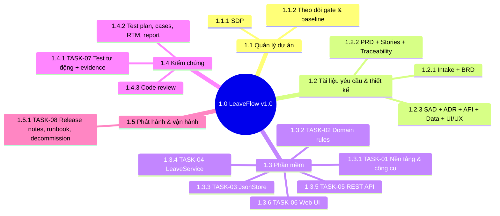
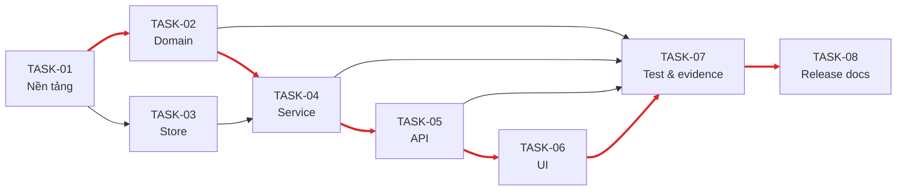

# Work Breakdown Structure — LeaveFlow v1.0

| Thuộc tính | Giá trị |
|---|---|
| Mã tài liệu | WBS-LF-001 · v1.1 (bổ sung dictionary 1.1–1.4) · 2026-11-02 · Owner: Nguyễn Trần Hà |
| Prompt | `development/TaskBreakdown_ISO_21511_Prompt.md` (ISO 21511:2018, hướng deliverable) |
| Giới hạn kích thước task | 1 phiên agent · ≤ 6 file chạm · ≤ 3 vòng sửa |

## 1. Cây WBS

## 2. WBS dictionary

| WBS | Deliverable | Tiêu chí chấp nhận | Task | US / FR |
|---|---|---|---|---|
| 1.1.1 | `Software_Development_Plan.md` | Audit DevPlan 0 Fail; PO + Tech lead ký | — | — |
| 1.1.2 | Bảng gate trong `docs/README.md`, tag baseline | Mỗi gate có audit + chữ ký + tag | — | — |
| 1.2.1 | `docs/01-intake/*`, `BRD.md`, `brd-audit.md` | Audit BRD 0 Fail; PO ký | — | BR-01…08 |
| 1.2.2 | `PRD.md`, `USER_STORIES.md`, `traceability.md` | Audit PRD 0 Fail; 0 orphan | — | FR, NFR, US |
| 1.2.3 | `SAD.md`, `ADR-*.md`, `api.md`, `openapi.yaml`, `data/model.md`, `UI_UX_design/` | Audit design 0 Fail; Tech lead ký | — | CMP, API |
| 1.4.2 | `TEST_PLAN.md`, `TEST_CASES.md`, `RTM.md`, `TEST_REPORT.md` | 100 % AC có TC PASS; GO/NO-GO | — | AC, NFR |
| 1.4.3 | `CODE_REVIEW.md` / PR | 0 blocking finding; reviewer độc lập approve | — | — |
| 1.3.1 | `package.json`, `scripts/lint.js`, CI | `npm run lint` và `npm test` chạy được, CI xanh | TASK-01 | NFR-05, NFR-06 |
| 1.3.2 | `src/domain/leave.js` | TC-01…TC-11 pass | TASK-02 | FR-02, FR-04, FR-06, FR-08 |
| 1.3.3 | `src/repo/jsonStore.js` | TC-26, TC-27 pass | TASK-03 | NFR-03, FR-10 |
| 1.3.4 | `src/service/leaveService.js` | TC-12…TC-25 pass | TASK-04 | US-01…US-08 |
| 1.3.5 | `src/server.js` | TC-28…TC-32 pass | TASK-05 | API-01…09, NFR-01, NFR-04 |
| 1.3.6 | `public/*` | TC-33…TC-37 pass | TASK-06 | S-01…S-05, NFR-02 |
| 1.4.1 | `tests/**`, `scripts/run-tests.js` | Evidence run lưu ở `docs/07-verification/evidence/` | TASK-07 | NFR-05 |
| 1.5.1 | `docs/09…11` | Release record có rollback + health check | TASK-08 | — |

## 3. Phụ thuộc & critical path

**Critical path (đỏ):** TASK-01 → 02 → 04 → 05 → 06 → 07 → 08. TASK-03 song song với TASK-02.
