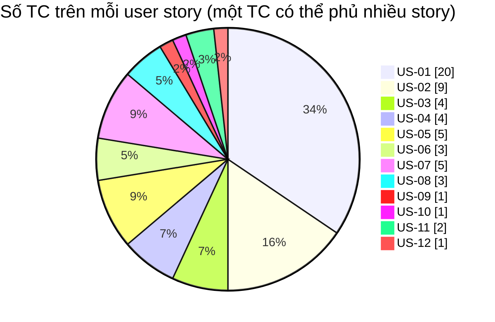

# Requirements Traceability Matrix — LeaveFlow v1.1

| Thuộc tính | Giá trị |
|---|---|
| Mã tài liệu | RTM-LF-001 · v1.1 (R1.1) |
| Owner | Nguyễn Trần Hà |
| Ngày | 2026-11-02 |
| Commit được test | `6996dae` (base) + thay đổi chưa commit của bài tập |
| Môi trường | win32 10.0.19045, Node v22.0.0; UI: Browser pane (Chromium) 800 px |
| Run id | `RUN-2026-11-02-6996dae-local-node22` |
| Prompt | `verification/TestCase_RTM_IEEE_829_Prompt.md` v2.0 |

> Cột Result của TC tự động được **sinh máy** từ `junit.xml` của run, không gõ tay.

## 1. Ma trận AC/NFR → TC

| Acceptance criterion / NFR | Requirement | Story | Test case | Result | Evidence | Defect | Notes |
|---|---|---|---|---|---|---|---|
| AC-01.1 Tạo đơn hợp lệ → PENDING, tính ngày công, approver | FR-01 | US-01 | TC-01 | **PASS** | evidence/RUN-2026-11-02-6996dae-local-node22/test-spec.log, junit.xml | — | — |
| AC-01.1 Tạo đơn hợp lệ → PENDING, tính ngày công, approver | FR-01 | US-01 | TC-02 | **PASS** | evidence/RUN-2026-11-02-6996dae-local-node22/test-spec.log, junit.xml | — | — |
| AC-01.1 Tạo đơn hợp lệ → PENDING, tính ngày công, approver | FR-01 | US-01 | TC-12 | **PASS** | evidence/RUN-2026-11-02-6996dae-local-node22/test-spec.log, junit.xml | — | — |
| AC-01.1 Tạo đơn hợp lệ → PENDING, tính ngày công, approver | FR-01 | US-01 | TC-27 | **PASS** | evidence/RUN-2026-11-02-6996dae-local-node22/test-spec.log, junit.xml | — | — |
| AC-01.1 Tạo đơn hợp lệ → PENDING, tính ngày công, approver | FR-01 | US-01 | TC-29 | **PASS** | evidence/RUN-2026-11-02-6996dae-local-node22/test-spec.log, junit.xml | — | — |
| AC-01.1 Tạo đơn hợp lệ → PENDING, tính ngày công, approver | FR-01 | US-01 | TC-33 | **PASS (retest)** | evidence/ui-2026-11-02/03-created-DEF-001-toast-overlap.jpg, evidence/ui-2026-11-02/06-retest-DEF-001-toast-top.jpg | DEF-001 | Lần chạy đầu FAIL → sửa → retest PASS |
| AC-01.1 Tạo đơn hợp lệ → PENDING, tính ngày công, approver | FR-01 | US-01 | TC-49 | **PASS (retest)** | evidence/ui-r1.1-2026-11-02/20-employee-overview.jpg, evidence/ui-r1.1-2026-11-02/21-live-working-day-preview.jpg, evidence/ui-r1.1-2026-11-02/22-submitted-toast-ring-updated.jpg, evidence/ui-r1.1-2026-11-02/23-DEF-008-before-mojibake.jpg, evidence/ui-r1.1-2026-11-02/24-DEF-008-retest-my-requests.jpg, evidence/ui-r1.1-2026-11-02/25-employee-calendar.jpg | DEF-008 | Lần chạy đầu FAIL → sửa → retest PASS |
| AC-01.2 Dữ liệu sai → lỗi inline, không tạo | FR-02 | US-01 | TC-03 | **PASS** | evidence/RUN-2026-11-02-6996dae-local-node22/test-spec.log, junit.xml | — | — |
| AC-01.2 Dữ liệu sai → lỗi inline, không tạo | FR-02 | US-01 | TC-04 | **PASS** | evidence/RUN-2026-11-02-6996dae-local-node22/test-spec.log, junit.xml | — | — |
| AC-01.2 Dữ liệu sai → lỗi inline, không tạo | FR-02 | US-01 | TC-05 | **PASS** | evidence/RUN-2026-11-02-6996dae-local-node22/test-spec.log, junit.xml | — | — |
| AC-01.2 Dữ liệu sai → lỗi inline, không tạo | FR-02 | US-01 | TC-06 | **PASS** | evidence/RUN-2026-11-02-6996dae-local-node22/test-spec.log, junit.xml | — | — |
| AC-01.2 Dữ liệu sai → lỗi inline, không tạo | FR-02 | US-01 | TC-07 | **PASS** | evidence/RUN-2026-11-02-6996dae-local-node22/test-spec.log, junit.xml | — | — |
| AC-01.2 Dữ liệu sai → lỗi inline, không tạo | FR-02 | US-01 | TC-08 | **PASS** | evidence/RUN-2026-11-02-6996dae-local-node22/test-spec.log, junit.xml | — | — |
| AC-01.2 Dữ liệu sai → lỗi inline, không tạo | FR-02 | US-01 | TC-09 | **PASS** | evidence/RUN-2026-11-02-6996dae-local-node22/test-spec.log, junit.xml | — | — |
| AC-01.2 Dữ liệu sai → lỗi inline, không tạo | FR-02 | US-01 | TC-30 | **PASS** | evidence/RUN-2026-11-02-6996dae-local-node22/test-spec.log, junit.xml | — | — |
| AC-01.2 Dữ liệu sai → lỗi inline, không tạo | FR-02 | US-01 | TC-34 | **PASS** | evidence/ui-2026-11-02/02-validation-error.jpg | — | — |
| AC-01.2 Dữ liệu sai → lỗi inline, không tạo | FR-02 | US-01 | TC-46 | **PASS** | evidence/RUN-2026-11-02-6996dae-local-node22/test-spec.log, junit.xml | DEF-008 | — |
| AC-01.3 Trùng đơn PENDING/APPROVED → từ chối | FR-03 | US-01 | TC-14 | **PASS** | evidence/RUN-2026-11-02-6996dae-local-node22/test-spec.log, junit.xml | — | — |
| AC-01.3 Trùng đơn PENDING/APPROVED → từ chối | FR-03 | US-01 | TC-30 | **PASS** | evidence/RUN-2026-11-02-6996dae-local-node22/test-spec.log, junit.xml | — | — |
| AC-01.3 Trùng đơn PENDING/APPROVED → từ chối | FR-03 | US-01 | TC-45 | **PASS** | evidence/RUN-2026-11-02-6996dae-local-node22/test-spec.log, junit.xml | — | — |
| AC-01.4 MANAGER không tạo đơn | FR-09 | US-01 | TC-13 | **PASS** | evidence/RUN-2026-11-02-6996dae-local-node22/test-spec.log, junit.xml | — | — |
| AC-02.1 Hiển thị 4 số dư, available = 12 − used − pending | FR-04 | US-02 | TC-11 | **PASS** | evidence/RUN-2026-11-02-6996dae-local-node22/test-spec.log, junit.xml | — | — |
| AC-02.1 Hiển thị 4 số dư, available = 12 − used − pending | FR-04 | US-02 | TC-18 | **PASS** | evidence/RUN-2026-11-02-6996dae-local-node22/test-spec.log, junit.xml | — | — |
| AC-02.1 Hiển thị 4 số dư, available = 12 − used − pending | FR-04 | US-02 | TC-28 | **PASS** | evidence/RUN-2026-11-02-6996dae-local-node22/test-spec.log, junit.xml | — | — |
| AC-02.1 Hiển thị 4 số dư, available = 12 − used − pending | FR-04 | US-02 | TC-33 | **PASS (retest)** | evidence/ui-2026-11-02/03-created-DEF-001-toast-overlap.jpg, evidence/ui-2026-11-02/06-retest-DEF-001-toast-top.jpg | DEF-001 | Lần chạy đầu FAIL → sửa → retest PASS |
| AC-02.1 Hiển thị 4 số dư, available = 12 − used − pending | FR-04 | US-02 | TC-49 | **PASS (retest)** | evidence/ui-r1.1-2026-11-02/20-employee-overview.jpg, evidence/ui-r1.1-2026-11-02/21-live-working-day-preview.jpg, evidence/ui-r1.1-2026-11-02/22-submitted-toast-ring-updated.jpg, evidence/ui-r1.1-2026-11-02/23-DEF-008-before-mojibake.jpg, evidence/ui-r1.1-2026-11-02/24-DEF-008-retest-my-requests.jpg, evidence/ui-r1.1-2026-11-02/25-employee-calendar.jpg | DEF-008 | Lần chạy đầu FAIL → sửa → retest PASS |
| AC-02.2 Vượt số dư → từ chối (biên 12/13) | FR-04 | US-02 | TC-15 | **PASS** | evidence/RUN-2026-11-02-6996dae-local-node22/test-spec.log, junit.xml | — | — |
| AC-02.2 Vượt số dư → từ chối (biên 12/13) | FR-04 | US-02 | TC-30 | **PASS** | evidence/RUN-2026-11-02-6996dae-local-node22/test-spec.log, junit.xml | — | — |
| AC-02.3 SICK/UNPAID không trừ phép | FR-04 | US-02 | TC-16 | **PASS** | evidence/RUN-2026-11-02-6996dae-local-node22/test-spec.log, junit.xml | — | — |
| AC-02.4 Chỉ thấy đơn của mình, mới nhất trước | FR-05 | US-02 | TC-23 | **PASS** | evidence/RUN-2026-11-02-6996dae-local-node22/test-spec.log, junit.xml | — | — |
| AC-03.1 Hủy đơn PENDING | FR-06 | US-03 | TC-17 | **PASS** | evidence/RUN-2026-11-02-6996dae-local-node22/test-spec.log, junit.xml | — | — |
| AC-03.1 Hủy đơn PENDING | FR-06 | US-03 | TC-29 | **PASS** | evidence/RUN-2026-11-02-6996dae-local-node22/test-spec.log, junit.xml | — | — |
| AC-03.2 Không hủy đơn đã xử lý | FR-06 | US-03 | TC-10 | **PASS** | evidence/RUN-2026-11-02-6996dae-local-node22/test-spec.log, junit.xml | — | — |
| AC-03.2 Không hủy đơn đã xử lý | FR-06 | US-03 | TC-17 | **PASS** | evidence/RUN-2026-11-02-6996dae-local-node22/test-spec.log, junit.xml | — | — |
| AC-03.2 Không hủy đơn đã xử lý | FR-06 | US-03 | TC-30 | **PASS** | evidence/RUN-2026-11-02-6996dae-local-node22/test-spec.log, junit.xml | — | — |
| AC-03.3 Người khác không hủy được | FR-09 | US-03 | TC-17 | **PASS** | evidence/RUN-2026-11-02-6996dae-local-node22/test-spec.log, junit.xml | — | — |
| AC-04.1 Hộp duyệt đúng đơn của nhóm | FR-07 | US-04 | TC-23 | **PASS** | evidence/RUN-2026-11-02-6996dae-local-node22/test-spec.log, junit.xml | — | — |
| AC-04.1 Hộp duyệt đúng đơn của nhóm | FR-07 | US-04 | TC-29 | **PASS** | evidence/RUN-2026-11-02-6996dae-local-node22/test-spec.log, junit.xml | — | — |
| AC-04.1 Hộp duyệt đúng đơn của nhóm | FR-07 | US-04 | TC-35 | **PASS (retest)** | evidence/ui-2026-11-02/04-manager-inbox-DEF-002-no-empty-state.jpg, evidence/ui-2026-11-02/07-manager-after-restart.jpg, evidence/ui-2026-11-02/09-retest-DEF-002-empty-state.jpg | DEF-002 | Lần chạy đầu FAIL → sửa → retest PASS |
| AC-04.1 Hộp duyệt đúng đơn của nhóm | FR-07 | US-04 | TC-50 | **PASS (retest)** | evidence/ui-r1.1-2026-11-02/26-manager-inbox.jpg, evidence/ui-r1.1-2026-11-02/27-reject-modal-validation.jpg, evidence/ui-r1.1-2026-11-02/28-team-list-after-reject.jpg, evidence/ui-r1.1-2026-11-02/29-DEF-009-before-search-ime.jpg, evidence/ui-r1.1-2026-11-02/30-DEF-009-retest-search.jpg, evidence/ui-r1.1-2026-11-02/31-detail-timeline.jpg, evidence/ui-r1.1-2026-11-02/34-team-calendar.jpg, evidence/ui-r1.1-2026-11-02/36-csv-export-check.json | DEF-009 | Lần chạy đầu FAIL → sửa → retest PASS |
| AC-04.2 EMPLOYEE không xem scope=team | FR-09 | US-04 | TC-23 | **PASS** | evidence/RUN-2026-11-02-6996dae-local-node22/test-spec.log, junit.xml | — | — |
| AC-05.1 Duyệt → APPROVED, trừ phép | FR-08 | US-05 | TC-18 | **PASS** | evidence/RUN-2026-11-02-6996dae-local-node22/test-spec.log, junit.xml | — | — |
| AC-05.1 Duyệt → APPROVED, trừ phép | FR-08 | US-05 | TC-29 | **PASS** | evidence/RUN-2026-11-02-6996dae-local-node22/test-spec.log, junit.xml | — | — |
| AC-05.1 Duyệt → APPROVED, trừ phép | FR-08 | US-05 | TC-35 | **PASS (retest)** | evidence/ui-2026-11-02/04-manager-inbox-DEF-002-no-empty-state.jpg, evidence/ui-2026-11-02/07-manager-after-restart.jpg, evidence/ui-2026-11-02/09-retest-DEF-002-empty-state.jpg | DEF-002 | Lần chạy đầu FAIL → sửa → retest PASS |
| AC-05.2 Không xử lý lại | FR-08 | US-05 | TC-10 | **PASS** | evidence/RUN-2026-11-02-6996dae-local-node22/test-spec.log, junit.xml | — | — |
| AC-05.2 Không xử lý lại | FR-08 | US-05 | TC-21 | **PASS** | evidence/RUN-2026-11-02-6996dae-local-node22/test-spec.log, junit.xml | — | — |
| AC-06.1 Từ chối cần lý do ≤ 200 | FR-08 | US-06 | TC-19 | **PASS** | evidence/RUN-2026-11-02-6996dae-local-node22/test-spec.log, junit.xml | — | — |
| AC-06.1 Từ chối cần lý do ≤ 200 | FR-08 | US-06 | TC-50 | **PASS (retest)** | evidence/ui-r1.1-2026-11-02/26-manager-inbox.jpg, evidence/ui-r1.1-2026-11-02/27-reject-modal-validation.jpg, evidence/ui-r1.1-2026-11-02/28-team-list-after-reject.jpg, evidence/ui-r1.1-2026-11-02/29-DEF-009-before-search-ime.jpg, evidence/ui-r1.1-2026-11-02/30-DEF-009-retest-search.jpg, evidence/ui-r1.1-2026-11-02/31-detail-timeline.jpg, evidence/ui-r1.1-2026-11-02/34-team-calendar.jpg, evidence/ui-r1.1-2026-11-02/36-csv-export-check.json | DEF-009 | Lần chạy đầu FAIL → sửa → retest PASS |
| AC-06.2 Từ chối → hiện lý do, hoàn số dư | FR-08 | US-06 | TC-19 | **PASS** | evidence/RUN-2026-11-02-6996dae-local-node22/test-spec.log, junit.xml | — | — |
| AC-06.2 Từ chối → hiện lý do, hoàn số dư | FR-08 | US-06 | TC-29 | **PASS** | evidence/RUN-2026-11-02-6996dae-local-node22/test-spec.log, junit.xml | — | — |
| AC-07.1 Chi tiết có lịch sử ai/khi nào/ghi chú | FR-10 | US-07 | TC-22 | **PASS** | evidence/RUN-2026-11-02-6996dae-local-node22/test-spec.log, junit.xml | — | — |
| AC-07.1 Chi tiết có lịch sử ai/khi nào/ghi chú | FR-10 | US-07 | TC-25 | **PASS** | evidence/RUN-2026-11-02-6996dae-local-node22/test-spec.log, junit.xml | — | — |
| AC-07.1 Chi tiết có lịch sử ai/khi nào/ghi chú | FR-10 | US-07 | TC-36 | **PASS (retest)** | evidence/ui-2026-11-02/05-detail-DEF-003-actor-id.jpg, evidence/ui-2026-11-02/08-retest-DEF-003-actor-name.jpg | DEF-003 | Lần chạy đầu FAIL → sửa → retest PASS |
| AC-07.1 Chi tiết có lịch sử ai/khi nào/ghi chú | FR-10 | US-07 | TC-50 | **PASS (retest)** | evidence/ui-r1.1-2026-11-02/26-manager-inbox.jpg, evidence/ui-r1.1-2026-11-02/27-reject-modal-validation.jpg, evidence/ui-r1.1-2026-11-02/28-team-list-after-reject.jpg, evidence/ui-r1.1-2026-11-02/29-DEF-009-before-search-ime.jpg, evidence/ui-r1.1-2026-11-02/30-DEF-009-retest-search.jpg, evidence/ui-r1.1-2026-11-02/31-detail-timeline.jpg, evidence/ui-r1.1-2026-11-02/34-team-calendar.jpg, evidence/ui-r1.1-2026-11-02/36-csv-export-check.json | DEF-009 | Lần chạy đầu FAIL → sửa → retest PASS |
| AC-07.2 Chỉ chủ đơn/approver xem | FR-09 | US-07 | TC-22 | **PASS** | evidence/RUN-2026-11-02-6996dae-local-node22/test-spec.log, junit.xml | — | — |
| AC-08.1 Chỉ quản lý trực tiếp duyệt | FR-09 | US-08 | TC-20 | **PASS** | evidence/RUN-2026-11-02-6996dae-local-node22/test-spec.log, junit.xml | — | — |
| AC-08.2 Thiếu/sai định danh → 401 | FR-09 | US-08 | TC-24 | **PASS** | evidence/RUN-2026-11-02-6996dae-local-node22/test-spec.log, junit.xml | — | — |
| AC-08.2 Thiếu/sai định danh → 401 | FR-09 | US-08 | TC-28 | **PASS** | evidence/RUN-2026-11-02-6996dae-local-node22/test-spec.log, junit.xml | — | — |
| AC-09.1 Xem trước số ngày công và số dư sau đơn | FR-11 | US-09 | TC-49 | **PASS (retest)** | evidence/ui-r1.1-2026-11-02/20-employee-overview.jpg, evidence/ui-r1.1-2026-11-02/21-live-working-day-preview.jpg, evidence/ui-r1.1-2026-11-02/22-submitted-toast-ring-updated.jpg, evidence/ui-r1.1-2026-11-02/23-DEF-008-before-mojibake.jpg, evidence/ui-r1.1-2026-11-02/24-DEF-008-retest-my-requests.jpg, evidence/ui-r1.1-2026-11-02/25-employee-calendar.jpg | DEF-008 | Lần chạy đầu FAIL → sửa → retest PASS |
| AC-10.1 Lọc đơn theo trạng thái | FR-12 | US-10 | TC-50 | **PASS (retest)** | evidence/ui-r1.1-2026-11-02/26-manager-inbox.jpg, evidence/ui-r1.1-2026-11-02/27-reject-modal-validation.jpg, evidence/ui-r1.1-2026-11-02/28-team-list-after-reject.jpg, evidence/ui-r1.1-2026-11-02/29-DEF-009-before-search-ime.jpg, evidence/ui-r1.1-2026-11-02/30-DEF-009-retest-search.jpg, evidence/ui-r1.1-2026-11-02/31-detail-timeline.jpg, evidence/ui-r1.1-2026-11-02/34-team-calendar.jpg, evidence/ui-r1.1-2026-11-02/36-csv-export-check.json | DEF-009 | Lần chạy đầu FAIL → sửa → retest PASS |
| AC-10.2 Tìm kiếm theo mã/tên/lý do, gõ tiếng Việt không lỗi | FR-12 | US-10 | TC-50 | **PASS (retest)** | evidence/ui-r1.1-2026-11-02/26-manager-inbox.jpg, evidence/ui-r1.1-2026-11-02/27-reject-modal-validation.jpg, evidence/ui-r1.1-2026-11-02/28-team-list-after-reject.jpg, evidence/ui-r1.1-2026-11-02/29-DEF-009-before-search-ime.jpg, evidence/ui-r1.1-2026-11-02/30-DEF-009-retest-search.jpg, evidence/ui-r1.1-2026-11-02/31-detail-timeline.jpg, evidence/ui-r1.1-2026-11-02/34-team-calendar.jpg, evidence/ui-r1.1-2026-11-02/36-csv-export-check.json | DEF-009 | Lần chạy đầu FAIL → sửa → retest PASS |
| AC-11.1 Lịch tháng hiển thị ngày nghỉ đã duyệt/đang chờ | FR-13 | US-11 | TC-49 | **PASS (retest)** | evidence/ui-r1.1-2026-11-02/20-employee-overview.jpg, evidence/ui-r1.1-2026-11-02/21-live-working-day-preview.jpg, evidence/ui-r1.1-2026-11-02/22-submitted-toast-ring-updated.jpg, evidence/ui-r1.1-2026-11-02/23-DEF-008-before-mojibake.jpg, evidence/ui-r1.1-2026-11-02/24-DEF-008-retest-my-requests.jpg, evidence/ui-r1.1-2026-11-02/25-employee-calendar.jpg | DEF-008 | Lần chạy đầu FAIL → sửa → retest PASS |
| AC-11.1 Lịch tháng hiển thị ngày nghỉ đã duyệt/đang chờ | FR-13 | US-11 | TC-50 | **PASS (retest)** | evidence/ui-r1.1-2026-11-02/26-manager-inbox.jpg, evidence/ui-r1.1-2026-11-02/27-reject-modal-validation.jpg, evidence/ui-r1.1-2026-11-02/28-team-list-after-reject.jpg, evidence/ui-r1.1-2026-11-02/29-DEF-009-before-search-ime.jpg, evidence/ui-r1.1-2026-11-02/30-DEF-009-retest-search.jpg, evidence/ui-r1.1-2026-11-02/31-detail-timeline.jpg, evidence/ui-r1.1-2026-11-02/34-team-calendar.jpg, evidence/ui-r1.1-2026-11-02/36-csv-export-check.json | DEF-009 | Lần chạy đầu FAIL → sửa → retest PASS |
| AC-12.1 Xuất CSV đúng các dòng đang lọc | FR-14 | US-12 | TC-50 | **PASS (retest)** | evidence/ui-r1.1-2026-11-02/26-manager-inbox.jpg, evidence/ui-r1.1-2026-11-02/27-reject-modal-validation.jpg, evidence/ui-r1.1-2026-11-02/28-team-list-after-reject.jpg, evidence/ui-r1.1-2026-11-02/29-DEF-009-before-search-ime.jpg, evidence/ui-r1.1-2026-11-02/30-DEF-009-retest-search.jpg, evidence/ui-r1.1-2026-11-02/31-detail-timeline.jpg, evidence/ui-r1.1-2026-11-02/34-team-calendar.jpg, evidence/ui-r1.1-2026-11-02/36-csv-export-check.json | DEF-009 | Lần chạy đầu FAIL → sửa → retest PASS |
| NFR-01 p95 < 200 ms | NFR-01 | — | TC-32 | **PASS** | evidence/RUN-2026-11-02-6996dae-local-node22/test-spec.log, junit.xml | — | — |
| NFR-02 Label, bàn phím, aria-live, empty/error state | NFR-02 | — | TC-33 | **PASS (retest)** | evidence/ui-2026-11-02/03-created-DEF-001-toast-overlap.jpg, evidence/ui-2026-11-02/06-retest-DEF-001-toast-top.jpg | — | Kiểm tra label/aria/empty-state trên màn hình |
| NFR-02 Label, bàn phím, aria-live, empty/error state | NFR-02 | — | TC-34 | **PASS** | evidence/ui-2026-11-02/02-validation-error.jpg | — | Kiểm tra label/aria/empty-state trên màn hình |
| NFR-02 Label, bàn phím, aria-live, empty/error state | NFR-02 | — | TC-35 | **PASS (retest)** | evidence/ui-2026-11-02/04-manager-inbox-DEF-002-no-empty-state.jpg, evidence/ui-2026-11-02/07-manager-after-restart.jpg, evidence/ui-2026-11-02/09-retest-DEF-002-empty-state.jpg | — | Kiểm tra label/aria/empty-state trên màn hình |
| NFR-02 Label, bàn phím, aria-live, empty/error state | NFR-02 | — | TC-36 | **PASS (retest)** | evidence/ui-2026-11-02/05-detail-DEF-003-actor-id.jpg, evidence/ui-2026-11-02/08-retest-DEF-003-actor-name.jpg | — | Kiểm tra label/aria/empty-state trên màn hình |
| NFR-02 Label, bàn phím, aria-live, empty/error state | NFR-02 | — | TC-41 | **PASS** | evidence/ui-2026-11-02/13-mobile-375px.jpg, evidence/ui-2026-11-02/13-mobile-check.json, evidence/ui-2026-11-02/11-contrast-check.txt | DEF-005 | Defect phát hiện bởi audit thiết kế; TC được thêm để xác nhận bản sửa |
| NFR-02 Label, bàn phím, aria-live, empty/error state | NFR-02 | — | TC-51 | **PASS (retest)** | evidence/ui-r1.1-2026-11-02/32-DEF-010-before-dark-danger.jpg, evidence/ui-r1.1-2026-11-02/33-DEF-010-retest-dark-mode.jpg, evidence/ui-r1.1-2026-11-02/37-contrast-r1.1.txt, evidence/ui-r1.1-2026-11-02/35-mobile-375px.jpg, evidence/ui-r1.1-2026-11-02/35-mobile-check.json | DEF-010, DEF-011 | Lần chạy đầu FAIL → sửa → retest PASS |
| NFR-03 Không mất dữ liệu khi restart | NFR-03 | — | TC-26 | **PASS** | evidence/RUN-2026-11-02-6996dae-local-node22/test-spec.log, junit.xml | — | — |
| NFR-03 Không mất dữ liệu khi restart | NFR-03 | — | TC-37 | **PASS** | evidence/ui-2026-11-02/07-manager-after-restart.jpg | — | — |
| NFR-04 401/403/traversal/413/XSS | NFR-04 | — | TC-31 | **PASS** | evidence/RUN-2026-11-02-6996dae-local-node22/test-spec.log, junit.xml | — | — |
| NFR-04 401/403/traversal/413/XSS | NFR-04 | — | TC-38 | **PASS** | evidence/ui-2026-11-02/10-xss-escaped.jpg, evidence/ui-2026-11-02/10-xss-dom-check.json | — | — |
| NFR-04 401/403/traversal/413/XSS | NFR-04 | — | TC-42 | **PASS** | evidence/ops-2026-11-02/TC-42-bind-check.txt | DEF-007 | Defect phát hiện bởi audit thiết kế; TC được thêm để xác nhận bản sửa |
| NFR-04 401/403/traversal/413/XSS | NFR-04 | — | TC-46 | **PASS** | evidence/RUN-2026-11-02-6996dae-local-node22/test-spec.log, junit.xml | DEF-008 | — |
| NFR-04 401/403/traversal/413/XSS | NFR-04 | — | TC-48 | **PASS** | evidence/ops-2026-11-02/TC-48-scan.log | — | — |
| NFR-05 Coverage ≥ 80 % mỗi file src, lint 0 lỗi | NFR-05 | — | Run summary | **PASS** | evidence/RUN-2026-11-02-6996dae-local-node22/summary.json, coverage.log, lint.log | — | min line coverage src = 91.67 %; lint PASS |
| NFR-05 Coverage ≥ 80 % mỗi file src, lint 0 lỗi | NFR-05 | — | TC-44 | **PASS** | evidence/ops-2026-11-02/TC-44-mutation-before.json, evidence/ops-2026-11-02/TC-44-mutation-after.json | — | — |
| NFR-06 Node ≥ 22, 0 dependency | NFR-06 | — | CI + package.json | **PASS** | app/package.json (không có `dependencies`), .github/workflows/ci.yml | — | Chạy trên Node v22.0.0 local; CI chưa chạy vì chưa push |
| NFR-07 ≤ 20 user, ≤ 10 000 đơn, p95 < 200 ms | NFR-07 | — | TC-39 | **PASS** | evidence/ops-2026-11-02/TC-39-capacity.json | — | — |
| NFR-08 RTO ≤ 1 giờ, RPO = backup cuối ngày | NFR-08 | — | TC-40 | **PASS** | evidence/ops-2026-11-02/TC-40-restore-drill.log | — | — |
| NFR-09 Giữ hành vi khi bảo trì: characterization test + test đã duyệt được bảo vệ | NFR-09 | — | TC-43 | **PASS** | evidence/RUN-2026-11-02-6996dae-local-node22/test-spec.log, junit.xml | — | — |
| NFR-09 Giữ hành vi khi bảo trì: characterization test + test đã duyệt được bảo vệ | NFR-09 | — | TC-47 | **PASS** | evidence/ops-2026-11-02/TC-47-approved-tests.log | — | — |

## 2. Coverage summary

| Chỉ số | Giá trị |
|---|---|
| Acceptance criteria | 26 |
| AC có ≥ 1 TC PASS | 26 |
| NFR | 9 — có kết quả PASS: 9 |
| `GAP` | 0 |
| Test case | 51 (35 tự động, 16 thủ công / script hệ thống) |
| Tự động PASS / FAIL / SKIP | 35 / 0 / 0 |

