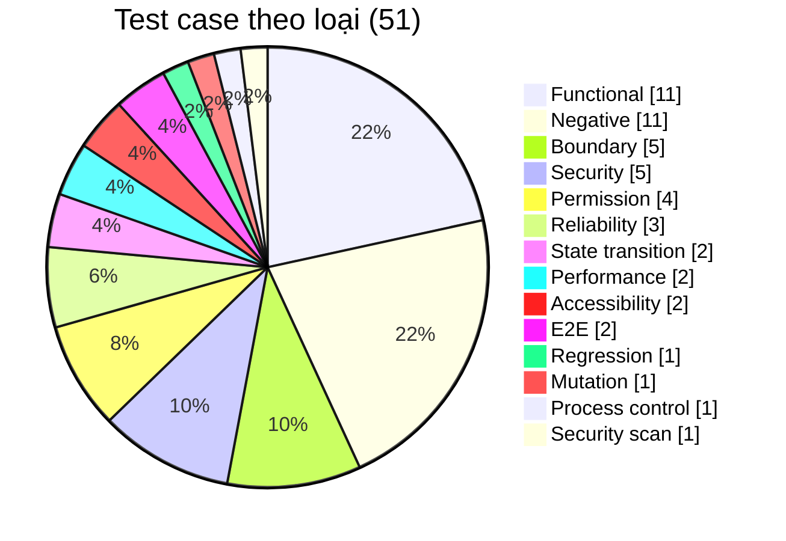

# Test Cases — LeaveFlow v1.1 (IEEE 829)

| Thuộc tính | Giá trị |
|---|---|
| Mã tài liệu | TC-LF-001 · v1.1 (R1.1) |
| Owner | Nguyễn Trần Hà |
| Ngày | 2026-11-02 |
| Commit được test | `31ac9c5` (working tree sạch) |
| Môi trường | win32 10.0.19045, Node v22.0.0; UI: Browser pane (Chromium) 800 px |
| Run id | `RUN-2026-11-02-31ac9c5-local-node22` |
| Prompt | `verification/TestCase_RTM_IEEE_829_Prompt.md` v2.0 |

> TC được **dẫn xuất từ AC** trong [USER_STORIES](../03-analysis/USER_STORIES.md), không từ code (RISK-04). Tên test tự động bắt đầu bằng mã `TC-xx` để RTM đối chiếu máy móc với `junit.xml`.

## 1. Phân bố

| Level | Số TC | File / cách chạy |
|---|---|---|
| Unit | 28 | `tests/unit/*.test.js` |
| Integration (HTTP thật) | 6 | `tests/api/*.test.js` (TC-28…32, TC-46) |
| Characterization | 1 | `tests/characterization/api.char.test.js` (TC-43) |
| UI / E2E (thủ công, có ảnh) | 10 | Browser pane, ảnh trong `evidence/ui-2026-11-02/` |
| System (script: capacity, restore, bind, mutation, guard, scan) | 6 | `scripts/capacity-check.js`, lệnh trong RUNBOOK — `evidence/ops-2026-11-02/` |

## 2. Test case tự động (TC-01 … TC-32, TC-43, TC-45, TC-46)

| ID | Tiêu đề | Traces | P | Loại | Tiền điều kiện | Bước | Dữ liệu | Kết quả mong đợi | Evidence | File |
|---|---|---|---|---|---|---|---|---|---|---|
| TC-01 | Đếm ngày công loại trừ T7, CN | AC-01.1 · FR-02 · US-01 | P0 | Boundary | — | Gọi `countWorkingDays` với 6 cặp ngày | T2–T6 09–13/11; T2–CN; 1 ngày; chỉ T7–CN; T6→T2; khoảng đảo | 5; 5; 1; 0; 2; 0 | assert trong `test-spec.log` | `leave.domain.test.js` |
| TC-02 | Đơn hợp lệ được chuẩn hóa | AC-01.1 · FR-01, FR-02 · US-01 | P0 | Functional | today=2026-11-02 | `validateNewRequest` với type " annual ", lý do có khoảng trắng | ANNUAL 2026-11-09→13 | type=ANNUAL, reason trim, days=5 | assert deepEqual | `leave.domain.test.js` |
| TC-03 | Từ chối loại nghỉ không hợp lệ | AC-01.2 · FR-02 · US-01 | P0 | Negative | — | Gửi type HOLIDAY / thiếu / body null | HOLIDAY, undefined, null | VALIDATION_ERROR "type phải là một trong…" | assert.throws | `leave.domain.test.js` |
| TC-04 | Từ chối ngày sai định dạng / không tồn tại | AC-01.2 · FR-02 · US-01 | P0 | Negative | — | Gửi 09/11/2026, 2026-02-30, 2026-13-01, số | như cột Steps | VALIDATION_ERROR startDate/endDate | assert.throws | `leave.domain.test.js` |
| TC-05 | endDate < startDate bị từ chối | AC-01.2 · FR-02 · US-01 | P0 | Negative | — | start 13/11, end 09/11 | — | "endDate phải lớn hơn hoặc bằng startDate" | assert.throws | `leave.domain.test.js` |
| TC-06 | Ngày quá khứ bị từ chối, hôm nay hợp lệ | AC-01.2 · FR-02 · US-01 | P0 | Boundary | today=2026-11-02 | start 01/11; start=end=02/11 | — | lỗi "quá khứ"; hôm nay → days=1 | assert | `leave.domain.test.js` |
| TC-07 | Đơn vắt sang năm khác bị từ chối | AC-01.2 · FR-02 · US-01 | P1 | Negative | — | 30/12/2026 → 02/01/2027 | — | "năm khác" | assert.throws | `leave.domain.test.js` |
| TC-08 | Khoảng chỉ có cuối tuần bị từ chối | AC-01.2 · FR-02 · US-01 | P1 | Boundary | — | 14–15/11/2026 (T7–CN) | — | "ít nhất 1 ngày làm việc" | assert.throws | `leave.domain.test.js` |
| TC-09 | Lý do bắt buộc, ≤ 200 ký tự | AC-01.2 · FR-02 · US-01 | P0 | Boundary | — | reason "   ", 201 ký tự, 200 ký tự | — | 2 lỗi; 200 ký tự hợp lệ | assert | `leave.domain.test.js` |
| TC-10 | State machine chỉ chuyển từ PENDING | AC-03.2, AC-05.2 · FR-06, FR-08 · US-03, US-05 | P0 | State transition | — | `assertTransition` mọi cặp | PENDING→3 đích; 3 trạng thái cuối→CANCELLED; UNKNOWN | 3 hợp lệ; còn lại INVALID_STATE | assert | `leave.domain.test.js` |
| TC-11 | Tính số dư theo năm, chỉ ANNUAL | AC-02.1 · FR-04 · US-02 | P0 | Functional | — | `computeBalance` với 5 đơn trộn loại/trạng thái/năm | APPROVED 3, PENDING 2, REJECTED 4, SICK 2, năm 2025 5 | used 3, pending 2, available 7 | assert deepEqual | `leave.domain.test.js` |
| TC-12 | Tạo đơn → PENDING, approver, lịch sử | AC-01.1 · FR-01, FR-10 · US-01, US-07 | P0 | Functional | Seed; clock 2026-11-02 | u1 tạo đơn mặc định | ANNUAL 09–13/11 | LR-0001, PENDING, 5 ngày, approver u3, history [null→PENDING by u1] | assert | `leave.service.test.js` |
| TC-13 | Quản lý không được tạo đơn | AC-01.4 · FR-09 · US-01 | P0 | Permission | Seed | u3 tạo đơn | — | FORBIDDEN | assert.throws | `leave.service.test.js` |
| TC-14 | Chặn đơn trùng; hủy rồi thì được | AC-01.3 · FR-03 · US-01 | P0 | Negative | u1 có đơn 09–13/11 | Tạo SICK 13–16/11; hủy đơn đầu; tạo lại; u2 tạo cùng ngày | — | CONFLICT có mã đơn; sau hủy tạo được; u2 tạo được | assert | `leave.service.test.js` |
| TC-15 | Không vượt số dư (biên 12/13) | AC-02.2 · FR-04 · US-02 | P0 | Boundary | u1 số dư 12 | Tạo 16/11→02/12 (13 ngày); 16/11→01/12 (12); thêm 1 ngày | — | "cần 13 ngày, còn 12"; 12 ngày OK; available 0 → lỗi | assert | `leave.service.test.js` |
| TC-16 | SICK/UNPAID không trừ phép năm | AC-02.3 · FR-04 · US-02 | P1 | Functional | Seed | u1 tạo SICK 13 ngày, UNPAID 5 ngày | — | balance 12/0/0/12 | assert deepEqual | `leave.service.test.js` |
| TC-17 | Hủy: chỉ chủ đơn, chỉ PENDING | AC-03.1, AC-03.2, AC-03.3 · FR-06, FR-09 · US-03 | P1 | Permission | u1 có đơn | u2 hủy; u1 hủy; hủy lại; hủy đơn APPROVED | — | FORBIDDEN; CANCELLED; INVALID_STATE; INVALID_STATE | assert | `leave.service.test.js` |
| TC-18 | Duyệt → APPROVED, trừ phép | AC-05.1, AC-02.1 · FR-08, FR-04 · US-05, US-02 | P0 | Functional | u1 có đơn 5 ngày | u3 approve với nhận xét có khoảng trắng | " Ok, chúc vui " | APPROVED, comment trim; balance used 5, available 7 | assert | `leave.service.test.js` |
| TC-19 | Từ chối bắt buộc lý do ≤ 200 | AC-06.1, AC-06.2 · FR-08 · US-06 | P0 | Negative | u1 có đơn | reject với "  ", thiếu, 201 ký tự, hợp lệ | "Trùng lịch release" | 3 lỗi VALIDATION; REJECTED; available 12 | assert | `leave.service.test.js` |
| TC-20 | Chỉ quản lý trực tiếp được duyệt | AC-08.1 · FR-09 · US-08 | P0 | Permission | Thêm u4 (MANAGER khác), u5 | u2, u1, u4 approve/reject; u3 approve | — | 3×FORBIDDEN (+reject u4); u3 APPROVED | assert | `leave.service.test.js` |
| TC-21 | Không xử lý lại đơn đã xử lý | AC-05.2 · FR-08 · US-05 | P0 | State transition | Đơn APPROVED | approve lại; reject | — | INVALID_STATE ×2 | assert.throws | `leave.service.test.js` |
| TC-22 | Chi tiết + lịch sử, đúng người xem | AC-07.1, AC-07.2 · FR-10, FR-09 · US-07 | P1 | Permission | Đơn bị u3 từ chối | u1, u3 xem; u2, u4 xem | "Thiếu người trực" | 2 dòng lịch sử, comment, actorName "Lê Minh Chi"; u2/u4 FORBIDDEN | assert | `leave.service.test.js` |
| TC-23 | Danh sách mine/team/lọc/quyền | AC-02.4, AC-04.1, AC-04.2 · FR-05, FR-07 · US-02, US-04 | P0 | Functional | u1, u2 (nhóm u3), u5 (nhóm u4) có đơn | list mine u1; team u3; team PENDING; team bởi u1; scope=all | — | đúng tập đơn, có employeeName; FORBIDDEN; VALIDATION_ERROR | assert | `leave.service.test.js` |
| TC-24 | Thiếu/sai định danh | AC-08.2 · FR-09 · US-08 | P0 | Security | — | authenticate(undefined), ("u999") | — | UNAUTHENTICATED ×2 | assert.throws | `leave.service.test.js` |
| TC-25 | Đơn không tồn tại → NOT_FOUND | AC-07.1 · FR-10 · US-07 | P1 | Negative | — | get/approve/cancel LR-9999 | — | NOT_FOUND ×3 | assert.throws | `leave.service.test.js` |
| TC-26 | Dữ liệu bền vững qua restart, ghi nguyên tử | NFR-03 · NFR-03 · — | P0 | Reliability | Thư mục tạm | Tạo+duyệt đơn với file; kiểm tra .tmp; tạo store mới cùng file | — | file tồn tại, không còn .tmp; đơn APPROVED, 2 history | assert | `jsonStore.test.js` |
| TC-27 | Sinh mã tuần tự, trả bản sao | AC-01.1 · FR-01 · US-01 | P1 | Functional | Store rỗng | nextRequestId; insert; sửa bản sao | — | LR-0001→LR-0002; dữ liệu gốc không đổi; seed không bị mutate | assert | `jsonStore.test.js` |
| TC-28 | Endpoint công khai & 401 | AC-08.2, AC-02.1 · FR-09, FR-04 · US-08, US-02 | P0 | Security | Server port ngẫu nhiên | GET /health, /users, /me (không header), /me (u1) | — | 200 ok; 3 users; 401 UNAUTHENTICATED; available 12 | HTTP response | `api.test.js` |
| TC-29 | E2E: tạo → duyệt → số dư; từ chối; hủy | AC-01.1, AC-04.1, AC-05.1, AC-06.2, AC-03.1 · FR-01, FR-05, FR-06, FR-07, FR-08 · US-01, US-03, US-04, US-05, US-06 | P0 | Functional | Server mới | POST tạo (u1) → GET team PENDING (u3) → approve → GET /me → GET detail → u2 tạo SICK → reject → u2 tạo UNPAID → cancel | — | 201 LR-0001; inbox [LR-0001]; APPROVED; used 5/available 7; 2 history; REJECTED; CANCELLED | HTTP response | `api.test.js` |
| TC-30 | Ánh xạ lỗi → HTTP status | AC-01.2, AC-01.3, AC-02.2, AC-03.2 · FR-02, FR-03, FR-04, NFR-04 · US-01, US-02, US-03 | P0 | Negative | Server mới | Gửi 10 request lỗi | type X; JSON hỏng; u3 tạo; LR-0404; /api/unknown; DELETE; trùng; 11 ngày; hủy 2 lần; body 11 KB | 400, 400, 403, 404, 404, 405, 409, 422, 409, 413 đúng `code` | HTTP response | `api.test.js` |
| TC-31 | Phục vụ UI, chặn path traversal | NFR-04 · NFR-04, NFR-02 · — | P0 | Security | Server mới | GET /, /app.js, /styles.css, /../src/server.js, /%2e%2e/src/server.js, /missing.html | — | 200 đúng content-type; 404 ×3 | HTTP response | `api.test.js` |
| TC-43 | Characterization: hành vi API v1.0.0 giữ nguyên (golden master 18 tương tác) | NFR-09 · NFR-09 · — | P0 | Regression | Server mới, golden `golden-v1.0.0.json` ghi trước khi sửa R1.1 | Chạy 18 request kịch bản; so sánh status + body (mask timestamp) với golden | Kịch bản cố định | deepEqual với golden | `test-spec.log`, `junit.xml` | `api.char.test.js` |
| TC-45 | Đơn trùng với đơn ĐÃ DUYỆT bị chặn (diệt mutant còn sống) | AC-01.3 · FR-03 · US-01 | P0 | Negative | u1 có đơn APPROVED 09–13/11 | Tạo SICK 13/11 | — | CONFLICT, nêu mã đơn (APPROVED) | assert | `mutation-gaps.test.js` |
| TC-46 | Body không phải UTF-8 → 400; UTF-8 tiếng Việt lưu nguyên vẹn | AC-01.2, NFR-04 · FR-02, NFR-04 · US-01 | P1 | Negative | Server mới | POST body mã hóa latin1; POST body UTF-8 | "Chúc mừng" | 400 BAD_JSON; 201 với reason nguyên vẹn | HTTP response | `encoding.test.js` |
| TC-32 | Hiệu năng p95 < 200 ms | NFR-01 · NFR-01 · — | P1 | Performance | Server mới, 1 đơn | 200 GET tuần tự xen kẽ /me và list | — | p95 < 200 ms (log `p95=` trong diagnostic) | `test-spec.log` dòng `ℹ p95=` | `api.test.js` |

## 3. Test case thủ công / script hệ thống (TC-33 … TC-42, TC-44, TC-47 … TC-51)

### TC-33 — UI: nhân viên gửi đơn hợp lệ

| Trường | Nội dung |
|---|---|
| Traces | AC-01.1, AC-02.1 · FR-01, FR-04, FR-05, NFR-02 · US-01, US-02 |
| Priority | P0 |
| Type | Functional / UI |
| Preconditions | App :3000, user u1, dữ liệu trống |
| Steps | 1. Chọn ANNUAL 2. Từ 09/11/2026 3. Đến 13/11/2026 4. Lý do "Du lịch gia đình" 5. Gửi đơn |
| Test data | như Steps |
| Expected result | Toast "Đã gửi đơn LR-0001 (5 ngày công)"; dòng mới *Chờ duyệt*; thẻ Đang chờ 5, Còn lại 7; toast không che nút |
| Evidence method | Ảnh 03 (lần 1, DEF-001), ảnh 06 (retest) |

### TC-34 — UI: lỗi validation hiển thị inline

| Trường | Nội dung |
|---|---|
| Traces | AC-01.2 · FR-02, NFR-02 · US-01 |
| Priority | P0 |
| Type | Negative / UI |
| Preconditions | App :3000, user u1 |
| Steps | Nhập Từ 13/11, Đến 09/11, lý do, bấm Gửi |
| Test data | — |
| Expected result | Chữ đỏ "endDate phải lớn hơn hoặc bằng startDate", không tạo đơn |
| Evidence method | Ảnh 02 |

### TC-35 — UI: quản lý duyệt từ hộp duyệt

| Trường | Nội dung |
|---|---|
| Traces | AC-04.1, AC-05.1 · FR-07, FR-08, NFR-02 · US-04, US-05 |
| Priority | P0 |
| Type | Functional / UI |
| Preconditions | LR-0001 PENDING của u1 |
| Steps | Chọn u3 → thấy LR-0001 → bấm Duyệt |
| Test data | — |
| Expected result | Đơn rời hộp duyệt, vào "Lịch sử đơn của nhóm" với badge Đã duyệt; mọi bảng có empty-state |
| Evidence method | Ảnh 04 (DEF-002), ảnh 07, ảnh 09 (retest empty-state) |

### TC-36 — UI: chi tiết đơn và lịch sử

| Trường | Nội dung |
|---|---|
| Traces | AC-07.1 · FR-10, NFR-02 · US-07 |
| Priority | P1 |
| Type | Functional / UI |
| Preconditions | LR-0001 APPROVED |
| Steps | Bấm mã LR-0001 |
| Test data | — |
| Expected result | Dialog có thông tin đơn + 2 dòng lịch sử với **tên** người thực hiện |
| Evidence method | Ảnh 05 (DEF-003), ảnh 08 (retest) |

### TC-37 — Dữ liệu còn sau khi restart server thật

| Trường | Nội dung |
|---|---|
| Traces | NFR-03 · NFR-03 · — |
| Priority | P0 |
| Type | Reliability |
| Preconditions | LR-0001 APPROVED trong `app/data/db.json` |
| Steps | Dừng server (preview_stop) → khởi động lại → mở trang với u3 |
| Test data | — |
| Expected result | LR-0001 vẫn *Đã duyệt* |
| Evidence method | Ảnh 07 |

### TC-38 — UI: escape HTML trong lý do (XSS)

| Trường | Nội dung |
|---|---|
| Traces | NFR-04 · NFR-04 · — |
| Priority | P0 |
| Type | Security / UI |
| Preconditions | Instance tạm :3001, dữ liệu trống |
| Steps | POST đơn với lý do chứa `` + `<b>`; mở hộp duyệt u3; đếm phần tử img/b trong bảng |
| Test data | `<b>XSS</b>` |
| Expected result | Hiển thị nguyên văn dạng text; 0 ``, 0 `<b>` trong DOM; không alert |
| Evidence method | Ảnh 10 + kết quả DOM query |

### TC-39 — Capacity: đọc/ghi ở mức tải tối đa v1.0

| Trường | Nội dung |
|---|---|
| Traces | NFR-07 · NFR-07, NFR-01 · — |
| Priority | P2 |
| Type | Performance |
| Preconditions | File dữ liệu sinh sẵn 20 user, 10 000 đơn (3.59 MB) |
| Steps | `node scripts/capacity-check.js <out>`: 200 GET /me, 200 GET list mine, 200 GET list team, 1 POST tạo đơn |
| Test data | 20 user · 10 000 đơn |
| Expected result | p95 /me và list mine < 200 ms; POST trả 201 |
| Evidence method | `TC-39-capacity.json` |

### TC-40 — Diễn tập backup → hỏng file → restore

| Trường | Nội dung |
|---|---|
| Traces | NFR-08 · NFR-08, NFR-03 · — |
| Priority | P1 |
| Type | Reliability |
| Preconditions | Server chạy với DATA_FILE tạm, 1 đơn |
| Steps | 1. Tạo đơn 2. Dừng, backup 3. Cắt cụt db.json 4. Khởi động (phải lỗi) 5. Restore 6. Khởi động, đọc LR-0001 |
| Test data | db.json bị cắt còn 50 byte |
| Expected result | Bước 4 báo SyntaxError; sau restore health ok, LR-0001 còn; thời gian phục hồi ≪ RTO 1 giờ |
| Evidence method | `TC-40-restore-drill.log` |

### TC-41 — UI: mobile 375 px, touch target ≥ 44 px, tương phản ≥ 4.5:1

| Trường | Nội dung |
|---|---|
| Traces | NFR-02 · NFR-02 · — |
| Priority | P1 |
| Type | Accessibility / UI |
| Preconditions | App :3000 sau sửa DEF-005 |
| Steps | 1. Đặt viewport mobile 375×812 2. Tải trang 3. Đo scrollWidth và chiều cao nút nhỏ nhất 4. Tính tỉ lệ tương phản các cặp màu trong styles.css |
| Test data | viewport 375×812 |
| Expected result | Không cuộn ngang; mọi nút ≥ 44 px; mọi cặp màu ≥ 4.5:1 |
| Evidence method | Ảnh 13 + JSON đo + bảng tương phản |

### TC-42 — Server chỉ lắng nghe trên loopback

| Trường | Nội dung |
|---|---|
| Traces | NFR-04 · NFR-04 · — |
| Priority | P0 |
| Type | Security |
| Preconditions | App khởi động bằng `npm start` (HOST mặc định) |
| Steps | Chạy `netstat -ano` và lọc cổng 3000 |
| Test data | — |
| Expected result | LISTENING trên 127.0.0.1:3000, không có 0.0.0.0 |
| Evidence method | `TC-42-bind-check.txt` |

### TC-44 — Mutation score ≥ 80 % (trước 93.8 % → sau 100 %)

| Trường | Nội dung |
|---|---|
| Traces | NFR-05 · NFR-05 · — |
| Priority | P1 |
| Type | Mutation |
| Preconditions | Bộ test unit + integration |
| Steps | `node scripts/mutation.js <out>`: 16 mutant thủ công trên domain/service |
| Test data | 16 mutant |
| Expected result | Score ≥ 80 %; mọi mutant hợp lệ |
| Evidence method | JSON trước/sau |

### TC-47 — Test đã duyệt không bị sửa (hook + CI guard)

| Trường | Nội dung |
|---|---|
| Traces | NFR-09 · NFR-09 · — |
| Priority | P0 |
| Type | Process control |
| Preconditions | `.claude/approved-tests.txt` (SHA-256) |
| Steps | `node scripts/approved-tests.js check`; thử hook với đường dẫn test đã duyệt |
| Test data | api.test.js |
| Expected result | check OK; hook exit 2 BLOCKED |
| Evidence method | log |

### TC-48 — Scan: 0 dependency, 0 secret, 0 sink nguy hiểm

| Trường | Nội dung |
|---|---|
| Traces | NFR-04 · NFR-04, NFR-06 · — |
| Priority | P1 |
| Type | Security scan |
| Preconditions | Repo hiện tại |
| Steps | `node scripts/scan.js` |
| Test data | 80 file |
| Expected result | scan: OK |
| Evidence method | log |

### TC-49 — E2E nhân viên R1.1: xem trước ngày công → gửi → vòng số dư → lọc → lịch

| Trường | Nội dung |
|---|---|
| Traces | AC-09.1, AC-11.1, AC-01.1, AC-02.1 · FR-11, FR-13, FR-01, FR-04 · US-09, US-11, US-01, US-02 |
| Priority | P0 |
| Type | E2E / UI |
| Preconditions | App :3000 dữ liệu demo, user u1 |
| Steps | 1. Chọn 16–20/11 → xem trước 2. Gửi 3. Mở Đơn của tôi + chip lọc 4. Mở Lịch nghỉ |
| Test data | ANNUAL 16–20/11 |
| Expected result | Xem trước "5 ngày công · còn 2"; toast LR-0006; vòng số dư cập nhật; lịch hiển thị ô xanh/vàng |
| Evidence method | Ảnh 20–25 |

### TC-50 — E2E quản lý R1.1: hộp duyệt → từ chối qua modal → tìm kiếm → CSV → chi tiết → lịch nhóm

| Trường | Nội dung |
|---|---|
| Traces | AC-04.1, AC-06.1, AC-07.1, AC-10.1, AC-10.2, AC-12.1, AC-11.1 · FR-07, FR-08, FR-10, FR-12, FR-14, FR-13 · US-04, US-06, US-07, US-10, US-12, US-11 |
| Priority | P0 |
| Type | E2E / UI |
| Preconditions | Dữ liệu demo, user u3 |
| Steps | 1. Hộp duyệt 2. Từ chối LR-0003 không lý do → lỗi → nhập lý do 3. Đơn của nhóm, gõ "Bình" 4. Xuất CSV 5. Mở LR-0005 6. Lịch nhóm |
| Test data | "Trùng lịch trực hệ thống cuối tháng" |
| Expected result | Modal chặn lý do trống; REJECTED; tìm "Bình" ra 3 đơn, chữ không nhân đôi; CSV 1+3 dòng; timeline 2 bước có tên; lịch đủ người |
| Evidence method | Ảnh 26–31, 34 + JSON CSV |

### TC-51 — Giao diện tối + tương phản cả hai theme ≥ 4.5:1; mobile 375 px

| Trường | Nội dung |
|---|---|
| Traces | NFR-02 · NFR-02 · — |
| Priority | P1 |
| Type | Accessibility / UI |
| Preconditions | App v1.1 |
| Steps | 1. Bật giao diện tối 2. Tính tương phản 34 cặp màu 3. Mobile 375 px trên 3 trang |
| Test data | — |
| Expected result | 0 cặp < 4.5:1; không tràn; vùng chạm ≥ 44 px |
| Evidence method | Ảnh 32/33/35 + txt + JSON |

