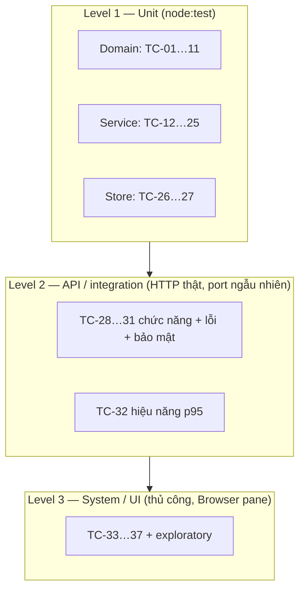

# Test Plan — LeaveFlow v1.0 (IEEE 829-2008)

| Thuộc tính | Giá trị |
|---|---|
| Mã tài liệu | TP-LF-001 |
| Phiên bản | 1.2 (R1.1) |
| Trạng thái | Draft v1.1 — **chưa có chữ ký phê duyệt**; các run đã thực hiện trước khi plan được ký (ghi nhận là sai lệch V-6 trong TEST_REPORT) |
| Owner | Nguyễn Trần Hà |
| Ngày | 2026-11-02 |
| Prompt | `verification/TestPlan_IEEE 829-2008_prompt.md` |
| Checklist | `verification/Test_Plan_IEEE_829_Checklist.xlsx` |
| Đầu vào | [PRD](../03-analysis/PRD.md), [USER_STORIES](../03-analysis/USER_STORIES.md), [SAD](../04-design/SAD.md), [api.md](../04-design/api.md), [SDP](../05-development/Software_Development_Plan.md) |

## 1. Test plan identifier
TP-LF-001 cho release LeaveFlow v1.0.0.

## 2. Introduction
Xác minh LeaveFlow v1.0 — web app quản lý đơn nghỉ phép một tiến trình Node.js (SAD §2) — đáp ứng 10 FR,
8 NFR và 21 AC của 8 user story trước khi review và release. Tài liệu tham chiếu: PRD-LF-001 v1.1,
US-LF-001, SAD-LF-001, API-LF-001, SDP-LF-001, IEEE 829-2008.

## 3. Test items

| Item | Phiên bản | Vị trí |
|---|---|---|
| Domain rules (CMP-03) | 1.0.0 | `app/src/domain/leave.js` |
| LeaveService (CMP-02) | 1.0.0 | `app/src/service/leaveService.js` |
| JsonStore (CMP-04) | 1.0.0 | `app/src/repo/jsonStore.js` |
| HTTP adapter (CMP-01) | 1.0.0 | `app/src/server.js` |
| Web UI (CMP-05) | 1.0.0 | `app/public/` |

## 4. Features to be tested
FR-01…FR-10 (toàn bộ), NFR-01…NFR-08.

## 5. Features not to be tested

| Mục | Lý do |
|---|---|
| Đăng nhập thật, SSO | Ngoài phạm vi (ADR-003) |
| Đa trình duyệt, mobile | Chỉ kiểm thử Chromium của Claude desktop Browser pane; ghi nhận rủi ro |
| Tải đồng thời nhiều client, nhiều tiến trình | ADR-002 — chỉ 1 tiến trình; NFR-01 đo tuần tự |
| Ngày lễ, nửa ngày | Ngoài phạm vi |

## 6. Approach

| Kỹ thuật | Áp dụng |
|---|---|
| Equivalence partitioning | Loại nghỉ, vai trò, trạng thái |
| Boundary value | Ngày = hôm nay / hôm qua; lý do 200/201 ký tự; số dư 12/13 ngày; T6→T2 |
| State transition | Mọi cặp (from, to) của state machine — TC-10, TC-17, TC-21 |
| Decision table | Phân quyền vai trò × chủ đơn × approver — TC-20, TC-22 |
| Negative / security | 401/403/404/405/409/413/422, path traversal, JSON hỏng |
| Exploratory | UI: một phiên khám phá theo 2 persona (An, Chi) |

**Nguyên tắc chống "test tự chứng minh" (RISK-04):** TC được dẫn xuất từ AC trong USER_STORIES, không từ code; dữ liệu ngày dùng đồng hồ cố định `2026-11-02 (thứ Hai)`.

## 7. Item pass/fail criteria
- Unit/API: assertion pass. NFR-01: p95 < 200 ms. NFR-05: line coverage ≥ 80 % mỗi file `src/`.
- UI: kết quả quan sát khớp "Expected" trong TEST_CASES; có ảnh chụp làm evidence.

## 8. Suspension & resumption
Dừng nếu lint fail hoặc > 20 % test fail (lỗi môi trường); tiếp tục khi build lại xanh.
Không sửa source/test giữa một run; lỗi → `DEF-xxx`, sửa ở run sau.

## 9. Test deliverables
[TEST_CASES.md](./TEST_CASES.md) · [RTM.md](./RTM.md) · `evidence/<run-id>/` · [TEST_REPORT.md](./TEST_REPORT.md)

## 10. Environment

| Thành phần | Giá trị |
|---|---|
| OS | Windows 10 Pro 10.0.19045 (x64) |
| Runtime | Node.js v22.0.0 |
| Trình duyệt | Browser pane (Chromium) của Claude desktop, viewport 800×600 |
| Dữ liệu | Seed 3 user (u1, u2 EMPLOYEE → u3 MANAGER); test thêm u4/u5 qua helper |
| CI | GitHub Actions ubuntu-latest, Node 22 |

## 11. Responsibilities & schedule

| # | Việc (theo thứ tự) | Người thực hiện | Người chịu trách nhiệm | Ngày |
|---|---|---|---|---|
| 1 | Thiết kế test case từ AC (TEST_CASES) | AI agent | Owner | 2026-11-02 |
| 2 | Chuẩn bị dữ liệu test (seed, helper, đồng hồ cố định) | AI agent | Owner | 2026-11-02 |
| 3 | Chạy test tự động + lưu evidence | AI agent | Owner | 2026-11-02 |
| 4 | Kiểm thử UI thủ công + chụp evidence | Agent điều khiển Browser pane | Owner | 2026-11-02 |
| 5 | Phân loại defect, quyết định suspend/resume | Owner | Owner | Trong mỗi run |
| 6 | Viết TEST_REPORT, RTM | AI agent | Owner | 2026-11-02 |
| 7 | Duyệt plan + kết quả | QA reviewer (mentor) | Mentor | Trước 2026-11-05 (mốc release, SDP §4) |

**Nhân sự & đào tạo:** 1 owner (học viên) + AI agent; không cần tester chuyên trách. Owner cần nắm `node:test` và
kỹ thuật boundary/state-transition — học qua prompt `verification/TestCase_RTM_IEEE_829_Prompt.md`; QA reviewer cần
đọc được junit/log Node.

## 12. Entry / exit criteria

| | Tiêu chí |
|---|---|
| **Entry** | Plan baseline `plan-v1` (commit `31ac9c5`, chưa ký); TASK-01…06 Done; lint pass |
| **Exit** | 100 % AC có ≥ 1 TC PASS; NFR đo đạt ngưỡng hoặc ghi rõ chưa đo; 0 defect High mở; TEST_REPORT có GO/NO-GO |

## 13. Risks

| Rủi ro | Giảm thiểu |
|---|---|
| Test phụ thuộc ngày hệ thống | Đồng hồ inject (`fixedClock`) |
| Coverage Node 22 là experimental | Lưu nguyên log `coverage.log` làm evidence |
| UI chỉ test thủ công | Chụp màn hình từng bước; tự động hóa E2E ở v1.1 |

## 14. Approvals

| Vai trò | Tên | Quyết định | Ngày |
|---|---|---|---|
| Tác giả | Nguyễn Trần Hà (soạn cùng AI agent) | Đề xuất | 2026-11-02 |
| QA reviewer | Mentor khóa SDLC | ☐ Approve | |
| PO | Nguyễn Trần Hà | ☐ Approve | |

## 15. Bổ sung cho R1.1 (CR-R11-01)

| Hạng mục | Cách làm | Tiêu chí đạt (viết trước khi chạy) |
|---|---|---|
| Characterization | Ghi golden master hành vi API v1.0.0 **trước** khi sửa (TC-43) | Khớp 100 % trước và sau mỗi bước |
| Integration | `tests/api/*.test.js` trên server HTTP thật (TC-28…32, TC-46) | 100 % pass |
| Mutation | `scripts/mutation.js`, 16 mutant trên domain/service (TC-44) | Score ≥ 80 %; đo trước và sau |
| Test đã duyệt | SHA-256 trong `.claude/approved-tests.txt`; hook PreToolUse + bước CI (TC-47) | Không file nào đổi khi chưa phê duyệt lại |
| Scan | `scripts/scan.js` — dependency, secret, sink nguy hiểm (TC-48) | 0 finding |
| E2E UI | Kịch bản TC-49…51, chụp ảnh từng bước, cả 2 theme + mobile 375 px | Kết quả khớp Expected; defect ghi DEF-xxx |
| NotRun | Đếm riêng ở TEST_REPORT §5, có lý do + owner | Không tính NotRun là Pass |
