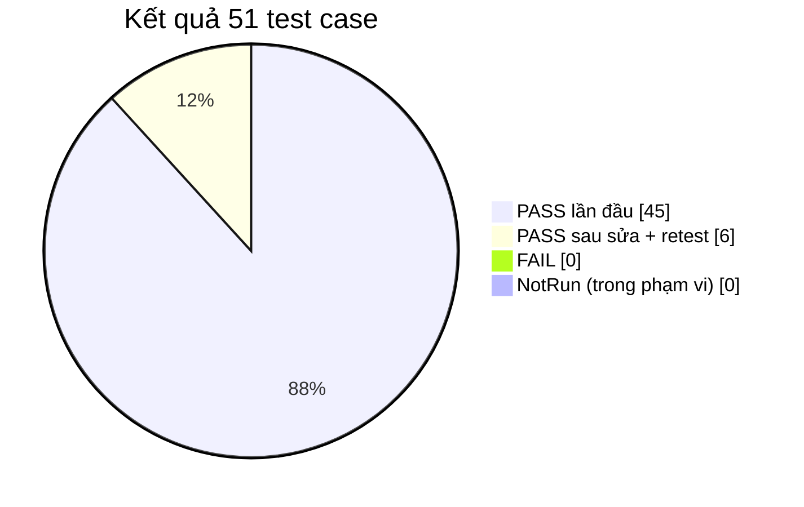
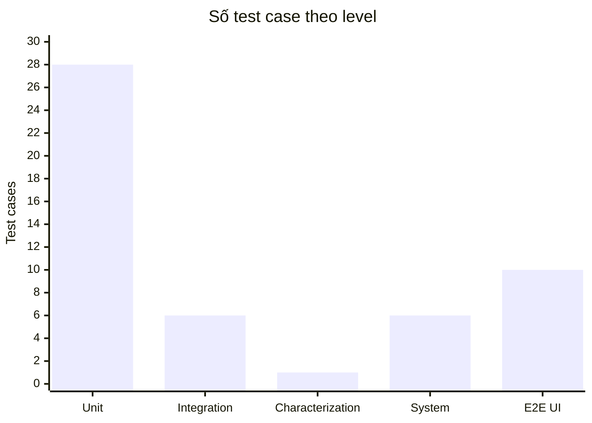
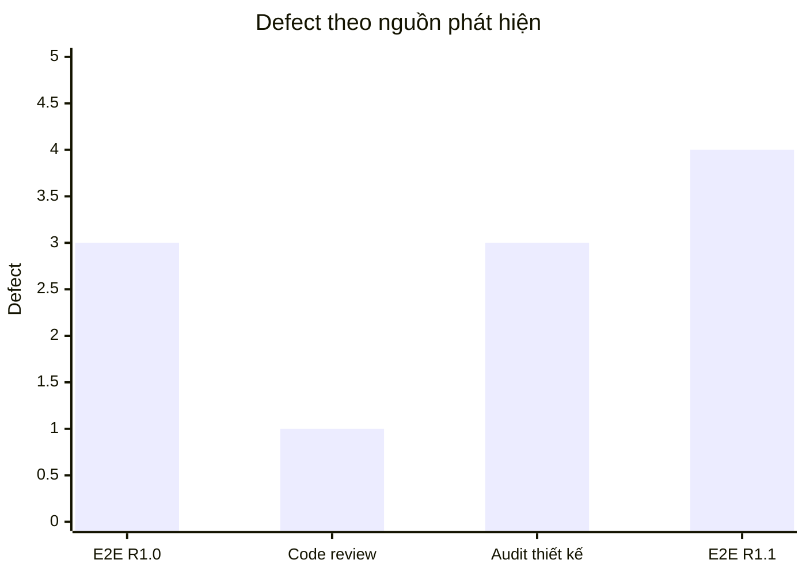

# Test Summary Report — LeaveFlow v1.1 (IEEE 829-2008)

| Thuộc tính | Giá trị |
|---|---|
| Mã báo cáo | TSR-LF-001 |
| Phiên bản | 2.0 (R1.1 — thay thế bản 1.1 cho R1.0) |
| Trạng thái | Final — chờ QA reviewer + Release owner ký |
| Owner | Nguyễn Trần Hà |
| Approvers | Mentor khóa SDLC (QA reviewer) · Nguyễn Trần Hà (Release owner) |
| Ngày | 2026-11-02 |
| Commit được test | **`31ac9c5`** trên nhánh `feature/leaveflow-r1.1` — working tree sạch khi chạy; tag `r1.1` |
| Môi trường | Windows 10 Pro 10.0.19045 x64 · Node.js v22.0.0 · Claude Browser pane (Chromium) 800 px + mobile 375 px |
| Run id | [`RUN-2026-11-02-31ac9c5-local-node22`](./evidence/RUN-2026-11-02-31ac9c5-local-node22/) (chạy trên commit `31ac9c5`; run trước commit giữ lại ở [`RUN-…-6996dae-…`](./evidence/RUN-2026-11-02-6996dae-local-node22/) làm lịch sử) · [`ops-2026-11-02`](./evidence/ops-2026-11-02/) · UI R1.0 [`ui-2026-11-02`](./evidence/ui-2026-11-02/) · UI R1.1 [`ui-r1.1-2026-11-02`](./evidence/ui-r1.1-2026-11-02/) |
| Prompt | `verification/TestReport_IEEE_829_Prompt.md` v2.0 |
| Đầu vào | [TEST_PLAN](./TEST_PLAN.md) · [TEST_CASES](./TEST_CASES.md) · [RTM](./RTM.md) · [CR-R11-01](../12-maintenance/CR-R11-01.md) |

---

## 1. Summary

Đã kiểm thử LeaveFlow **v1.0** và bản bảo trì **v1.1** (nâng cấp giao diện + 4 tính năng mới, CR-R11-01) ở 5 level:
unit, integration (HTTP thật), characterization, system/script và E2E giao diện có ảnh chụp.
**51/51 test case PASS** (35 tự động + 16 thủ công/script), **26/26 acceptance criteria**, **9/9 NFR** có evidence, **0 GAP**, **0 NotRun trong phạm vi**
(các mục ngoài phạm vi liệt kê riêng ở §5). Phát hiện **11 defect** (4 Medium, 7 Low) — **11/11 đã sửa và retest PASS**.
Chất lượng bộ test được đo bằng **mutation score: 93.8 % → 100 %** (16 mutant), không chỉ coverage (line thấp nhất `src/` 91.67 %).
Hành vi API v1.0 được khóa bằng **golden master 18 tương tác** — PASS trước và sau mọi bước R1.1.

> **Khuyến nghị: GO WITH CONDITIONS** cho release `r1.1` — điều kiện ở §7.

## 2. Scope and environment

| Level | Số TC | Công cụ / cách chạy | Evidence |
|---|---|---|---|
| Unit | 28 | `npm run test:unit` (`node:test`) | `test-spec.log`, `junit.xml` |
| **Integration** (server HTTP thật, cổng ngẫu nhiên) | 6 | `npm run test:integration` | `test-spec.log`, `junit.xml` |
| **Characterization** (golden master v1.0.0) | 1 | `npm run test:char` | `golden-v1.0.0.json`, `junit.xml` |
| System / script | 6 | capacity, restore drill, bind, mutation, approved-test guard, scan | `ops-2026-11-02/` |
| **E2E giao diện** (thủ công, Browser pane, ảnh chụp thật) | 10 | Kịch bản TC-33…38, 41, 49…51 | `ui-2026-11-02/`, `ui-r1.1-2026-11-02/` |

Dữ liệu: seed 3 user; test tự động dùng đồng hồ cố định 2026-11-02 (thứ Hai); E2E dùng dữ liệu demo tạo qua API (6 đơn).
Trên commit `31ac9c5` còn lưu: [`mutation.json`](./evidence/RUN-2026-11-02-31ac9c5-local-node22/mutation.json) (100 %), [`scan.log`](./evidence/RUN-2026-11-02-31ac9c5-local-node22/scan.log), [`approved-tests.log`](./evidence/RUN-2026-11-02-31ac9c5-local-node22/approved-tests.log).
Tái hiện toàn bộ: `cd app && npm run test:report && npm run test:mutation && npm run scan && npm run approved-tests`.

| File evidence của run cuối | Nội dung |
|---|---|
| [`lint.log`](./evidence/RUN-2026-11-02-31ac9c5-local-node22/lint.log) | `lint: OK (20 files checked)` |
| [`test-spec.log`](./evidence/RUN-2026-11-02-31ac9c5-local-node22/test-spec.log) | 35 TC + `ℹ p95=9.66ms max=26.45ms n=200` |
| [`junit.xml`](./evidence/RUN-2026-11-02-31ac9c5-local-node22/junit.xml) | 35 `<testcase>`, 0 `<failure>` — nguồn cột Result của RTM |
| [`coverage.log`](./evidence/RUN-2026-11-02-31ac9c5-local-node22/coverage.log) · [`summary.json`](./evidence/RUN-2026-11-02-31ac9c5-local-node22/summary.json) | Coverage theo file, verdict `PASS` |

## 3. Variances

| # | Sai lệch so với TEST_PLAN | Lý do | Ảnh hưởng |
|---|---|---|---|
| V-1 | Thêm TC-38 (XSS UI) | Phát sinh khi exploratory | Tăng độ phủ bảo mật |
| V-2 | Retest empty-state chạy trên instance tạm `:3001` | Cần dữ liệu trống | Không |
| V-3 | Thư mục run id bị ghi đè bởi lần chạy cuối (cùng ngày + commit gốc) | Chưa commit nên commit id không đổi | Evidence là của mã nguồn **cuối cùng** |
| V-4 | CI GitHub chưa chạy | Chưa push | Xem §5 NotRun |
| V-5…V-8 | Bổ sung TC sau code review và audit (TC-41, 42, 46) | Xác nhận DEF-004…008 | — |
| V-9 | R1.1: thêm TC-43…51 (characterization, mutation, guard, scan, E2E mới) | CR-R11-01 + yêu cầu slide B10 | Test plan v1.1 đã bổ sung |
| V-10 | Các run thực hiện trước khi TEST_PLAN được ký | Chưa có QA reviewer trực tiếp | QA ký hồi tố |

## 4. Coverage and results

### 4.1 Theo level

| Level | TC | PASS | FAIL | NotRun |
|---|---|---|---|---|
| Unit | 28 | 28 | 0 | 0 |
| Integration | 6 | 6 | 0 | 0 |
| Characterization | 1 | 1 | 0 | 0 |
| System / script | 6 | 6 | 0 | 0 |
| E2E UI (ảnh chụp) | 10 | 10 (6 sau retest) | 0 | 0 |
| **Tổng** | **51** | **51** | **0** | **0** |

### 4.2 Acceptance criteria

26/26 AC có ≥ 1 TC PASS (21 AC của R1.0 + 5 AC mới AC-09.1…AC-12.1 của R1.1). Chi tiết hai chiều: [RTM.md](./RTM.md).

### 4.3 NFR so với ngưỡng (viết trước khi đo)

| NFR | Ngưỡng | Đo được | Kết quả | Evidence |
|---|---|---|---|---|
| NFR-01 Performance | p95 < 200 ms | **9.66 ms** (max 26.45, n = 200) | PASS | TC-32 |
| NFR-02 Usability / A11y | tương phản ≥ 4.5:1, chạm ≥ 44 px, không tràn 375 px, label/aria | 34/34 cặp màu đạt ở **cả 2 theme**; 44 px; 0 tràn trên 3 trang | PASS (sau DEF-005, 010, 011) | TC-41, TC-51 |
| NFR-03 Reliability | 0 mất dữ liệu khi restart | 0 | PASS | TC-26, TC-37 |
| NFR-04 Security | 401/403/413/400, traversal, XSS, loopback, UTF-8, scan | Tất cả đạt | PASS | TC-24, 28, 30, 31, 38, 42, 46, 48 |
| NFR-05 Maintainability | line ≥ 80 % mỗi file `src/`; **mutation score ≥ 80 %** | 91.67 %; **93.8 % → 100 %** | PASS | `summary.json`, TC-44 |
| NFR-06 Portability | Node ≥ 22, 0 dependency | 0 dependency (scan) | PASS (local) | TC-48 |
| NFR-07 Capacity | 10 000 đơn, p95 < 200 ms | ≤ 97.32 ms | PASS | TC-39 (chạy trên build R1.0; API R1.1 chỉ thêm kiểm tra UTF-8) |
| NFR-08 Availability | RTO ≤ 1 giờ | restore 3.7 s, dữ liệu còn | PASS | TC-40 |
| NFR-09 Behavior preservation | golden master không đổi; test đã duyệt không bị sửa | 18/18 tương tác khớp; 8/8 file test khớp SHA-256 | PASS | TC-43, TC-47 |

### 4.4 Coverage code (`src/`)

| File | Line % | Branch % | Function % |
|---|---|---|---|
| `src/domain/leave.js` | 100.00 | 100.00 | 100.00 |
| `src/service/leaveService.js` | 100.00 | 100.00 | 96.43 |
| `src/repo/jsonStore.js` | 100.00 | 100.00 | 94.44 |
| `src/data/seed.js` | 100.00 | 100.00 | 100.00 |
| `src/server.js` | 91.67 | 90.77 | 95.24 |

> Coverage cao **không** chứng minh test tốt (slide B10 #9) — vì vậy dùng thêm mutation score.

### 4.5 Mutation testing (TC-44)

| Lần | Mutant hợp lệ | Bị diệt | Sống sót | Score |
|---|---|---|---|---|
| Trước | 16 | 15 | "overlap bỏ qua đơn APPROVED" | **93.8 %** |
| Sau (thêm TC-45) | 16 | 16 | — | **100 %** |

Lần chạy thử đầu tiên ra 87.5 %. Trong đó có một **mutant tương đương** do script viết sai (key bị ghi đè nên code không đổi). Mutant này đã được sửa trước lần đo "Trước".
Evidence: [before](./evidence/ops-2026-11-02/TC-44-mutation-before.json) · [after](./evidence/ops-2026-11-02/TC-44-mutation-after.json).

## 5. What was not tested (NotRun — đếm riêng, không tính là Pass)

| ID | Mục NotRun | Lý do | Rủi ro còn lại | Owner / khi nào |
|---|---|---|---|---|
| NR-01 | Pipeline CI trên GitHub | Đã commit + tag nhưng **chưa push** | Thấp — cùng lệnh đã chạy local trên `31ac9c5` | Nguyễn Trần Hà, khi push |
| NR-02 | Trình duyệt Firefox/Safari, điện thoại thật | Chỉ có Chromium + giả lập 375 px | Thấp | v1.2 |
| NR-03 | Tải đồng thời nhiều client | 1 tiến trình (ADR-002), TC-39 đo tuần tự | Thấp ở quy mô 15 người | v2.0 |
| NR-04 | Nhánh `500 INTERNAL_ERROR`, bootstrap `listen` | Không gây được lỗi mà không sửa code | Thấp | — |
| NR-05 | Múi giờ 00:00–07:00 giờ VN (RISK-03) | Chưa có test | Thấp | v1.2 |
| NR-06 | E2E tự động bằng script (Playwright…) | ADR-001: 0 dependency; E2E làm thủ công có ảnh | Trung bình — hồi quy UI phụ thuộc người chạy | v1.2 |
| NR-07 | Restore kiểm **quyền** file sau khôi phục | Máy cá nhân một user | Thấp | Khi triển khai thật |

## 6. Defects and risks

| ID | Tiêu đề | Sev | Phát hiện bởi | Sửa | Retest | Trạng thái |
|---|---|---|---|---|---|---|
| DEF-001 | Toast che nút Hủy | Low | E2E TC-33 | `styles.css` | TC-33 | Closed |
| DEF-002 | Bảng nhóm thiếu empty-state | Low | E2E TC-35 | `index.html`, `app.js` | TC-35 | Closed |
| DEF-003 | Lịch sử hiện mã user | Low | E2E TC-36 | `leaveService.js` `actorName` | TC-36, TC-22 | Closed |
| DEF-004 | Body JSON không phải object → 500 | Medium | Code review CR-01 | `readJsonBody` | TC-30 | Closed |
| DEF-005 | Badge tương phản < 4.5:1, nút < 44 px | Low | Audit thiết kế | tokens, `min-height` | TC-41 | Closed |
| DEF-006 | `status` không hợp lệ trả `[]` | Low | Audit thiết kế | kiểm tra enum | TC-23 | Closed |
| DEF-007 | Bind mọi interface; nhân viên không có quản lý tạo được đơn | Medium | Audit thiết kế | `HOST=127.0.0.1`, kiểm tra manager | TC-42, TC-13 | Closed |
| DEF-008 | Byte UTF-8 hỏng được lưu thành ký tự `�` (lộ ra khi seed bằng curl Windows) | Medium | **E2E R1.1** TC-49 (ảnh 23) | `TextDecoder(fatal)` → 400 | TC-46, ảnh 24 | Closed |
| DEF-009 | Ô tìm kiếm render lại cả trang → bộ gõ tiếng Việt nhân đôi chữ ("BinhBình") | Medium | **E2E R1.1** TC-50 (ảnh 29) | chỉ render lại danh sách | ảnh 30 | Closed |
| DEF-010 | Dark mode: chữ trắng trên nút đỏ 2.77:1 | Low | **E2E R1.1** TC-51 (ảnh 32) | token `--on-danger` | ảnh 33, contrast txt | Closed |
| DEF-011 | Mobile: 2 card tràn 7 px; chip lọc 36 px | Low | **E2E R1.1** TC-51 | `minmax(0,1fr)`, chip 44 px | `35-mobile-check.json` | Closed |
| TG-01 | *(test gap, không phải lỗi sản phẩm)* thiếu test trùng với đơn APPROVED | — | Mutation TC-44 | thêm TC-45 | 100 % | Closed |

| Severity | Critical | High | Medium | Low | Tổng |
|---|---|---|---|---|---|
| Mở | 0 | 0 | 0 | 0 | **0** |
| Đã đóng | 0 | 0 | 4 | 7 | 11 |

**Rủi ro còn lại:** RISK-01 (định danh giả lập → chỉ loopback), RISK-02 (1 tiến trình), RISK-03 (múi giờ), NR-06 (E2E thủ công).

## 7. Evaluation and sign-off

| GO criterion | Kết quả |
|---|---|
| 100 % AC có ≥ 1 TC PASS | ✅ 26/26 |
| NFR đạt ngưỡng viết trước | ✅ 9/9 |
| NotRun tách riêng, có lý do + owner | ✅ 7 mục §5 |
| Mutation score ≥ 80 % | ✅ 100 % |
| Hành vi cũ giữ nguyên (characterization) | ✅ 18/18 |
| 0 defect High/Critical mở | ✅ |

**Khuyến nghị: GO WITH CONDITIONS**
1. ✅ Đã commit `31ac9c5` + tag `r1.1`, evidence chạy lại trên đúng commit. Còn: push để CI chạy (đóng NR-01). *CI pass vẫn chưa đủ để phát hành* — cần thêm checklist release có người ký ([RELEASE-1.1.0](../09-release/RELEASE-1.1.0.md)).
2. Chỉ chạy trên loopback cho tới khi có xác thực thật (ADR-003).
3. Reviewer độc lập duyệt diff R1.1 ([CODE_REVIEW §5](../08-review/CODE_REVIEW.md#5-r11-review)).

| Vai trò | Tên | Quyết định | Ngày |
|---|---|---|---|
| Người lập báo cáo | Nguyễn Trần Hà (soạn cùng AI agent) | Đề xuất GO with conditions | 2026-11-02 |
| QA reviewer | Mentor khóa SDLC | ☐ Chờ ký | |
| Release owner | Nguyễn Trần Hà | ☐ Chờ ký | |

> AI agent chuẩn bị báo cáo và evidence, **không** đưa verdict cuối và không ký (slide B10: "Oracle và verdict" là quyết định của con người).
