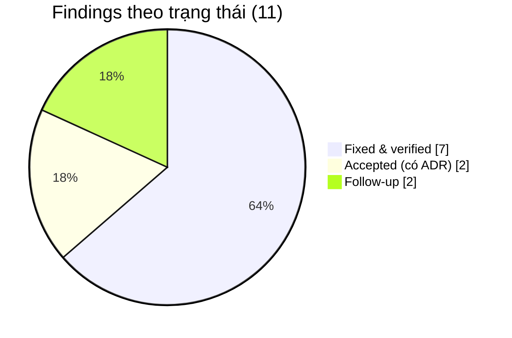

# Code Review Record — LeaveFlow v1.0 (IEEE 1028)

| Thuộc tính | Giá trị |
|---|---|
| Mã | CR-LF-001 |
| Ngày | 2026-11-02 |
| Phạm vi | Toàn bộ `app/` (src, public, tests, scripts), `.github/workflows/ci.yml` |
| Commit được review | `31ac9c5` (nhánh `feature/leaveflow-r1.1`, tag `r1.1`) — reviewer độc lập review diff `main...feature/leaveflow-r1.1` |
| Risk tier | Medium |
| Prompt | `verification/Code_Review_IEEE_1028_Prompt.md` (reviewer chỉ đọc) |
| Checklist | `verification/Code_Review_IEEE_1028_Checklist.xlsx` — 19 dòng, chấm ở §3 |
| Pre-review | AI agent (Claude) — **không phải reviewer độc lập** |
| Reviewer độc lập / Approver | Mentor khóa SDLC — ☐ chờ review |

> SOP §5.8: agent có thể tóm tắt và pre-review, nhưng **không** thay thế reviewer con người và không phê duyệt.
> Bản ghi này là đầu vào cho reviewer; quyết định merge thuộc về reviewer + owner.
> Phase 8 không có thư mục tài liệu theo SOP (bản ghi nằm trong PR); file này tồn tại vì bài tập chưa có PR — xem adaptation log.

## 1. Mô tả thay đổi (nội dung PR)

| Mục | Nội dung |
|---|---|
| Vấn đề | Quy trình nghỉ phép bằng email/Excel chậm và sai số dư ([intent](../01-intake/intent.md)) |
| Thay đổi hành vi | Thêm app LeaveFlow v1.0: 9 endpoint REST + giao diện web 5 màn hình |
| Checks đã chạy | `npm run lint` ✅ · `npm test` 32/32 ✅ · coverage src ≥ 91.3 % ✅ · UI/system 10 TC ✅ |
| Checks chưa chạy | CI GitHub (chưa push) |
| Hỗ trợ của agent | Agent sinh phần lớn mã, test và tài liệu theo task card; owner chỉ đạo, kiểm tra output và chạy lại kiểm thử |

## 2. Findings

| ID | File:line | Mức | Phát hiện | Xử lý | Trạng thái |
|---|---|---|---|---|---|
| CR-01 | `app/src/server.js` `readJsonBody` | **Blocking** | Body JSON hợp lệ nhưng không phải object (`null`, `[]`, `42`) đi tới handler → `body.comment` ném `TypeError` → **500**. Tái hiện: `POST /api/leave-requests/LR-0001/approve` body `null` → `500 INTERNAL_ERROR` | **DEF-004**: chỉ chấp nhận JSON object, còn lại `400 BAD_JSON`; thêm 4 assertion hồi quy vào TC-30 | Fixed & verified |
| CR-02 | `app/src/server.js` `serveStatic` | Non-blocking | Kiểm tra `fullPath.startsWith(PUBLIC_DIR)` không có dấu phân cách — một thư mục anh em tên `public2` sẽ lọt qua | Đổi thành `PUBLIC_DIR + path.sep`; TC-31 vẫn PASS | Fixed |
| CR-03 | `app/src/server.js` `readJsonBody` | Non-blocking | Bản nháp đầu gọi `req.destroy()` khi body > 10 KB → client không nhận được phản hồi 413 (phát hiện khi tự rà soát TASK-05, trước lần chạy test đầu) | Đọc hết body, bỏ dữ liệu, rồi trả 413; TC-30 kiểm chứng | Fixed |
| CR-04 | `app/src/server.js` `authenticate` | Non-blocking (chấp nhận) | Định danh bằng header có thể giả mạo | Đã ghi nhận trong ADR-003 / RISK-01; điều kiện: chỉ chạy localhost | Accepted |
| CR-05 | `app/src/repo/jsonStore.js` | Non-blocking (chấp nhận) | Ghi lại toàn bộ file mỗi thay đổi; không an toàn cho nhiều tiến trình | ADR-002 / RISK-02 | Accepted |
| CR-06 | `app/public/app.js` | Follow-up | Dùng `prompt()`/`confirm()` native: khó test tự động, không đồng bộ giao diện | Follow-up v1.1 (design-audit P-4); owner: Nguyễn Trần Hà | Open (follow-up) |
| CR-08 | `app/src/server.js` bootstrap | **Blocking** | `listen(port)` bind mọi interface, trái với giảm thiểu RISK-01 (phát hiện bởi audit thiết kế) | DEF-007: bind `HOST` mặc định `127.0.0.1`; TC-42 | Fixed & verified |
| CR-09 | `app/src/service/leaveService.js` `listRequests` | Non-blocking | `status` không được kiểm tra | DEF-006; TC-23 | Fixed & verified |
| CR-10 | `app/src/service/leaveService.js` `createRequest` | Non-blocking | Nhân viên không có quản lý tạo được đơn không ai duyệt được | DEF-007; TC-13 | Fixed & verified |
| CR-11 | Comment trong `leave.js`, `leaveService.js` | Non-blocking | Mã FR trong comment lệch PRD (vd. FR-02 thay vì FR-04) | Sửa comment khớp PRD v1.1 | Fixed |
| CR-07 | `app/src/service/leaveService.js` `today()` | Follow-up | "Hôm nay" tính theo UTC; người dùng ở UTC+7 trong 00:00–07:00 thấy lệch 1 ngày | RISK-03; follow-up v1.1 thêm cấu hình múi giờ | Open (follow-up) |

## 3. IEEE 1028 checklist

| # | Category | Item | Status | Evidence / Notes |
|---|---|---|---|---|
| 1 | Preparation | Review Objective | Pass | §1: tìm defect + kiểm tra conformance với SAD/API trước release v1.0.0 |
| 2 | Preparation | Entry Criteria | Pass | Có source, SAD, api.md, PRD, TEST_REPORT, evidence run |
| 3 | Architecture | Design Conformance | Pass | 5 file khớp CMP-01…05; luồng phụ thuộc `server → service → domain` đúng SAD §5; mã lỗi khớp api.md §3 |
| 4 | Architecture | Modularity | Pass | Domain thuần không I/O (`leave.js`); service nhận `store`, `now` qua constructor |
| 5 | Logic | Requirements Coverage | Pass | FR-01…10 có code + TC (RTM); không có tính năng ngoài PRD |
| 6 | Logic | Boundary Conditions | Pass | Biên 200/201 ký tự, 12/13 ngày, hôm nay/hôm qua, T6→T2 có test (TC-06, 09, 15, 01) |
| 7 | Logic | Variable Initialization | Pass | Không có biến dùng trước khi gán; `data` store khởi tạo với mặc định `users/requests/history` |
| 8 | Error handling | Exception Handling | Pass (sau CR-01) | `DomainError` ném ở domain/service, map tập trung ở `server.js`; lỗi lạ → 500 + `console.error` |
| 9 | Error handling | Meaningful Messages | Pass | Thông báo tiếng Việt cụ thể (vd. "cần 13 ngày, còn 12 ngày"); 500 không lộ stack trace |
| 10 | Security | Input Validation | Pass (sau CR-01, CR-02) | Validate ở `validateNewRequest`, giới hạn body 10 KB, chặn traversal, `escapeHtml` ở UI (TC-38) |
| 11 | Security | AuthN/AuthZ | Pass với điều kiện | Kiểm tra quyền ở server cho mọi use case (TC-13, 17, 20, 22, 23); định danh giả lập — CR-04 |
| 12 | Performance | Resource Management | Pass | `createReadStream().pipe()` cho file tĩnh; ghi file đồng bộ ngắn; server đóng sạch trong test (`t.after`) |
| 13 | Performance | Algorithmic Efficiency | Pass | O(n) trên danh sách đơn nhỏ; p95 5.69 ms (TC-32); 10 000 đơn: p95 ≤ 97 ms (TC-39) |
| 14 | Maintainability | Coding Standards | Pass | `'use strict'`, CommonJS nhất quán, lint OK (`lint.log`) |
| 15 | Maintainability | Naming Conventions | Pass | Tên theo nghiệp vụ: `createRequest`, `computeBalance`, `assertTransition` |
| 16 | Maintainability | Code Comments | Pass | Comment nêu *lý do* (CMP-xx, ADR, DEF-xxx), không chú thích hiển nhiên |
| 17 | Testing | Unit Test Coverage | Pass | Line ≥ 91.3 % mỗi file `src/` (`summary.json`) |
| 18 | Testing | Test Success | Pass | 32/32 PASS sau lần sửa cuối (`junit.xml`) |
| 19 | Exit | Action Items Addressed | Pass | CR-01…03, CR-08…11 fixed & verified; CR-04/05 accepted bằng ADR; CR-06/07 có owner + version mục tiêu |

**Kết quả pre-review:** 19/19 Pass (1 có điều kiện) · 0 blocking còn mở → đề nghị reviewer độc lập review diff và phê duyệt.

## 4. Approvals

| Vai trò | Tên | Commit | Quyết định | Ngày |
|---|---|---|---|---|
| Tác giả / Owner | Nguyễn Trần Hà | (commit release) | ☐ Xác nhận đã đọc toàn bộ diff | |
| Reviewer độc lập | Mentor khóa SDLC | (commit release) | ☐ Approve / ☐ Request changes | |

## 5. R1.1 review

| Mục | Nội dung |
|---|---|
| Phạm vi | `app/public/*` (viết lại), `app/src/server.js` (kiểm tra UTF-8), `app/tests/characterization/*`, `app/tests/unit/mutation-gaps.test.js`, `app/tests/api/encoding.test.js`, `app/scripts/{mutation,scan,approved-tests}.js`, `.claude/{settings.json,hooks/,approved-tests.txt}`, CI |
| Change request | [CR-R11-01](../12-maintenance/CR-R11-01.md) — được duyệt **trước** khi sửa code (☐ chờ chữ ký PO) |
| Bằng chứng giữ hành vi | TC-43 golden master PASS trước và sau; TC-47 test đã duyệt không đổi (`approved tests: OK`) |

| ID | File | Mức | Phát hiện | Xử lý | Trạng thái |
|---|---|---|---|---|---|
| CR-12 | `app/public/app.js` | Blocking | Ô tìm kiếm render lại cả trang, bộ gõ tiếng Việt nhân đôi chữ | DEF-009 → `renderListBody` | Fixed & verified |
| CR-13 | `app/src/server.js` | Blocking | Byte UTF-8 hỏng được chấp nhận | DEF-008 → `TextDecoder({fatal:true})`; TC-46 | Fixed & verified |
| CR-14 | `app/public/styles.css` | Non-blocking | Dark mode nút đỏ 2.77:1; mobile tràn 7 px | DEF-010, DEF-011 | Fixed & verified |
| CR-15 | `app/public/app.js` | Non-blocking | Logic đếm ngày công lặp lại ở client (`workingDays`) — có thể lệch server | Chấp nhận: chỉ dùng để xem trước; server vẫn là nguồn sự thật (FR-02); ghi follow-up v1.2 dùng chung module | Accepted |
| CR-16 | `.claude/settings.json` | Non-blocking | Hook chỉ chặn agent; người vẫn sửa được test | Đúng thiết kế — CI guard (TC-47) chặn ở pipeline; phê duyệt lại bằng `approved-tests.js approve` + review | Accepted |

Kết quả pre-review R1.1: 0 blocking còn mở. ☐ Reviewer độc lập duyệt diff R1.1.
