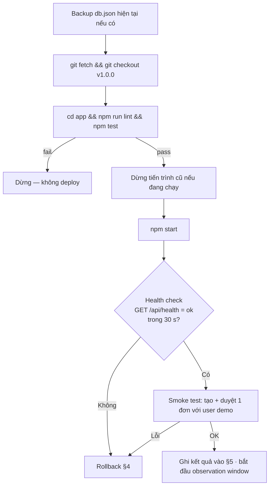

# Release Record — LeaveFlow v1.0.0

| Thuộc tính | Giá trị |
|---|---|
| Release ID | REL-LF-1.0.0 |
| Phiên bản | `v1.0.0` |
| Commit | Commit chứa thay đổi của bài tập trên nền `6996dae` — điền SHA khi tag |
| Môi trường đích | Local workstation (demo), Node.js ≥ 22 |
| Release owner | Nguyễn Trần Hà — ☐ chờ authorize |
| Trạng thái | **Ready — chờ authorize** (điều kiện: TEST_REPORT §7) |
| Guidance | SOP §5.9 (kit không có prompt/checklist release — dùng checklist trong tài liệu này) |

## 1. Release notes

**LeaveFlow v1.0.0 — bản đầu tiên**

Tính năng:
- Nhân viên gửi đơn nghỉ phép năm / ốm / không lương, hệ thống tự đếm ngày công (T2–T6).
- Tự chặn đơn sai ngày, đơn trùng thời gian, và đơn vượt 12 ngày phép năm (tính cả đơn đang chờ).
- Quản lý trực tiếp duyệt hoặc từ chối (bắt buộc lý do) từ hộp duyệt.
- Nhân viên hủy đơn chưa xử lý; xem số dư và lịch sử từng đơn.

Sửa lỗi trong giai đoạn kiểm thử: DEF-001 (toast che nút), DEF-002 (thiếu empty-state), DEF-003 (lịch sử hiện mã user), DEF-004 (body JSON không phải object gây 500).

Giới hạn đã biết: định danh giả lập (chỉ chạy localhost — ADR-003); một tiến trình (ADR-002); "hôm nay" theo UTC (RISK-03); chưa hỗ trợ ngày lễ / nửa ngày.

## 2. Pre-release checklist

| # | Kiểm tra | Trạng thái | Evidence |
|---|---|---|---|
| 1 | Artifact = commit đã review | ☐ Chờ commit + review | [CODE_REVIEW](../08-review/CODE_REVIEW.md) |
| 2 | Test report GO | ✅ GO with conditions | [TEST_REPORT §7](../07-verification/TEST_REPORT.md#7-evaluation-and-sign-off) |
| 3 | CI xanh trên commit release | ☐ Chờ push | `.github/workflows/ci.yml` |
| 4 | 0 defect High/Critical mở | ✅ | TEST_REPORT §6 |
| 5 | Rollback đã chuẩn bị | ✅ | §4 |
| 6 | Runbook sẵn sàng | ✅ | [RUNBOOK](../10-operations/RUNBOOK.md) |

## 3. Deployment steps



```bash
cd app
npm run lint && npm test
npm start                       # PORT=3000 DATA_FILE=app/data/db.json mặc định
curl -s http://localhost:3000/api/health   # {"status":"ok"}
```

## 4. Rollback plan

| Tình huống | Hành động | Thời gian mục tiêu |
|---|---|---|
| Health check fail / smoke test fail | Dừng tiến trình → `git checkout <tag trước>` → khôi phục `db.json` từ backup → `npm start` | < 5 phút |
| Lần cài đầu tiên (không có bản trước) | Dừng tiến trình; quay lại quy trình email cũ; giữ `db.json` để điều tra | < 5 phút |

Dữ liệu tương thích: v1.0.0 là schema đầu tiên — không có migration.

## 5. Health observation (điền sau khi deploy)

| Chỉ số | Ngưỡng | Kết quả |
|---|---|---|
| `/api/health` | `{"status":"ok"}` | |
| Smoke test tạo + duyệt | Thành công | |
| Log lỗi 500 trong 1 giờ đầu (`LOG_REQUESTS=1`) | 0 | |
| Thời điểm deploy / người thực hiện | — | |

## 6. Authorization

| Vai trò | Tên | Quyết định | Ngày |
|---|---|---|---|
| Release owner | Nguyễn Trần Hà | ☐ Authorize | |
| Chuẩn bị tài liệu | AI agent | Không có quyền authorize hay deploy (SOP §3.6) | 2026-11-02 |
