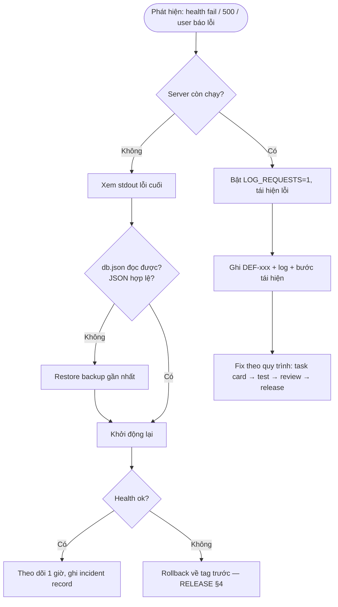

# Runbook — LeaveFlow v1.0

| Thuộc tính | Giá trị |
|---|---|
| Mã | OPS-LF-001 · v1.1 (thêm HOST, lịch backup) · 2026-11-02 |
| Service owner | Nguyễn Trần Hà |
| Hỗ trợ | Owner (giờ hành chính) — không có on-call 24/7 cho bản demo |
| Guidance | SOP §5.10 |

## 1. Tổng quan dịch vụ

| Mục | Giá trị |
|---|---|
| Tiến trình | `node app/src/server.js` (1 tiến trình) |
| Địa chỉ bind | `HOST` (mặc định `127.0.0.1` — chỉ máy cục bộ, RISK-01; **không** đặt `0.0.0.0` khi định danh còn giả lập) |
| Cổng | `PORT` (mặc định 3000) |
| Dữ liệu | `DATA_FILE` (mặc định `app/data/db.json`) |
| Health | `GET /api/health` → `{"status":"ok"}` |
| Log | stdout; bật log từng request bằng `LOG_REQUESTS=1` (`METHOD path status ms`) |

## 2. Thao tác thường ngày

| Việc | Lệnh |
|---|---|
| Khởi động | `cd app && npm start` |
| Khởi động có log request | `LOG_REQUESTS=1 npm start` (PowerShell: `$env:LOG_REQUESTS='1'; npm start`) |
| Dừng | `Ctrl+C` trong terminal đang chạy |
| Kiểm tra sức khỏe | `curl -s localhost:3000/api/health` |
| Backup (cuối mỗi ngày, RPO 1 ngày) | Dừng server → copy `app/data/db.json` sang `backup/db-YYYYMMDD.json` |
| Restore | Dừng server → chép file backup về `app/data/db.json` → khởi động |
| Reset dữ liệu demo | Dừng server → xóa `app/data/db.json` → khởi động (seed 3 user được tạo lại) |

## 3. Giám sát & ngưỡng

SLI/SLO chính thức: [RELEASE-1.1.0 §5](../09-release/RELEASE-1.1.0.md#5-sli--slo).

| Tín hiệu | Ngưỡng cảnh báo | Hành động |
|---|---|---|
| Health check | Không trả `ok` | §4 sự cố S1 |
| Dòng log status `500` | ≥ 1 | Thu thập log + request, tạo DEF-xxx |
| Thời gian phản hồi (log `ms`) | > 200 ms lặp lại | Kiểm tra kích thước `db.json`, xem xét ADR-002 |
| Kích thước `db.json` | > 5 MB | Lên kế hoạch chuyển SQLite (ADR-002) |

## 4. Xử lý sự cố

| Mức | Ví dụ | Phản hồi |
|---|---|---|
| S1 | Không truy cập được, mất dữ liệu | Ngay — restore/rollback |
| S2 | Một chức năng lỗi (duyệt/hủy) | Trong ngày — workaround: duyệt qua email như cũ |
| S3 | Lỗi hiển thị | Lên lịch bản vá |

**Quy tắc:** sửa lỗi production luôn đi qua intake → task → test → review; không sửa nóng trên máy chạy.
AI agent có thể phân tích log (đã loại dữ liệu nhạy cảm) nhưng không thay đổi môi trường chạy.

## 5. Lỗi thường gặp

| Triệu chứng | Nguyên nhân | Cách xử lý |
|---|---|---|
| `EADDRINUSE :3000` | Cổng đang bị dùng | `PORT=3001 npm start` hoặc dừng tiến trình cũ |
| `SyntaxError: Unexpected token` khi khởi động | `db.json` hỏng (sửa tay) | Restore backup |
| Không tạo được đơn "ngày quá khứ" lúc 0h–7h | "Hôm nay" theo UTC (RISK-03) | Chọn ngày bắt đầu từ ngày mai; fix ở v1.1 |
| `npm` báo lỗi SSL | Proxy công ty | Không cần `npm install` — app không có dependency; chạy `node src/server.js` |
