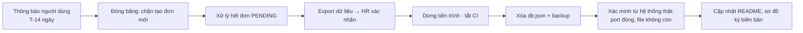

# Decommissioning Plan — LeaveFlow

| Thuộc tính | Giá trị |
|---|---|
| Mã | DEC-LF-001 · v1.0 (kế hoạch, chưa thực hiện) · 2026-11-02 |
| Owner | Nguyễn Trần Hà |
| Kích hoạt khi | Thay bằng hệ thống HR chính thức, hoặc kết thúc khóa học |
| Guidance | SOP §5.11 |

## 1. Inventory

| Thành phần | Vị trí | Owner | Xử lý |
|---|---|---|---|
| Tiến trình Node | Máy chạy demo | Owner | Dừng |
| Dữ liệu `db.json` | `DATA_FILE` | Owner + HR | Export → bàn giao → xóa (§2) |
| Backup | `backup/` | Owner | Xóa sau khi HR xác nhận |
| Mã nguồn | GitHub `hant8911-design/SDLC-Practice` | Owner | Giữ, đánh dấu archived trong README |
| CI workflow | `.github/workflows/ci.yml` | Owner | Tắt workflow |
| Credential | Không có (định danh giả lập) | — | N/A |

## 2. Data disposition

| Tập dữ liệu | Quyết định | Quy tắc | Người duyệt |
|---|---|---|---|
| Đơn nghỉ + lịch sử | Export JSON/CSV cho HR, rồi xóa | Theo chính sách lưu trữ hồ sơ nhân sự của HR | HR |
| User demo | Xóa | Không phải dữ liệu thật | Owner |
| Evidence test (`docs/07-verification/evidence`) | Giữ cùng repo | Bằng chứng của bài tập | Owner |

## 3. Trình tự

## 4. Verification & sign-off

| Kiểm tra | Cách xác minh (không dựa vào lời agent) | Kết quả |
|---|---|---|
| Không còn tiến trình | `curl localhost:3000/api/health` thất bại | |
| Dữ liệu đã xóa | `Test-Path app/data/db.json` = False; thư mục backup trống | |
| HR nhận đủ dữ liệu | Biên bản bàn giao có chữ ký HR | |

| Vai trò | Tên | Quyết định | Ngày |
|---|---|---|---|
| Service owner | Nguyễn Trần Hà | ☐ | |
| HR (data owner) | — | ☐ | |
