# CR-R11-01 — Change Request: nâng cấp giao diện & 4 tính năng trải nghiệm (R1.1)

| Thuộc tính | Giá trị |
|---|---|
| Mã | CR-R11-01 · v1.0 · 2026-11-02 |
| Người yêu cầu | Nguyễn Trần Hà (PO), theo phản hồi giảng viên: giao diện cần chuyên nghiệp, tính năng đầy đủ hơn |
| Loại | Perfective maintenance (không sửa lỗi nghiệp vụ, không đổi API) |
| Quy trình | Slide B10/buổi 9 — Maintenance Loop: change approval → characterization test → sửa từng bước → regression → R1.1 |
| Phê duyệt thay đổi | ☐ PO · ☐ Tech lead — **trước khi sửa code**; bản nháp CR viết trước bước 3 dưới đây |

## 1. Thay đổi được yêu cầu

| ID | Mô tả | FR / US mới |
|---|---|---|
| CHG-A | Giao diện mới: sidebar, thẻ KPI, vòng tiến độ phép năm, modal riêng, toast, giao diện tối, responsive | NFR-02 |
| CHG-B | Xem trước số ngày công / số dư sau đơn | FR-11 · US-09 |
| CHG-C | Lọc theo trạng thái + tìm kiếm | FR-12 · US-10 |
| CHG-D | Lịch tháng ngày nghỉ (cá nhân / nhóm) | FR-13 · US-11 |
| CHG-E | Xuất CSV cho quản lý | FR-14 · US-12 |

## 2. Impact analysis

| Thành phần | Ảnh hưởng | Rủi ro | Kiểm soát |
|---|---|---|---|
| CMP-05 Web UI (`app/public/*`) | **Viết lại toàn bộ** | Cao — hồi quy UI | E2E có ảnh TC-49…51 + toàn bộ TC-33…38 cũ áp lên UI mới |
| CMP-01…04 (API, service, domain, store) | **Không đổi hành vi** — UI mới chỉ dùng API-01…09 sẵn có | Thấp | Characterization TC-43 (golden master trước khi sửa) |
| Hợp đồng API (`api.md`, `openapi.yaml`) | Không đổi | — | TC-43 |
| Dữ liệu (`db.json`) | Không đổi schema, không migration | — | — |
| Test đã duyệt | Không được sửa | Agent "sửa test cho pass" | Hook PreToolUse + CI guard (TC-47) |
| Tài liệu | PRD, USER_STORIES, traceability, UX, SAD, TEST_PLAN/CASES/RTM/REPORT, CODE_REVIEW, RELEASE | — | Checklist review bằng tay mục E |

## 3. Trình tự thực hiện (đã làm)

```mermaid
flowchart LR
    A[1. Viết CR + impact analysis] --> B[2. Ghi golden master v1.0.0<br/>TC-43 PASS]
    B --> C[3. Khóa test đã duyệt<br/>SHA-256 + hook + CI]
    C --> D[4. Viết lại UI theo CHG-A…E]
    D --> E[5. Regression: 35 tự động + TC-43]
    E --> F[6. E2E có ảnh → DEF-008…011]
    F --> G[7. Sửa → retest → TC-43 vẫn PASS]
    G --> H[8. Mutation, scan, guard]
    H --> I[9. Release r1.1 — chờ ký]
```

## 4. Behavior preservation (gate của buổi 9)

| Kiểm tra | Trước khi sửa | Sau khi sửa | Evidence |
|---|---|---|---|
| Golden master 18 tương tác API (TC-43) | PASS (ghi trước khi viết lại UI) | PASS | `app/tests/characterization/golden-v1.0.0.json`, `junit.xml` |
| 8 file test đã duyệt không đổi (TC-47) | Ghi SHA-256 | `approved tests: OK (8 files unchanged)` | `TC-47-approved-tests.log` |
| Hành vi thay đổi có chủ đích | — | Chỉ 1: body không phải UTF-8 hợp lệ → 400 (DEF-008, sửa lỗi) — không nằm trong golden vì golden chỉ có input hợp lệ | TC-46 |

## 5. Kết quả

R1.1 hoàn thành: 4 FR mới, 4 defect phát hiện khi E2E (DEF-008…011) đã sửa, mutation score 93.8 % → 100 %.
Chi tiết: [TEST_REPORT](../07-verification/TEST_REPORT.md), [RELEASE-1.1.0](../09-release/RELEASE-1.1.0.md).
