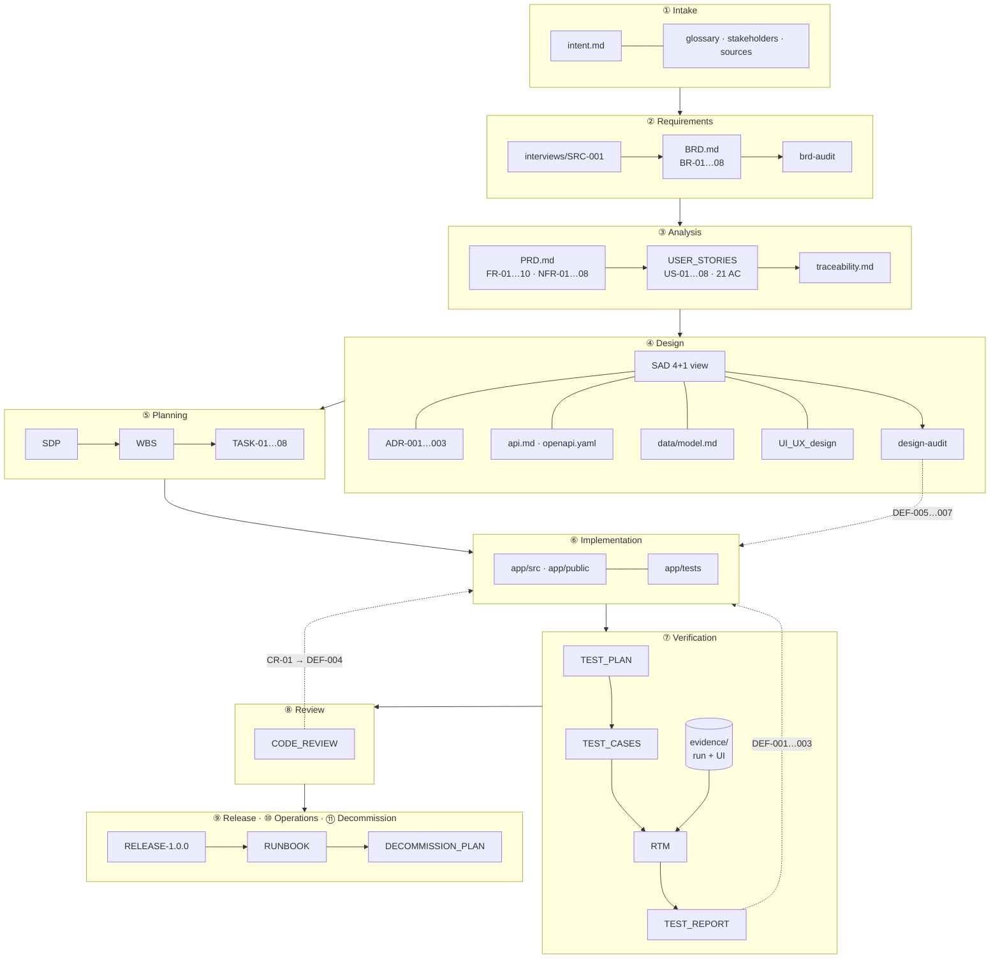
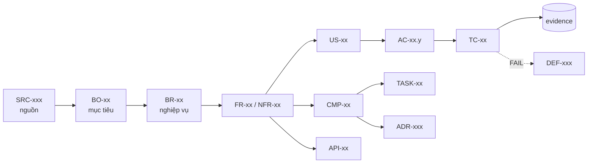
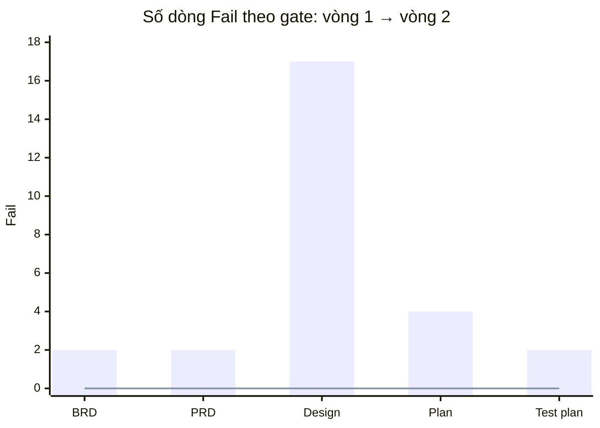
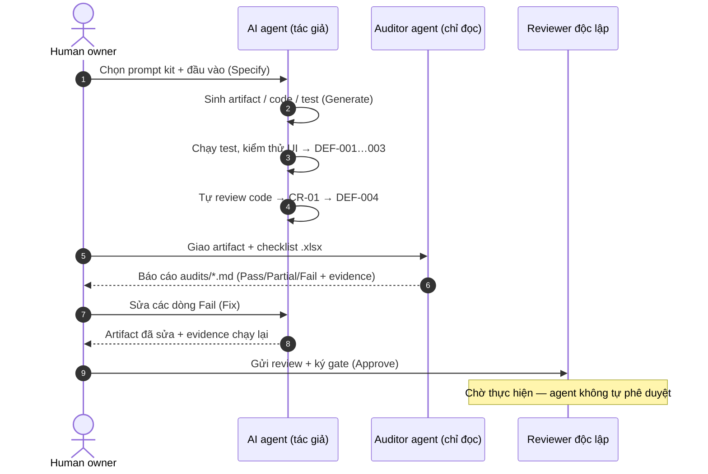

# LeaveFlow — Hồ sơ dự án theo Agentic SDLC

> Ứng dụng nhỏ quản lý **đơn nghỉ phép** (nhân viên gửi đơn → quản lý trực tiếp duyệt), được đưa qua **đủ 11 phase**
> của quy trình trong [AI_SDLC-SOP.md](../AI_SDLC-SOP.md) bằng chính các prompt và checklist của kit này.
> Mục tiêu: chứng minh quy trình — app cố tình nhỏ, tài liệu thì đầy đủ và truy vết được.

| | |
|---|---|
| **Sản phẩm** | [`app/`](../app/README.md) — Node.js 22, 0 dependency, `cd app && npm start` |
| **Kết quả kiểm thử** | **51/51 TC PASS** · 26/26 AC · 9/9 NFR · NotRun tách riêng · mutation **100 %** · coverage `src/` ≥ 91.6 % · p95 6 ms → [TEST_REPORT](./07-verification/TEST_REPORT.md) |
| **Defect** | 11 phát hiện (E2E, code review, audit) — 11/11 đã đóng |
| **Phiên bản** | r1.0 (MVP) → **r1.1** (giao diện mới + 4 tính năng, [CR-R11-01](./12-maintenance/CR-R11-01.md)) |
| **Hồ sơ Capstone** | [**CAPSTONE.md**](./CAPSTONE.md) — bảng một trang, truy vết 7 mắt xích, tự kiểm slide 10, lộ trình 30/60/90 |
| **Owner** | Nguyễn Trần Hà · AI agent (Claude) hỗ trợ soạn nháp, code, test — không phê duyệt |

---

## 1. Dòng chảy artifact qua 11 phase



## 2. Mục lục tài liệu

| Phase | Thư mục | Artifact | Prompt / checklist của kit đã dùng |
|---|---|---|---|
| 0 Kit | [00-kit](./00-kit/) | [adaptation-log](./00-kit/adaptation-log.md) · [harness](./00-kit/harness.md) · [**checklist review bằng tay**](./00-kit/MANUAL_REVIEW_CHECKLIST.md) · [CLAUDE.md](../CLAUDE.md) · [subagents](../.claude/agents/) · [skill](../.claude/skills/sdlc-gate/SKILL.md) | `step-by-step-guidance.md` §A2 |
| 1 Intake | [01-intake](./01-intake/) | [intent](./01-intake/intent.md) · [glossary](./01-intake/glossary.md) · [stakeholders](./01-intake/stakeholders.md) · [sources](./01-intake/sources.md) | `requirements/Intake_Intent_Prompt.md` |
| 2 Requirements | [02-requirements](./02-requirements/) | [BRD](./02-requirements/BRD.md) · [SRC-001](./02-requirements/interviews/SRC-001.md) · [brd-audit](./02-requirements/brd-audit.md) | `analysis/BRD_*_Prompt_IEEE_standard.md`, `requirements/BRD-Template.md`, `BRD_IEEE_29148_Checklist.xlsx` |
| 3 Analysis | [03-analysis](./03-analysis/) | [PRD](./03-analysis/PRD.md) · [USER_STORIES](./03-analysis/USER_STORIES.md) · [traceability](./03-analysis/traceability.md) · [prd-audit](./03-analysis/prd-audit.md) | `analysis/PRD_Prompt_IEEE_standard.md`, `PRD_IEEE_29148_Checklist.xlsx` |
| 4 Design | [04-design](./04-design/) | [SAD](./04-design/SAD.md) · [ADR-001](./04-design/ADR-001-node-no-framework.md) · [ADR-002](./04-design/ADR-002-json-file-store.md) · [ADR-003](./04-design/ADR-003-simulated-auth.md) · [api](./04-design/api.md) · [openapi.yaml](./04-design/openapi.yaml) · [data model](./04-design/data/model.md) · [UI/UX](./04-design/UI_UX_design/README.md) · [design-audit](./04-design/design-audit.md) | `design/SAD_Prompt_IEEE_standard.md`, các prompt sơ đồ UML, `apiDesign_prompt.md`, `databaseDesign_NoSQL_prompt.md`, `UI-UX-Design_prompt.md`, `Design_Audit_Prompt.md` + 10 checklist |
| 5 Planning | [05-development](./05-development/) | [SDP](./05-development/Software_Development_Plan.md) · [WBS](./05-development/WBS.md) · [tasks/](./05-development/tasks/) | `development/DevPlan_ISO_24748_5_Prompt.md`, `TaskBreakdown_ISO_21511_Prompt.md`, `DevPlan_ISO_24748_5_Checklist.xlsx` |
| 6 Implementation | [`app/`](../app/) | Mã nguồn + test; traceability cập nhật | `development/Implementation_Task_Prompt.md` |
| 7 Verification | [07-verification](./07-verification/) | [TEST_PLAN](./07-verification/TEST_PLAN.md) · [TEST_CASES](./07-verification/TEST_CASES.md) · [RTM](./07-verification/RTM.md) · [TEST_REPORT](./07-verification/TEST_REPORT.md) · [evidence/](./07-verification/evidence/) | `verification/TestPlan_*`, `TestCase_RTM_*`, `TestReport_*`, `Test_Plan_IEEE_829_Checklist.xlsx` |
| 8 Review | [08-review](./08-review/) | [CODE_REVIEW](./08-review/CODE_REVIEW.md) | `verification/Code_Review_IEEE_1028_Prompt.md` + checklist |
| 9 Release | [09-release](./09-release/) | [RELEASE-1.0.0](./09-release/RELEASE-1.0.0.md) · [RELEASE-1.1.0](./09-release/RELEASE-1.1.0.md) (SBOM, AI-BOM, SLI/SLO) | SOP §5.9 |
| 10 Operations | [10-operations](./10-operations/) | [RUNBOOK](./10-operations/RUNBOOK.md) | SOP §5.10 |
| 11 Decommissioning | [11-decommissioning](./11-decommissioning/) | [DECOMMISSION_PLAN](./11-decommissioning/DECOMMISSION_PLAN.md) | SOP §5.11 |
| 12 Maintenance | [12-maintenance](./12-maintenance/) | [CR-R11-01](./12-maintenance/CR-R11-01.md) (change request, impact analysis, characterization) | Slide B10 hàng Maintenance |
| Capstone | [CAPSTONE.md](./CAPSTONE.md) · [ai/delivery-log.csv](./ai/delivery-log.csv) | LR-28, LR-29 | Slide B10 #06–12, #16–19 |

## 3. Chuỗi truy vết ID



| Cấp | Số lượng | Nơi định nghĩa |
|---|---|---|
| BO / BR | 3 / 8 | BRD |
| FR / NFR | 14 / 9 | PRD |
| US / AC | 12 / 26 | USER_STORIES |
| CMP / API / ADR | 5 / 9 / 3 | SAD, api.md |
| TASK | 8 | tasks/ |
| TC / DEF | 51 / 11 | TEST_CASES, TEST_REPORT |

## 4. Gate status

Kết quả audit checklist thật (auditor agent độc lập, chỉ đọc, 2 vòng). Quy tắc: 0 Fail mới được ký; Partial phải có owner + hạn.

| Gate | Checklist | Vòng 1 Fail | Vòng 2 (P / Pa / F / NA) | Chữ ký | Tag |
|---|---|---|---|---|---|
| ① Intake | SOP §5.1 exit criteria | — | Đủ: owner, AC, risk tier Medium, approvers | ☐ Requester | `intake-v1` ✅ tag (chưa ký) |
| ② Requirements | BRD IEEE 29148 | 2 | 15 / 5 / **0** / 0 | ☐ PO | `requirements-v1` ✅ tag (chưa ký) |
| ③ Analysis | PRD IEEE 29148 | 2 | 16 / 3 / **0** / 1 | ☐ PO + Tech lead | `analysis-v1` ✅ tag (chưa ký) |
| ④ Design | 10 checklist thiết kế | 17 | 148 / 16 / **0** / 58 | ☐ Tech lead | `design-v1` ✅ tag (chưa ký) |
| ⑤ Planning | DevPlan ISO 24748-5 | 4 | 12 / 10 / **0** / 0 | ☐ PO + Tech lead | `plan-v1` ✅ tag (chưa ký) |
| ⑦ Verification | Test plan IEEE 829 | 2 | 16 / 2 / **0** / 0 | ☐ QA reviewer | — |
| ⑧ Review | Code review IEEE 1028 | — | 19/19 Pass (pre-review của agent) | ☐ Reviewer độc lập | — |
| ⑨ Release | Pre-release checklist | — | 10/12 ✅ (còn CI sau push + review R1.1) | ☐ Release owner | `r1.1` ✅ tag (chưa ký) |
| **Tổng 14 checklist** | | **27** | **207 / 36 / 0 / 59** (302 dòng) | | |



> **Việc còn lại thuộc về con người:** commit + tạo tag baseline, chạy CI trên GitHub, và các chữ ký ☐ ở trên.
> AI agent đã soạn, kiểm thử và audit nhưng **không phê duyệt** (SOP §3.1, §5.8).

## 5. Vòng lặp Specify → Generate → Audit → Fix → Approve đã diễn ra thế nào



## 6. Cách tái hiện

```bash
cd app
npm run test:report        # lint + 32 test + coverage + junit → docs/07-verification/evidence/<run-id>/
npm start                  # http://localhost:3000
```
